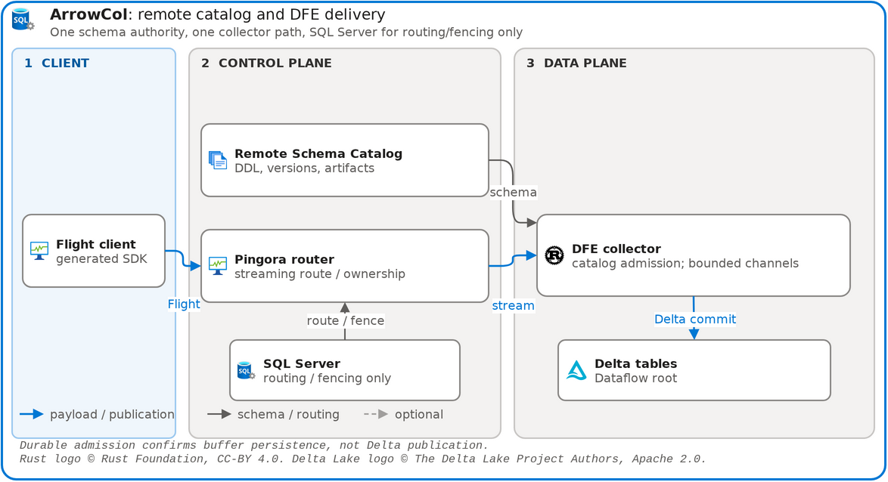
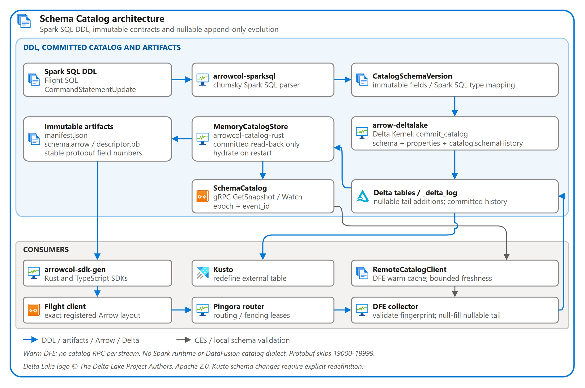

# Rust Playground

A Linux-first Rust learning monorepo organized with Cargo and Nx. It keeps
independent applications under `bin/`, reusable libraries under `crates/`, and
repository automation under `tools/`. The initial sample combines the
`greeting` library with the `hello-world` CLI and its Linux container image.

## Development environment

Development is Linux-first in WSL and uses the repository devcontainer:

- Ubuntu 24.04
- Rust 1.96.1, rustfmt, Clippy, cargo-make, mold, clang, and LLDB
- Node.js 24 and Nx 23
- Azure CLI, GitHub CLI, and Docker Buildx through Docker-outside-of-Docker

The source configuration builds `.devcontainer/Dockerfile` and applies the
locked Dev Container Features. The default configuration uses the immutable
GHCR image pinned in `.devcontainer/docker-compose.yml`.

The host bootstrap installs only shared developer-machine prerequisites.
Repository dependencies are installed by the devcontainer's post-create step.
The WSL host's `~/.azure` and `~/.config/gh` directories are mounted read/write
into the devcontainer. See
[headless devcontainer operations](docs/devcontainer/headless-operations.md)
for exact keep-running, monitoring, and targeted-cleanup commands.

## Quick start

After completing the one-time setup in [CONTRIBUTING.md](CONTRIBUTING.md),
install the pinned host CLI dependencies and build the workspace from source:

```bash
npm ci
npx nx run devcontainer:test-source
```

To use the checked-in immutable prebuilt image instead:

```bash
npm ci
npx nx run devcontainer:test
```

Both targets start the selected devcontainer and run every Nx `verify` target
inside it. Stop only this workspace's Compose project when finished:

```bash
npx nx run devcontainer:down -- --volumes
```

## Arrow collector platform

The repository provides a single Arrow Flight collection path through the remote Schema Catalog and DFE:

```text
Spark SQL DDL
      |
      v
Remote Schema Catalog -- immutable manifest / schema.arrow / descriptor.pb
      |
      +--> generated Rust and TypeScript clients
                       |
                       v
              Pingora router -- one fenced Dataflow owner per table
                       |
                       v
               DFE collector -- bounded Flight admission
                       |          optional durable_buffer
                       v
              shared Dataflow Delta root --> Kusto validation and Grafana

SQL Server stores router registrations, pressure, and routing/fencing leases only. It is not the schema catalog or a delivery ledger.
```

Clients receive no durable receipt IDs and there is no receipt-polling or purge API. DFE completion means best-effort admission unless `durable_buffer` is enabled; `durable_admission` confirms buffer persistence only, not a Delta commit or query visibility. Preserve source data and reconcile using the application’s destination-level checks before retrying ambiguous outcomes; retries can duplicate rows.

See the [platform architecture](docs/architecture/arrowcol-platform/README.md) for catalog, routing, fencing, buffering, and delivery contracts.

### Lakehouse loadtest architecture

[](docs/architecture/arrowcol-platform/diagrams/platform.drawio)

The [platform diagram](docs/architecture/arrowcol-platform/diagrams/platform.drawio) shows the remote catalog, routing/fencing, and DFE-only collection path. The [loadtest guide](projects/loadtest/README.md) documents storage modes, maintenance, validation, Kusto, and qualification evidence.

### Schema Catalog architecture

[](docs/architecture/arrowcol-platform/diagrams/schema-catalog.drawio)

Spark SQL DDL creates immutable catalog contracts backed by Delta metadata, generates Rust and TypeScript SDKs, and feeds the DFE's bounded schema cache through gRPC change events. Nullable tail additions preserve registered older clients; Kusto external tables must be explicitly redefined to pick up the evolved Delta schema.

The tenant fork preserves copied history after source retention cleanup; native external tables instead read the current active snapshot. Stable publication identities protect retries of the same publication, not duplicate independent client requests. Local functional results are not Azure QAP performance evidence. See the [loadtest guide](projects/loadtest/README.md) for the current CLI, credential boundaries, lifecycle commands, and qualification artifacts.

### Experiments

Experiments isolate a behavior with small deterministic fixtures, independent
oracles and durable evidence; they do not run the lakehouse loadtest.

The [Azure QAP experiment](experiments/azure-qap/README.md) examines whether
append, OPTIMIZE, old-partition DELETE and physical VACUUM reload unchanged data.
See the [lessons learned, with diagrams](docs/experiments/azure-qap/README.md).

The [collector-chain experiment](experiments/collector-chain/README.md) chains
3 clients through middle ArrowCol and OTAPCol collectors into one batching
gateway each, then asserts every client ID in Kustainer over the local Delta
output. See the [write-up and diagram](docs/experiments/collector-chain/README.md).

### Finite qualification quick start

Run from the repository root in the source devcontainer:

```bash
git submodule update --init --recursive
npm ci

# Bootstrap and verify the standalone SQL Server + Hive control plane.
npx --no-install nx run arrowcol-infra:bootstrap
npx --no-install nx run arrowcol-infra:integration-verify
npx --no-install nx run arrowcol-infra:down

# Verify deterministic catalog artifact and Rust/TypeScript SDK generation.
npx --no-install nx run arrowcol-sdk-gen:verify

# Run finite paired Arrow and Quiver crash/recovery qualification.
npx --no-install nx run loadtest:e2e
```

The Arrow phase registers
[`projects/loadtest/schemas/sqlserver.sql`](projects/loadtest/schemas/sqlserver.sql)
through Flight SQL, exports the immutable catalog artifacts, generates and
checks both SDK packages, starts the remote Schema Catalog, router, routing-only SQL Server, and DFE
collector, then validates the Dataflow Delta root. The Quiver phase exercises
the DFE durable buffer and restart replay; buffer acknowledgement does not prove
Delta publication.

The current runner retains output beneath `onelake/benchmark/latest/` and prints
its exact output directory. A new start may reset only a sealed, validated local
attempt after verifying its private corpus and evidence archive. Failed,
interrupted, nonvalidated, Azure, or unmarked legacy attempts block reset and
preserve their original corpus. See the [loadtest lifecycle and evidence
guide](projects/loadtest/README.md#per-attempt-evidence-custody) for the reset
preconditions. The DFE live E2E retains evidence under
`projects/arrowcol-dataflow-rust/.diagnostics/<run-id>/`.

### Continuous comparison and dashboards

```bash
npx --no-install nx run loadtest:run -- \
  --warmup 2m --concurrency 8 --batch-rows 1024
```

Omitting `--measure` runs generation until interrupted. The retained local stack
exposes Grafana at `http://127.0.0.1:3000` and Prometheus at
`http://127.0.0.1:9090`. Arrow Flight and optional OTEL baseline signals remain
separate. Use the canonical loadtest guide for current lifecycle and mode
options rather than the removed `benchmark-down`/`--run-id` interface.

See the [loadtest guide](projects/loadtest/README.md) for diagnostics and the
[load generator diagram and runbook](docs/architecture/loadtest/README.md) for
the generated-schema data path and exact run commands. See the
[delivery and verification matrix](docs/delivery-verification.md) for issue
coverage, exact qualification evidence, and intentional limitations.

## Nx targets

Run repository targets inside the devcontainer:

```bash
npx nx run rust:format
npx nx run rust:format-check
npx nx run rust:lint
npx nx run rust:build
npx nx run rust:test
npx nx run rust:verify
npx nx run auth-automation:verify
npx nx run tools-scripts:verify
npx nx run rust-playground-build:verify
npx nx run devcontainer:verify
```

`rust:lint` checks all first-party Markdown as well as Rust Clippy. To check or
autofix Markdown alone:

```bash
npx --no-install nx run tools-scripts:markdown-lint
npx --no-install nx run tools-scripts:markdown-lint-fix
```

Markdown checks include new files and hidden documentation directories, exclude
submodules and ignored/generated output, and allow long lines and inline HTML.
CI runs read-only lint and rejects tracked changes or unexpected untracked files
after verification. Check that gate explicitly on a committed checkout with:

```bash
npx --no-install nx run rust:fail-on-untracked-files
```

The gate is separate from local lint so uncommitted authoring remains supported.

Run all verification targets serially with:

```bash
npx nx run-many -t verify --all --parallel=1
```

## Parallel GitHub CI

CI discovers the complete Nx verification graph, then fans out independent
checks onto separate runners. Matrix concurrency is uncapped; dependencies,
not a global serial queue, determine when work starts.

```text
                           +--> Node checks --------------------+
  Nx task discovery -------+--> runtime image builds ---+        |
                           |                            |        |
                           +------------------------+   |        |
                                                    |   |        |
  locked source environment --> shared image -------+   |        |
                                  |                     |        |
                                  +--> Rust checks -----|--------+
                                  +--> Delta reader ----+        |
                                                       |        |
                                                       v        |
                                                artifact E2E ---+
                                                                |
                                               final CI gate <--+
```

Each Rust shard uses the same source-built tools, its own Cargo cache, and
only its Nx prerequisite closure. Same-project Rust checks share compiled
dependencies instead of duplicating them across runners. The source image is
cached by its exact build inputs, identity-verified, and transferred using
multithreaded Zstandard. Native CI uses mold without debug/incremental cache
bloat; application release builds are unchanged.

Runtime images use separate persistent BuildKit caches. E2E verifies the
exported image identities and reader executable before running; it does not
rebuild them or wait for unrelated checks. Every shard checks its worktree,
scoped cleanup always runs, and the final `Verify in source devcontainer`
check fails if any branch fails, is canceled, or is skipped. No runtime images
are published by CI.

## Cleaning temporary state

Every Nx project has an uncached `clean` target. The root `rust:clean` runs all
project cleanup targets, then cleans root-owned temporary state:

```bash
npx --no-install nx run rust:clean
npx --no-install nx run loadtest:clean
npx --no-install nx run greeting:clean
```

Cleanup removes only each project's `.temp/`, `.ci-logs/`, `logs/`, and
`coverage/`. `loadtest:clean` also removes the root `onelake/` directory,
including retained demo tables and E2E diagnostics. Missing state is a no-op;
directory symlinks are removed without following their targets.

Managed caches and build outputs are preserved: `node_modules/`, `.nx/`,
Cargo caches and `target/`, Docker images/volumes/build caches, `dist/`, and
`out/`. Configuration, credentials, and cached authentication profiles are
not removed.

These targets clean files only; they do not stop running processes or
containers. Stop the load test before cleaning its state.

## Sample CLI and image

Run the sample application:

```bash
npx nx run hello-world:run -- --name Ferris
```

Build and smoke-test its local Linux amd64 image:

```bash
npx nx run hello-world:image-smoke
docker run --rm --platform linux/amd64 \
  ghcr.io/mdrakiburrahman/rust-playground/hello-world:dev \
  --name Ferris
```

After the public `latest` tag has been published and verified, the equivalent
prebuilt invocation is:

```bash
docker run --rm --platform linux/amd64 \
  ghcr.io/mdrakiburrahman/rust-playground/hello-world:latest \
  --name Ferris
```

## Project structure

- `bin/` - For independent binary crates. Nothing should depend on any crates
  in here. This is like `cmd` in the `go` project. Crates within this folder
  will often contain accessories to the corresponding source code like
  `Dockerfile`s.
- `crates/` - For library crates. Library crates may depend on each other and
  binary crates may also depend on them. This is just like `pkg` in the `go`
  project.
- `Cargo.toml` - This root level Cargo configuration defines the workspace and
  points to all other crates both bin and lib.
- `rust-toolchain.toml` - This pins the rust toolchain version that this repo
  uses.
- `tools/` - TypeScript CLIs, lifecycle helpers, and the local Nx Docker build
  plugin.
- `projects/otelcol-rust/` - Nx build/configuration and Docker image for the
  pinned, editable otel-arrow submodule at `submodules/otel-arrow`.
- `projects/loadtest/` - Two-service Compose demo and content-verified Delta
  E2E; generated telemetry lives in gitignored `onelake/`.
- `projects/kusto-explorer/` - Rust (Axum + Leptos) browser KQL workbench,
  wired into the loadtest against the local Kusto emulator.
- `.devcontainer/` - Reproducible source-built and immutable prebuilt
  development environments.

See [Rust project layout](docs/rust/project-layout.md) and
[adding Rust projects](docs/rust/adding-projects.md).

## Local Rust telemetry collector

```bash
git submodule update --init --recursive
npx --no-install nx run loadtest:run
```

See [loadtest](projects/loadtest/README.md) and
[collector development](projects/otelcol-rust/README.md#editing-the-submodule).

The [arrow-deltalake SDK](crates/arrow-deltalake/README.md) accepts pure Arrow
batches for Parquet-only or Delta writing. OTEL-specific routing and joins
live in the separate [Delta adapter](crates/otel-deltalake-exporter/README.md).
Writer-side Delta operations use Delta Kernel; delta-rs is confined to the
loadtest reader.

## Public GHCR images

The repository publishes these package locations. A tag should be treated as
available only after its manifest and public visibility have been verified:

| Image | Tags | Purpose |
| --- | --- | --- |
| `ghcr.io/mdrakiburrahman/rust-playground/devcontainer` | immutable content hash, branch alias, and `latest` from `main` | Development environment |
| `ghcr.io/mdrakiburrahman/rust-playground/otelcol-rust` | `branch-<sanitized-branch>`, `sha-<full-git-sha>`, and `latest` from `main` | OTLP-to-Delta collector |
| `ghcr.io/mdrakiburrahman/rust-playground/arrowcol-dataflow-rust` | `branch-<sanitized-branch>`, `sha-<full-git-sha>`, and `latest` from `main` | DFE Arrow Flight collector |
| `ghcr.io/mdrakiburrahman/rust-playground/arrowcol-catalog-rust` | `branch-<sanitized-branch>`, `sha-<full-git-sha>`, and `latest` from `main` | Remote Schema Catalog |
| `ghcr.io/mdrakiburrahman/rust-playground/delta-maintenance` | `branch-<sanitized-branch>`, `sha-<full-git-sha>`, and `latest` from `main` | Delta maintenance |
| `ghcr.io/mdrakiburrahman/rust-playground/arrow-tenant-stream` | `branch-<sanitized-branch>`, `sha-<full-git-sha>`, and `latest` from `main` | Tenant history stream |
| `ghcr.io/mdrakiburrahman/rust-playground/arrowcol-router-rust` | `branch-<sanitized-branch>`, `sha-<full-git-sha>`, and `latest` from `main` | Pingora Arrow Flight router |
| `ghcr.io/mdrakiburrahman/rust-playground/kusto-explorer` | `branch-<sanitized-branch>`, `sha-<full-git-sha>`, and `latest` from `main` | Browser KQL workbench for Kusto clusters |
| `ghcr.io/mdrakiburrahman/rust-playground/hello-world` | `branch-<sanitized-branch>`, `sha-<full-git-sha>`, and `latest` from `main` | Retained sample runtime image |

Local image qualification uses `:dev` and does not publish:

```bash
npx --no-install nx run otelcol-rust:image-smoke
npx --no-install nx run arrowcol-dataflow-rust:image-smoke
npx --no-install nx run arrowcol-router-rust:image-smoke
npx --no-install nx run arrowcol-catalog-rust:image-smoke
npx --no-install nx run delta-maintenance:image-smoke
npx --no-install nx run arrow-tenant-stream:image-smoke
npx --no-install nx run kusto-explorer:image-smoke
```

No GHCR image is published merely by adding these targets, building locally,
or changing documentation. This uncommitted workspace has not published an
image. In the repository release path, publication begins only when
`.github/workflows/publish-images.yml` runs on GitHub and verifies the pushed
manifests.

See [container publishing](docs/containers/publishing.md) for login,
publication, visibility, and manifest verification. These documents describe
the expected operations; they do not assert that a workflow or publication
run is currently green.

## Contributing

See [CONTRIBUTING.md](CONTRIBUTING.md).

## License

MIT. See [LICENSE](LICENSE).
