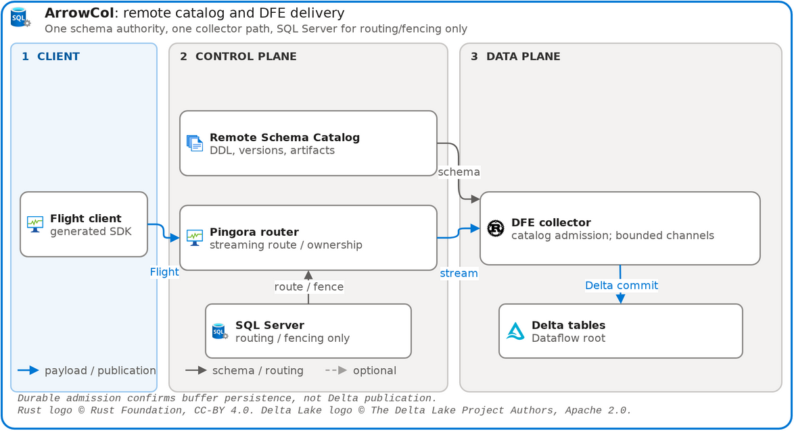

# Arrow collector platform

Typed clients send Arrow Flight over HTTP/2 through a streaming Pingora router to one fenced Dataflow owner per table. The DFE collector validates against the remote Schema Catalog and writes the Dataflow Delta root.

| Component | Owns | Does not do |
| --- | --- | --- |
| Remote Schema Catalog | DDL, immutable schema versions, artifacts, and change events | Store router leases or delivery receipts |
| SQL Server | Router registrations, pressure, and routing/fencing leases | Store schemas, Arrow payloads, delivery receipts, or publication status |
| Router | Select the Dataflow table owner and forward Flight | Decode/buffer the Flight body, retry DoPut, or switch backends midstream |
| DFE collector | Exact catalog admission, bounded channels, optional durable buffer, fenced Delta publication | Return client-queryable delivery receipts or a purge signal |

There is no Direct collector, SQL catalog, Hive Metastore, client durable receipt ID, receipt-polling endpoint, or delivery purge API. Best-effort DFE completion means bounded admission. With `durable_buffer`, completion means the local buffer persisted every batch; it still does not mean a Delta commit or downstream visibility. Neither mode provides exactly-once delivery or payload deduplication.

| Read next | Contract |
| --- | --- |
| [Delivery guarantees](delivery-guarantees.md) | DFE best-effort versus durable-buffer admission and client retry limits |
| [SDK generation](sdk-generation.md) | DDL to immutable artifacts to Rust/TypeScript clients |
| [Routing](routing.md) | Metadata, trust boundary, pressure, ownership, fencing |
| [Catalog](catalog.md) | Supported DDL, remote catalog commits, exact schema admission |
| [Storage](storage.md) | Bounded DFE buffers, Parquet/Delta controls, persistence limits |
| [Observability](observability.md) | Router and DFE metrics, Arrow/OTEL dashboards |
| [Lakehouse loadtest](../loadtest/README.md) | DFE, local/Azure storage, maintenance, tenant forks, Kusto, and validation |

Maintenance and streaming run outside the collector. OPTIMIZE rewrites active files without creating new logical rows. A historical tenant fork skips those rewrites and owns its sink files, while native Kusto follows the active snapshot, including replacements and removals, after asynchronous cache refresh. Cache statistics are not a substitute for comparing actual cached query results with the independent oracle and uncached fallback.

Start with the [root quick start](../../../README.md#arrow-collector-platform) or the [load generator guide](../loadtest/README.md). The architecture diagrams are maintained as Draw.io sources with matching PNG renders.
