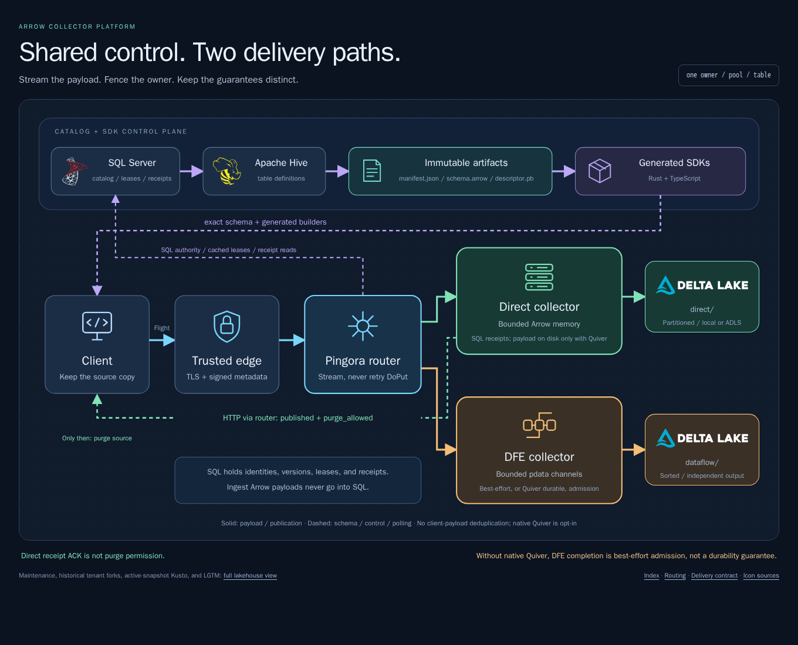

# Arrow collector platform

Typed clients send Arrow Flight over HTTP/2 through a streaming Pingora router
to one fenced owner per table and implementation pool. Direct and DFE collectors
write independent Delta roots; they do **not** offer the same delivery guarantee.

| Read next | Contract |
| --- | --- |
| [Delivery guarantees](delivery-guarantees.md) | Direct happy/sad paths, HTTP polling, retries, purge; DFE best-effort gap |
| [SDK generation](sdk-generation.md) | DDL to immutable artifacts to Rust/TypeScript clients |
| [Routing](routing.md) | Metadata, trust boundary, pressure, ownership, fencing |
| [Catalog](catalog.md) | Supported DDL, SQL/Hive saga, exact schema admission |
| [Storage](storage.md) | Bounded buffers, Parquet/Delta controls, persistence limits |
| [Observability](observability.md) | Metrics and separate Arrow/OTEL dashboards |
| [Lakehouse loadtest](../../../loadtest-architecture.html) | Both pools, local/Azure storage, maintenance, tenant forks, Kusto, and validation |

## System boundary

| Component | Owns | Does not do |
| --- | --- | --- |
| SQL Server | Catalog sagas/versions/artifacts, registrations, pressure, leases, direct receipts/events/publication observations | Store ingest Arrow IPC payloads, record batches, or value buffers |
| Hive Metastore | Catalog/database/table definitions through its official API | Store delivery receipts |
| Router | Select a pool/table owner; forward Flight; read direct receipts from SQL | Decode/buffer the Flight body, retry DoPut, switch backends midstream |
| Direct collector | Exact admission, bounded memory, SQL receipts, fenced Delta publication | Persist pending Arrow payloads in SQL |
| DFE collector | Exact admission, bounded `arrowcol.flight@1.1` channel, fenced Delta publication, optional Quiver durable buffer | Return durable receipts or a client purge signal |

Direct clients retain source data until HTTP confirms publication. By default,
DFE completion means best-effort admission only. With
[native Quiver](delivery-guarantees.md#native-quiver-disk-persistence), both
pools fsync each batch to local disk before acknowledging it and replay it after
a crash, so DFE completion means durable admission. Neither pool provides payload
deduplication or exactly-once delivery.

Delta publication retry identity is narrower than client delivery identity:
replaying one publication must not append its rows again, but two independent
client submissions remain two deliveries. Downstream Kusto visibility has its
own status and does not change what a Direct `published` receipt means.

Maintenance and streaming run outside the collectors. OPTIMIZE rewrites active
files without creating new logical rows. A historical tenant fork skips those
rewrites and owns its sink files, while the local Kusto bridge reconciles the
active snapshot, including replacements and removals. See
[storage boundaries](storage.md) and the
[root loadtest diagram](../../../loadtest-architecture.html).

Start with the [root quick start](../../../README.md#arrow-collector-platform)
or the [load generator guide](../loadtest/README.md). The HTML diagrams are
self-contained browser documents; GitHub displays their source rather than
rendering them inline.
