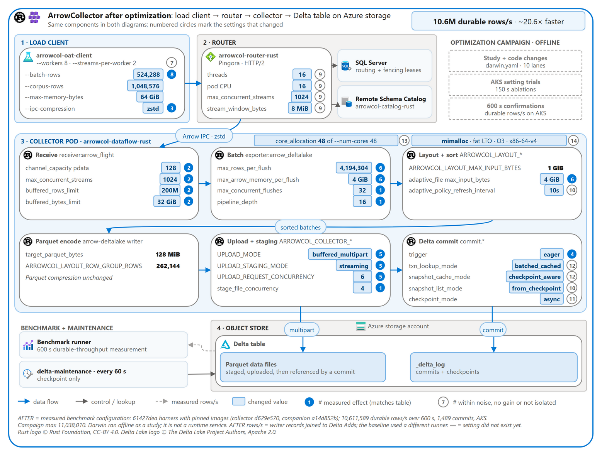

# Collector write path

[Architecture index](README.md) | [Buffers, files, and Delta](storage.md)

A benchmark run sends Arrow batches from the load client through the router to one collector pod. The pod receives them, groups them into large batches, sorts them, writes Parquet files, uploads the files, and commits them to a Delta table on Azure storage. The picture shows the measured benchmark configuration after the optimization campaign. Numbered circles mark the settings that changed from the earlier baseline; the campaign panel is offline study work, not a runtime service.

| Stage | In plain English | Source |
| --- | --- | --- |
| Load client | Builds Arrow batches and sends them over HTTP/2, zstd-compressed on the wire | `projects/arrowcol-oat` |
| Router | Picks the owning collector for a table and forwards the Flight stream without decoding it | `projects/arrowcol-router-rust` |
| Receive | Accepts Flight streams into bounded in-memory queues | `crates/arrowcol-dataflow-components` |
| Batch | Collects rows into large flushes and runs several flushes at once | `crates/arrowcol-dataflow-components` |
| Layout + sort | Orders rows and decides the file layout | `crates/arrow-deltalake` |
| Parquet encode | Writes Parquet files near the 128 MiB target | `crates/arrow-deltalake` |
| Upload + staging | Sends encoded Parquet chunks to Azure storage as multipart uploads | `crates/arrow-deltalake` |
| Delta commit | Publishes uploaded files to the Delta log | `crates/arrow-deltalake` |
| Maintenance | Checkpoints the Delta log outside the collector | `crates/delta-maintenance` |

## What the numbers mean

Throughput went from 516,369 to 10,611,589 durable rows/s over 600 seconds, about 20.6 times faster; the best campaign confirmation reached 11,038,010. The effects below are separate tests, not shares of that 20.6 times, and they do not add up. Most are one 150 s screen per setting with roughly 5% noise. Filled circles in the diagram have a measured effect; outlined circles are within noise, show no gain, or were not isolated.

| # | Change: before → now | Observed throughput effect |
| ---: | --- | --- |
| 1 | More parallel writes: 12 → 32 concurrent flush jobs, a deeper pipeline, up to 4 sibling files staged together | 57% slower without this group |
| 2 | Bigger input queues: 256 → 1,024 receiver streams, larger channels, more buffered rows | 24% slower without this group |
| 3 | zstd transfers: uncompressed → zstd-compressed Arrow batches (not Parquet compression) | 28% faster with zstd |
| 4 | Eager commits: a 2 s commit window → committing ready work promptly | 21% slower without it |
| 5 | Streaming uploads: finish and reread a local Parquet file → send encoded chunks to multipart upload | 11% slower with the old upload and staging settings |
| 6 | Bigger flushes: 2M → 4,194,304 rows; memory cap 1 → 4 GiB | 9% slower with the old caps |
| 7 | Undo client overshoot: an experimental 32 workers × 4 streams → 8 × 2 again; not a net change from the baseline | 12% faster than the oversized client |
| 8 | Bigger client batches: 65,536 → 524,288 rows | 6% slower with the old batch size |
| 9 | Router sizing: 4 → 16 threads, larger windows and CPU limit | About 5% slower with old sizing, at the noise edge |
| 10 | Fewer snapshot reads: refresh table policy less often, list the log from its checkpoint | 4.6% faster in the code and config step, within noise |
| 11 | Async checkpoints: background checkpoint every 20 commits | 1.6% slower without it, within noise |
| 12 | Grouped lookups: group and cache transaction checks, reuse checkpoint-aware table state | Less than 1% either way |
| 13 | 48-core setting: runtime allocation 32 → 48; the pod already had 48 CPUs | Going back to 32 was 4.4% faster, within noise |
| 14 | Code and build changes: layout and copy paths, capacity release, file writing, mimalloc, fat LTO, `x86-64-v4` | Not isolated on AKS; no percentage assigned |

Streaming uploads (5) remove the local-file round trip: the Parquet writer feeds already encoded bytes to a streaming sink, and a multipart task gathers up to six 8 MiB parts before awaiting requests. The measurements do not establish how much encoding and network transfer overlap.

## Other bundled settings

These changed in the same configuration but were not priced separately.

| Setting | Before → now |
| --- | --- |
| `ARROWCOL_LAYOUT_MAX_ROWS` | 2M → 1M |
| `max_files_per_commit` | 128 → 256 |
| `max_pending_files` | 512 → 1024 |
| Maximum message size | 128 MiB → 1 GiB |
| Client corpus rows and memory budget | 65,536 rows → 1,048,576 rows; 1 → 64 GiB |
| `delta-maintenance` jobs | purge, optimize, vacuum, checkpoint, prune-log → checkpoint only |

## Measured configuration

| Item | Baseline | Optimized |
| --- | --- | --- |
| Durable rows per second | 516,369 (two 600 s runs pooled) | 10,611,589 over 600 s with 1,489 commits |
| Settings | `main` at `3630d3e` | [AKS benchmark manifest](../../../experiments/aks-direct-benchmark/arrowcollector-aks-benchmark.yaml) |
| Collector images | Baseline manifest | Pinned collector `d629e570` and companion images `a14d852b`, run by the `61427dea` harness |

This is an observed campaign comparison, not a controlled attribution test: the runners, settings, images and hardware allocations differ, and the optimized run did not rebuild head code. It covers one collector, one table and one data shape, so it is not a production capacity guarantee.

The campaign followed the Darwin study; no change was generated by native `darwin evolve`. The Darwin-seed layout fast path cut median component finish time from 29.69 to 22.99 ms in a local test, which is not an AKS result. Controls for the storage layer are in [Buffers, files, and Delta](storage.md).
