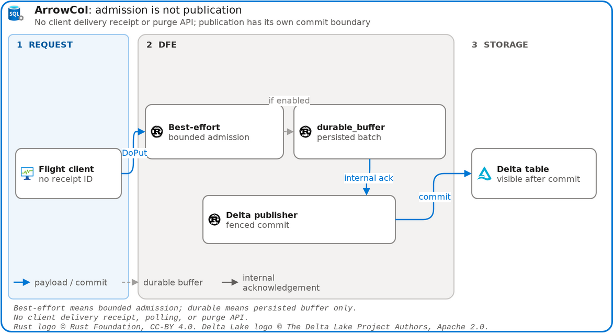

# DFE delivery guarantees and the client contract

[](diagrams/delivery.drawio)

[Architecture index](README.md)

Clients no longer receive durable receipt IDs. There is no client receipt API, HTTP status polling, or purge signal. Flight completion is an admission result—not evidence that rows are committed to Delta or visible to downstream queries.

| Contract | DFE behavior |
| --- | --- |
| Schema admission | Validate the exact Arrow layout and registered schema through the remote Schema Catalog before accepting batches |
| Default Flight completion | `best_effort_admission`: the bounded DFE channel accepted the batches; process loss can lose in-memory data |
| With `durable_buffer` | `durable_admission`: every batch is persisted to the configured local write-ahead buffer before completion |
| Delta publication | Asynchronous DFE export, protected by routing/fencing authority; not implied by Flight completion |
| Client receipt / polling / purge | None; internal publication IDs are not client receipt IDs |
| Retry and duplicate behavior | No payload deduplication or exactly-once guarantee; ambiguous client retries may duplicate rows |

## Admission versus publication

```text
Flight DoPut -> remote catalog validation -> bounded DFE admission
                                              |
                         optional durable_buffer WAL acknowledgement
                                              |
                     asynchronous fenced Delta publication -> query visibility
```

The ordinary path returns after bounded in-memory admission. When the durable buffer is configured, the response waits (bounded by `limits.admission_timeout`) until each batch is acknowledged by the write-ahead buffer. That acknowledgement means buffer persistence only; export, Delta commit, and Kusto/native query visibility occur later and can fail independently. DFE Nack, pressure, and metrics expose internal failures but do not create a per-delivery client status API.

## Client retry guidance

Retain source data until application-level destination checks establish the outcome. If a Flight result is lost or an export outcome is uncertain, the client cannot look up a receipt or ask the router whether publication completed. Reconcile against the destination when possible; if resending is chosen, account for possible duplicate rows. Server-side durable-buffer replay preserves buffered work across a restart when its configured state is retained, but is not a client purge permission or a Delta commit proof.

SQL Server remains only the router routing/fencing store. The remote Schema Catalog owns schema history and artifacts. Reset, stop, and provider custody receipts are separate operational evidence and do not describe ingest delivery.

See [routing](routing.md) for lease and commit fencing, [storage](storage.md) for buffer limits and reset-generation checks, and the [DFE configuration](../../../projects/arrowcol-dataflow-rust/config.yaml) for the remote catalog and routing-store endpoints.
