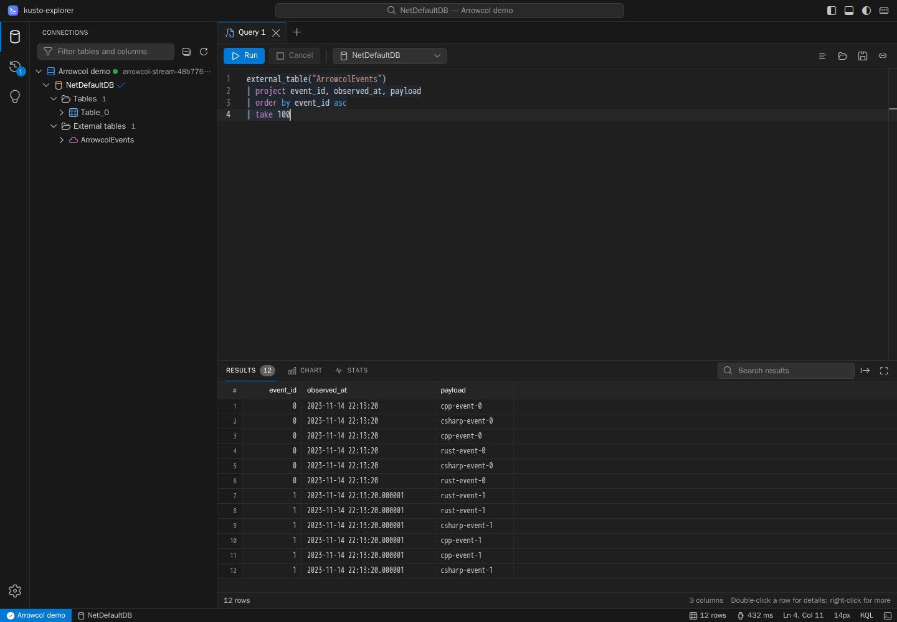

# Localhost catalogue and ingestion demo

| Component | Local address | Purpose |
| --- | --- | --- |
| Catalogue UI | <http://localhost:4173/lakehouse> | Explore contracts, build SDKs and download artifacts |
| Local / hosted simulation | `18817` / `18818` | Two independent, persistent catalogue authorities |
| Regional Arrowcol | `18830` | Admit SDK batches and commit Delta/Parquet |
| Optional on-node Arrowcol | `18832` | Admit and forward to regional using the same catalogue authority |
| Optional Kusto emulator | `18090` | Query the committed Delta table, without copying rows |

For coding agents setting up this demo for someone else, follow the
[agent execution checklist](#agent-execution-checklist) and return the actual
reachable URLs and connection details, not just commands.

Use the repository devcontainer for the complete demo. Rust, Node/Nx, protoc and
Docker must be available there. C++ additionally requires CMake and protobuf C++
development libraries; C# requires the .NET 8 SDK. Allocate at least 6 GiB to the
optional Kusto container, in addition to the development and catalogue services.
Follow the repository's devcontainer setup before these commands.

For the optional C++/C# samples in the Ubuntu 24.04 devcontainer:

```bash
sudo apt-get update
sudo apt-get install -y cmake libprotobuf-dev dotnet-sdk-8.0
```

**Keep `.temp/contract-builder` and Docker metadata volumes.** They contain real
local contracts, history, releases and data. Do not run broad clean/reset targets
against a demo you need to keep. These services are unauthenticated local
development services; never expose their ports to the public internet.

## 1. Start the catalogue

In the devcontainer terminal:

```bash
npx --no-install nx run arrowcol-sdk-gen:catalog-ui
```

Keep it running and forward port `4173` in your editor. `/`, `/fabric` and
`/lakehouse` remain separate frontends. Select a registry, browse its tables, or
use **Create and build**. Click a workflow run for its pipeline, logs, pinned
version and downloadable archive. The host-visible path is also displayed.

The default hosted choice is a second local service, not a cloud deployment.
For actual local Unity/Hive metadata services, follow
[native catalogue setup](catalog.md#optional-local-unity-catalog-and-hive-services).
After enabling builds and restarting the idle UI, select those authorities from
the same dropdown. Their initial contract scope is flat, unpartitioned v1 tables
and exact rebuilds; this does not adopt arbitrary foreign tables.

The screenshots below are real local captures using **Hosted simulation**, the
second local authority; the same controls apply to **Local catalogue**.


## 2. Build the editable sample's SDK

In a second devcontainer terminal:

```bash
npx --no-install nx run arrowcol-protoc:build-contract --registry=local --definition=examples/arrowcol-stream/schema.sql
```

This creates `demo.public.events`: required `event_id`, required `observed_at`
(UTC microseconds), and nullable `payload`. Copy the successful run's `id`.
The workflow compiles and validates the SDK before registering the new contract.
It does not silently overwrite an existing table.

For an existing, intentionally reused sample contract, rebuild instead:

```bash
npx --no-install nx run arrowcol-protoc:build-contract --registry=local --table=demo.public.events --schema-version=1
```

Do not use the fixture generator as a substitute for this committed build.
Changing values in the sample app needs no schema rebuild. Changing the schema
does: use a new contract rather than assuming this CREATE-only demo performs ALTER.

Open the successful run to inspect its stages and download the SDK:


## 3. Prepare and start collectors

Replace `RUN_UUID` with the successful run ID:

```bash
export RUN=RUN_UUID
npx --no-install nx run arrowcol-sdk-gen:stream-demo --action=prepare --run-id="$RUN"
npx --no-install nx run arrowcol-sdk-gen:stream-demo --action=serve --run-id="$RUN" --node
```

Leave `serve` running. Omit `--node` for regional-only ingestion. Both collectors
resolve the selected authority themselves; SDK clients never receive a registry
endpoint. Configurations, logs, extracted SDK and sample build projects are under
`.temp/contract-builder/demos/RUN_UUID/`.

The on-node exporter uses explicit `registration: shared_catalog`: it does not
replay CREATE/ALTER into the regional collector. Existing independent-catalogue
forwarding retains its default DDL-replay behavior. This minimal topology is
best-effort admission; it does not enable Quiver crash-durable buffering or claim
exactly-once delivery. SDK batching is enabled; the node forwards admitted batches
without promising an additional timed aggregation stage.

## 4. Emit data for five minutes

In another terminal:

```bash
export RUN=RUN_UUID
npx --no-install nx run arrowcol-sdk-gen:stream-demo --action=emit --run-id="$RUN"
```

| Option | Meaning |
| --- | --- |
| `--language=rust` | Default; edit `examples/arrowcol-stream/rust/main.rs` |
| `--language=cpp` | Edit `examples/arrowcol-stream/cpp/main.cpp` |
| `--language=csharp` | Edit `examples/arrowcol-stream/csharp/Program.cs` |
| `--duration-seconds=300` | Default five-minute application loop, not an SDK stream lifetime limit |
| `--interval-ms=1000` | Default one event per second |
| `--node` | Send to the optional node instead of directly to regional |
| `--duration-seconds=5` | Short smoke run |

The wrapper compiles the chosen sample and runs it against the active demo.
C++ and C# first build the generated native bridge to the shared Rust runtime.
Build output is retained outside the immutable release archive.
Use `--action=build --language=cpp` (or `rust`/`csharp`) to compile without sending.
Samples use deterministic synthetic timestamps and values for exact comparison;
edit the event construction to use your own values or current timestamps.

When running a compiled sample directly, pass `--endpoint` or set
`ARROWCOL_ENDPOINT`; there is no hardcoded IP fallback. The wrapper supplies the
active local endpoint automatically, overriding the environment. See
[connection configuration and DNS](sdk-developer-guide.md#configure-the-collector-connection)
and the complete Cargo, CMake and .NET project-reference examples in that guide.
Ordinary protobuf types stay `Events`; only the Arrowcol-specific helpers are
named `ArrowcolEventsContract` and `ArrowcolEventsStream`.

Run the app directly if you need its own Ctrl+C handler to flush before exit;
the wrapper is primarily a bounded-duration runner. Killing a process does not
guarantee a final flush. All samples explicitly flush and close on normal exit.
See the [SDK developer guide](sdk-developer-guide.md) for the minimal APIs.

### Windows Command Prompt

These are **CMD**, not PowerShell, commands. They invoke the existing Linux
devcontainer through WSL; they do not claim a native Windows collector build.
Replace the distribution/container names if yours differ. Run `serve` in a
separate CMD window, and keep the catalogue terminal open:

```bat
set RUN=RUN_UUID
wsl -d Ubuntu-24.04 -u root -- docker exec -u vscode -w /workspaces/rust-playground rust-playground_devcontainer-workspace-1 npx --no-install nx run arrowcol-sdk-gen:stream-demo --action=prepare --run-id=%RUN%
wsl -d Ubuntu-24.04 -u root -- docker exec -u vscode -w /workspaces/rust-playground rust-playground_devcontainer-workspace-1 npx --no-install nx run arrowcol-sdk-gen:stream-demo --action=serve --run-id=%RUN% --node
```

In another CMD window:

```bat
set RUN=RUN_UUID
wsl -d Ubuntu-24.04 -u root -- docker exec -u vscode -w /workspaces/rust-playground rust-playground_devcontainer-workspace-1 npx --no-install nx run arrowcol-sdk-gen:stream-demo --action=emit --run-id=%RUN% --language=rust --node
```

The same wrapper accepts `--language=cpp` or `--language=csharp`. Source edits in
the Windows checkout are visible through its devcontainer bind mount.

## 5. Inspect committed Delta and optional Kusto

After an emitter completes, allow the regional Delta export to commit:

```bash
npx --no-install nx run arrowcol-sdk-gen:stream-demo --action=inspect --run-id="$RUN"
```

This reads the active Parquet files named by Delta Add/Remove actions, not every
file in the directory. It records `committed-files.json` and `committed-rows.json`.
Inspecting immediately after admission may show fewer rows; admission is not a
sink-visibility barrier. Repeated emit runs append data and can repeat sample IDs.

**`kusto-up` starts a local 6 GiB emulator with `ACCEPT_EULA=Y`; run it only if you
accept the emulator license.** It mounts the selected warehouse read-only and
retains a named Kusto data volume:

```bash
npx --no-install nx run arrowcol-sdk-gen:stream-demo --action=kusto-up --run-id="$RUN"
npx --no-install nx run arrowcol-sdk-gen:stream-demo --action=kusto-query --run-id="$RUN"
```

The helper uses the same pinned emulator image as the upstream loadtest. It
creates `ArrowcolEvents` as a native Delta external table in `NetDefaultDB`;
it does not copy events into a separate Kusto ingestion pipeline.
The query result is also saved as `kusto-rows.json`. Use the printed endpoint
with a KQL client:

| Connection field | Value |
| --- | --- |
| Host-side cluster URI | Printed `hostEndpoint`, normally `http://localhost:18090` |
| Container-side cluster URI | Printed `endpoint`, normally `http://arrowcol-stream-<run-prefix>-kusto:8080`; only on its Docker network |
| Database | `NetDefaultDB` |
| Authentication | None for this local emulator; do not use a cloud sign-in flow |
| Data source | Delta external table `ArrowcolEvents`, not a regular ingested Kusto table |
| Timestamp caution | The sample intentionally emits fixed synthetic timestamps; do not filter with `ago(5m)` |

```kusto
external_table("ArrowcolEvents") | take 100
```

For a client without a Kusto UI, query the host endpoint directly. Use the actual
published port if it differs; HTTP errors and Kusto response errors must both
be checked:

```bash
curl --fail-with-body --silent --show-error \
  -H 'Content-Type: application/json' \
  --data '{"db":"NetDefaultDB","csl":"external_table(\"ArrowcolEvents\") | take 100"}' \
  http://localhost:18090/v2/rest/query
```

In Windows CMD, save this UTF-8 request as `kusto-query.json` to avoid shell
quoting of KQL pipes and nested quotes:

```json
{
  "db": "NetDefaultDB",
  "csl": "external_table(\"ArrowcolEvents\") | take 100"
}
```

```bat
curl.exe --fail-with-body --silent --show-error -H "Content-Type: application/json" --data-binary "@kusto-query.json" http://localhost:18090/v2/rest/query
```

Inside the devcontainer, use the internal URI from `kusto-up`, or run the
`kusto-query` target above; the container's `localhost` is not the Docker host.
If Docker runs inside WSL, verify the host-published address from Windows before
handing it to the user. Configure a loopback-only forward if needed; a URL that
works only inside a container is not a verified host URL.

The optional Kusto Explorer is not required for ingestion. Follow the
[Kusto Explorer README](../../../projects/kusto-explorer/README.md#standalone-container);
attach it to the emulator's Docker network and configure the printed internal
endpoint, with default database `NetDefaultDB`.

This actual Kusto Explorer capture shows twelve rows from a short Rust/C++/C#
qualification through both direct and node paths. A five-minute run produces more
rows; sample IDs intentionally repeat across runs and languages.



## Agent execution checklist

These are instructions for an agent asked to run the localhost demo, not
permission to deploy anything remotely. Reuse the repository tooling and the
steps above; do not invent a separate collector, SDK generator or query proxy.

Use the same source revision as this guide, not an older default-branch checkout.
Preserve an existing dirty checkout and ask before switching it. Select the
requested mode first; if it is unclear, ask before starting extra components:

| Requested mode | Scope and checklist steps |
| --- | --- |
| **UI only** | Steps 1-2, then 8-9: catalogue UI and its owned catalogue services. Browse existing metadata; do not create a sample table, generate an SDK, emit events or start collectors/Kusto. |
| **UI + SDK** | Steps 1-4, then 8-9: also build the sample SDK and selected language's application. Do not start collectors or emit data. |
| **Ingestion demo** | Steps 1-5, then 8-9: also run regional Arrowcol and the emitter, and inspect Delta. Add node only if requested; no Kusto. |
| **Full demo** | Steps 1-9: UI, SDK, regional Arrowcol, emitter, Delta, local Kusto and Kusto Explorer. Confirm emulator EULA acceptance before starting Kusto; node remains optional. |

Run only the steps for that mode. Installing C++/.NET tooling is necessary only
when the selected sample language needs it. Return the actual reachable UI URL
even in UI-only mode; do not report an unstarted component as ready.

1. Inspect the checkout, devcontainer, active ports and existing run state.
   Preserve user edits, `.temp/contract-builder`, releases, registry identity and
   Docker data volumes. Reuse healthy services; never kill another process merely
   because it owns a port. Use another supported port or ask when ownership is
   unclear. Do not commit, push or mutate a real hosted service without permission.
2. Check prerequisites inside the environment that will execute the commands.
   Start or reuse `arrowcol-sdk-gen:catalog-ui` from step 1. Forward port `4173`
   to the user's host using loopback-only access and verify `/lakehouse` from the
   host browser. Keep the process alive using the environment's persistent
   background/terminal facility; retain its process handle and logs.
3. Use an owned local registry (the hosted simulator is also an owned local
   service). Inspect for `demo.public.events` before CREATE. Build the sample
   contract if absent; otherwise rebuild the exact existing version only after
   confirming its three-column schema matches. Record the successful run ID,
   registry, table ID, schema version, fingerprint and artifact path.
4. Run `stream-demo --action=prepare --run-id=...`. Build the selected language
   with `--action=build`; fix missing toolchains rather than changing the schema.
   The projects generated under `.temp` are not checked in. For a user's own
   application, follow the project references in the SDK developer guide.
5. Start `stream-demo --action=serve --run-id=...`, adding `--node` only when that
   hop is requested. Keep the supervisor alive and read its actual `endpoints.json`.
   Run a short emitter smoke check, then the default five-minute loop unless the
   user requested a shorter run. Record admitted counts and query committed Delta
   rows using `--action=inspect`; do not equate admission with sink visibility.
6. For full-demo mode or an explicit Kusto request, confirm emulator EULA
   acceptance if not already given.
   Run `--action=kusto-up` and `--action=kusto-query`. Record both the internal URI
   and host URI from `kusto.json`; verify the host URI with a real query from the
   user's host. Check `NetDefaultDB` and `external_table("ArrowcolEvents")` contain
   the expected synthetic data, accounting for prior runs and repeated event IDs.
7. For full-demo mode or an explicit browser-workbench request, start/reuse the repository's
   Kusto Explorer on the same Docker network as the emulator. Set
   `KUSTO_EXPLORER_CONNECTIONS=Arrowcol demo=<internal URI>` and
   `KUSTO_EXPLORER_DEFAULT_DATABASE=NetDefaultDB`; publish only to host loopback.
   Verify its health and run the external-table query in the UI before returning
   its browser URL. A raw Kusto cluster URI is not a browser workbench URL.
8. Capture screenshots only from components in the selected mode, not an
   authenticated Fabric/cloud workspace. UI-only may show an empty catalogue;
   do not create data just for a screenshot. For broader modes, show the selected
   schema, successful workflow/artifact and, if running, Kusto query results.
   Never include credentials or fabricate successful results. Report blocked
   components or unavailable screenshots plainly.
9. Leave the user-requested UI, collectors and Kusto available after the handoff,
   with their logs and exact stop instructions. Stop only temporary verification
   helpers you own. If the environment cannot keep services running or cannot
   forward a host port, state that limitation instead of claiming a working URL.

The final handoff **must include** these fields for the selected mode. Mark
out-of-scope components as **not started (outside requested mode)**:

| Return to the user | Required evidence/details |
| --- | --- |
| Catalogue URL | Actual host URL, normally `http://localhost:4173/lakehouse`, with registry/table selected when possible |
| SDK artifact | Successful run ID, pinned schema version, downloadable artifact and real host-visible path |
| Collector connection | `ARROWCOL_ENDPOINT` value and where the app must run to reach it; node versus regional |
| Kusto connection | Verified host cluster URI, internal Docker URI, `NetDefaultDB`, no-auth emulator setting and the query below |
| Kusto browser UI | Verified workbench URL and connection name if started; otherwise say it was not started |
| Evidence | Actual admitted/committed/query counts and screenshots or their file paths; distinguish old rows from new sends |
| Lifecycle | Which services are still running, owned process/container identifiers, log locations and non-destructive stop commands |

When Kusto is included, provide this ready-to-paste query in the handoff:

```kusto
external_table("ArrowcolEvents")
| project event_id, observed_at, payload
| order by event_id asc
| take 100
```

## Stop and troubleshoot

| Symptom/action | Guidance |
| --- | --- |
| Stop collectors | Ctrl+C in `serve`; it stops only its child processes and retains all data |
| Stop Kusto | `npx --no-install nx run arrowcol-sdk-gen:stream-demo --action=kusto-stop --run-id="$RUN"` |
| Port conflict | Use `serve --port-base=18930`; Kusto uses independent `--kusto-port=18091` |
| Table already exists | Rebuild its pinned version; do not replay CREATE or delete the warehouse |
| Missing generated stream adapter | Rebuild with the new generator; initial protobuf stream support is flat scalars |
| Native compiler/toolchain missing | Install the missing CMake/protobuf C++ or .NET 8 SDK in the devcontainer |
| `outcome_unknown` | Retain source records and reconcile committed data; do not blindly retry |
| Stale `serve.lock` after a crash | Inspect its PID and logs before removing that exact lock; never kill unrelated processes |
| Fewer Delta/Kusto rows than admitted | Check regional logs and wait for committed output; an acknowledgement is not proof of persistence |

For repeatable qualification, use a fresh, empty `events` table build and run
`CONTRACT_STREAM_RUN=RUN_UUID npx --no-install nx run arrowcol-sdk-gen:stream-demo-e2e`.
It compiles all three languages before sending, exercises both direct and node
paths, compares every committed value in Delta and Kusto, then stops only its own
collectors/emulator. It retains data and evidence and refuses a nonempty table.
