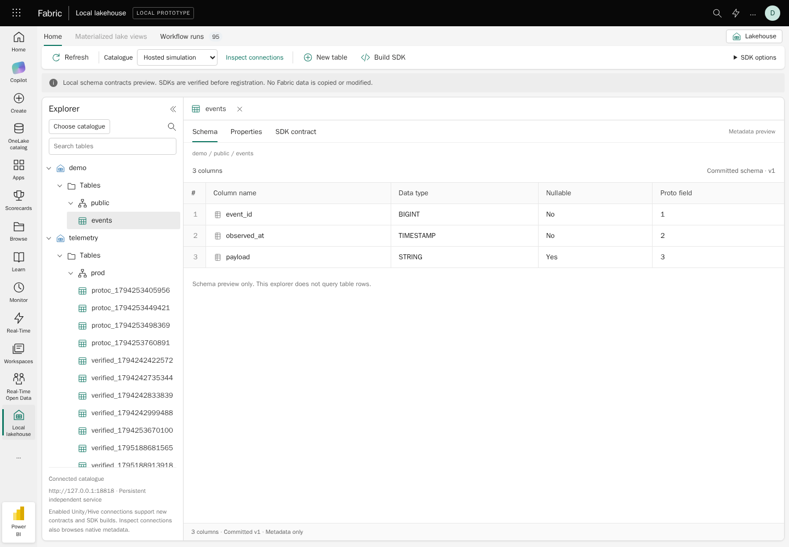
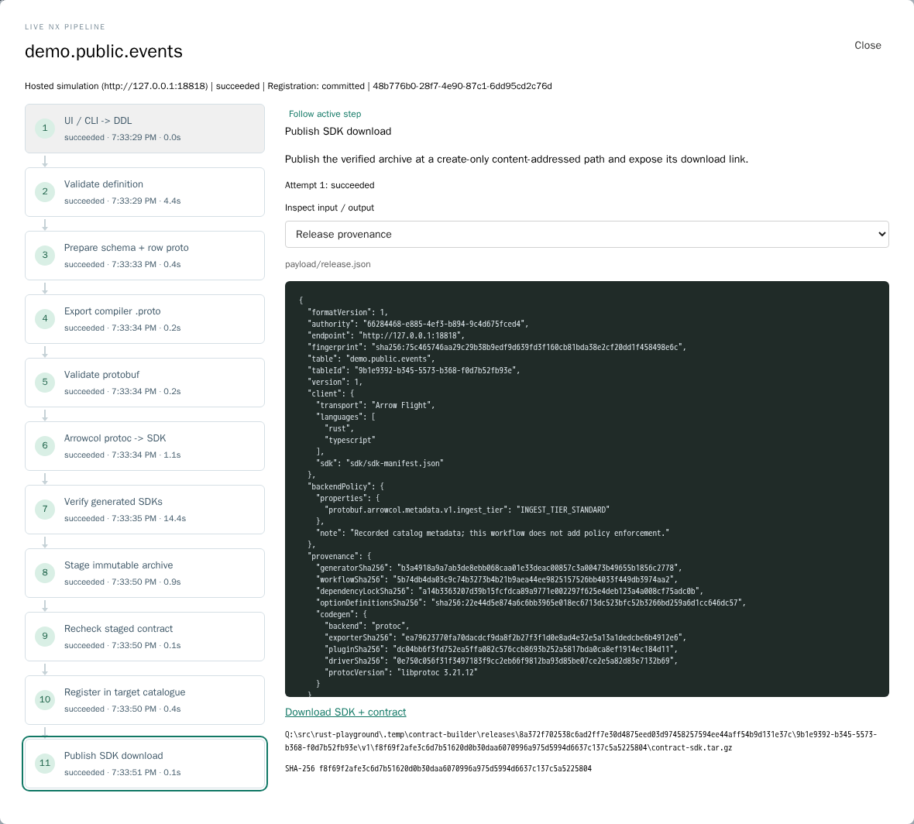
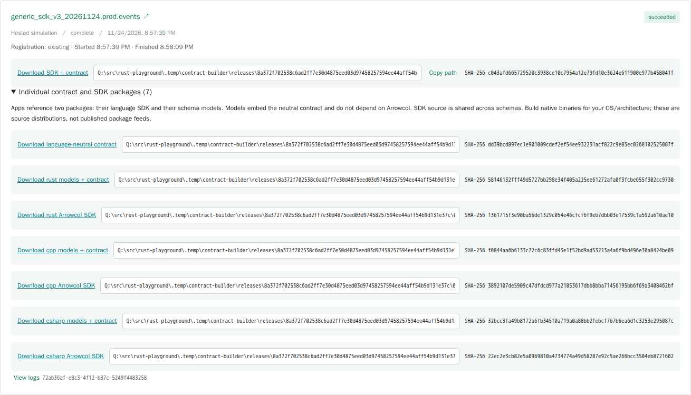

# Localhost catalogue and ingestion demo

| Component | Purpose | Prerequisite |
| --- | --- | --- |
| [Localhost UI](#localhost-ui) | Browse tables, create contracts, build and download packages; UI on `4173`, owned registries on `18817` / `18818` | Repository devcontainer |
| [Sample App](#sample-app) | Editable Rust/C++/C# application using the SDK and models packages | Successful contract release; Localhost Arrowcol to send events |
| [Localhost Arrowcol](#localhost-arrowcol) | Regional collector on `18830`, optional node on `18832`, and Delta/Parquet output | Prepared contract run and its running catalogue |
| [Localhost Kusto](#localhost-kusto) | Query Delta through the emulator on `18090`, optionally with Kusto Explorer | Prepared contract run and its Delta warehouse; committed events for nonempty results |

For coding agents setting up this demo for someone else, follow the
[agent execution checklist](#agent-execution-checklist) and return the actual
reachable URLs and connection details, not just commands.

Set up the components you need. Localhost UI includes contract/package builds.
The Sample App can be compiled without collectors. To exercise the complete path,
build the Sample App, start Localhost Arrowcol, run the app, then query its
committed data with Localhost Kusto.

Use the repository devcontainer for the complete demo. Rust, Node/Nx, protoc and
Docker must be available there. C++ additionally requires CMake and protobuf C++
development libraries; C# requires the .NET 8 SDK. Allocate at least 6 GiB to the
optional Kusto container, in addition to the development and catalogue services.
Follow the repository's devcontainer setup before these commands.

For the optional C++/C# samples in the Ubuntu 24.04 devcontainer:

```bash
sudo apt-get update
sudo apt-get install -y cmake libprotobuf-dev dotnet-sdk-8.0
```

**Keep `.temp/contract-builder` and Docker metadata volumes.** They contain real
local contracts, history, releases and data. Do not run broad clean/reset targets
against a demo you need to keep. These services are unauthenticated local
development services; never expose their ports to the public internet.

## Localhost UI

Starts the browser UI and two persistent catalogue services. It supports table
creation and package builds without running the Sample App, Arrowcol collectors
or Kusto.

In the devcontainer terminal:

```bash
npx --no-install nx run arrowcol-sdk-gen:catalog-ui
```

Keep it running and forward port `4173` in your editor. Open `/lakehouse` for
the table explorer, `/fabric` for the catalogue grid, or `/` for the basic explorer.
Select a registry, browse its tables, or
use **Create and build**. Click a workflow run for its pipeline, logs, pinned
version and downloadable archives. Expand **Individual contract and SDK packages**
for the neutral contract and each language's models/SDK. Every package has a
digest and host-visible path. **Download SDK + contract** contains the complete
developer bundle.

The default hosted choice is a second local service, not a cloud deployment.
For actual local Unity/Hive metadata services, follow
[native catalogue setup](catalog.md#optional-local-unity-catalog-and-hive-services).
After enabling builds and restarting the idle UI, select those authorities from
the same dropdown. They support creating flat, unpartitioned v1 tables
and exact rebuilds; this does not adopt arbitrary foreign tables.

The screenshots below are real local captures using **Hosted simulation**, the
second local authority; the same controls apply to **Local catalogue**.
They use an isolated qualification namespace; the commands below use `demo.public.events`.



## Sample App

Build an editable Rust, C++ or C# emitter against a successful contract release.
Compiling the app does not send events. Running it requires
[Localhost Arrowcol](#localhost-arrowcol).

### Build the contract

In a second devcontainer terminal:

```bash
npx --no-install nx run arrowcol-protoc:build-contract --registry=local --definition=examples/arrowcol-stream/schema.sql
```

This creates `demo.public.events`: required `event_id`, required `observed_at`
(UTC microseconds), and nullable `payload`. Copy the successful run's `id`.
The workflow checks canonical artifacts, Rust models and Rust/TypeScript Arrow
builders before registration. Build the C++/C# sample applications to check those
toolchains, and run the emitters to verify ingestion. CREATE fails if the table
already exists.

If the sample table already exists with the expected schema, rebuild its pinned version:

```bash
npx --no-install nx run arrowcol-protoc:build-contract --registry=local --table=demo.public.events --schema-version=1
```

Do not use the fixture generator as a substitute for this committed build.
Changing values in the sample app needs no schema rebuild. Changing the schema
does: use a new contract rather than assuming this CREATE-only demo performs ALTER.

Open the successful run to inspect its stages and download packages. A
pinned-version rebuild skips registration:



Expand the run's package section to download the neutral contract or either
dependency for your language:



### Prepare and build

Replace `RUN_UUID` with the successful run ID:

```bash
export RUN=RUN_UUID
npx --no-install nx run arrowcol-sdk-gen:stream-demo --action=prepare --run-id="$RUN"
npx --no-install nx run arrowcol-sdk-gen:stream-demo --action=build --run-id="$RUN" --language=rust
```

Use `--language=cpp` or `--language=csharp` to build either of those applications.
The extracted SDK/models packages and sample projects are under
`.temp/contract-builder/demos/RUN_UUID/`.

### Run the app

Start [Localhost Arrowcol](#localhost-arrowcol) with the same run ID, then run
the app in another terminal. It emits for five minutes by default:

```bash
export RUN=RUN_UUID
npx --no-install nx run arrowcol-sdk-gen:stream-demo --action=emit --run-id="$RUN"
```

| Option | Meaning |
| --- | --- |
| `--language=rust` | Default; edit `examples/arrowcol-stream/rust/main.rs` |
| `--language=cpp` | Edit `examples/arrowcol-stream/cpp/main.cpp` |
| `--language=csharp` | Edit `examples/arrowcol-stream/csharp/Program.cs` |
| `--duration-seconds=300` | Default five-minute application loop, not an SDK stream lifetime limit |
| `--interval-ms=1000` | Default one event per second |
| `--node` | Send to the optional node instead of directly to regional |
| `--duration-seconds=5` | Short smoke run |

The wrapper compiles the chosen sample and runs it against the active demo.
C++ and C# first build the same schema-independent native SDK library.
Build output is retained outside the immutable release archive.
Use `--action=build --language=cpp` (or `rust`/`csharp`) to compile without sending.
Samples use deterministic synthetic timestamps and values for exact comparison;
edit the event construction to use your own values or current timestamps.

The wrapper supplies both configuration values as command-line arguments; you
do not need to set environment variables for `--action=emit`. When running a
compiled sample directly, supply them yourself:

| Argument (takes precedence) | Environment alternative | Value |
| --- | --- | --- |
| `--endpoint` | `ARROWCOL_ENDPOINT` | Collector Flight/gRPC URI, such as `http://127.0.0.1:18830`; not the UI URL or registry endpoint |
| `--contract` | `ARROWCOL_CONTRACT` | Local directory `.temp/contract-builder/demos/RUN_UUID/sdk/models/<language>/contract/`, containing the manifest, Arrow schema and protobuf descriptors; not an archive or `.proto` filename |

These environment-variable names belong to the sample apps, not the SDK.
The apps load an `ArrowcolContract` from the directory and pass that object
plus the endpoint to `ArrowcolStream<Events>.connect` (or its C++/C# equivalent).
Stream creation opens its own transport connection; no separate connection
object is required. There is no hardcoded IP fallback.
The wrapper overrides environment configuration with the active local run.
For a collector on another VM, run the app directly using the
[same-VM and remote-VM configuration examples](sdk-developer-guide.md#configure-the-collector-connection).
That guide also contains complete Cargo, CMake and .NET project references.

Run the app directly if you need its own Ctrl+C handler to flush before exit;
the wrapper is primarily a bounded-duration runner. Killing a process does not
guarantee a final flush. All samples explicitly flush and close on normal exit.
See the [SDK developer guide](sdk-developer-guide.md) for the minimal APIs.

### Windows Command Prompt

Run these commands in **Windows CMD**. They execute the Linux demo inside
the repository devcontainer through WSL.
Replace the distribution/container names if yours differ. Prepare and compile:

```bat
set RUN=RUN_UUID
wsl -d Ubuntu-24.04 -u root -- docker exec -u vscode -w /workspaces/rust-playground rust-playground_devcontainer-workspace-1 npx --no-install nx run arrowcol-sdk-gen:stream-demo --action=prepare --run-id=%RUN%
wsl -d Ubuntu-24.04 -u root -- docker exec -u vscode -w /workspaces/rust-playground rust-playground_devcontainer-workspace-1 npx --no-install nx run arrowcol-sdk-gen:stream-demo --action=build --run-id=%RUN% --language=rust
```

After starting [Localhost Arrowcol](#localhost-arrowcol), emit from another CMD window:

```bat
set RUN=RUN_UUID
wsl -d Ubuntu-24.04 -u root -- docker exec -u vscode -w /workspaces/rust-playground rust-playground_devcontainer-workspace-1 npx --no-install nx run arrowcol-sdk-gen:stream-demo --action=emit --run-id=%RUN% --language=rust
```

The same wrapper accepts `--language=cpp` or `--language=csharp`. Source edits in
the Windows checkout are visible through its devcontainer bind mount.

## Localhost Arrowcol

Requires a successful contract run that has completed
[prepare](#prepare-and-build), with its selected catalogue still running.
The regional collector admits SDK batches and writes Delta/Parquet. Starting
collectors does not start the Sample App or Kusto.

### Start collectors

In the devcontainer terminal:

```bash
export RUN=RUN_UUID
npx --no-install nx run arrowcol-sdk-gen:stream-demo --action=serve --run-id="$RUN"
```

Add `--node` to start the optional node-to-regional hop. Leave `serve` running
and keep the catalogue service available. Both collectors resolve the selected
authority themselves; SDK clients receive a collector endpoint.
Configurations, logs and `endpoints.json` are under
`.temp/contract-builder/demos/RUN_UUID/`.

In **Windows CMD**, start the same supervisor in a separate window:

```bat
set RUN=RUN_UUID
wsl -d Ubuntu-24.04 -u root -- docker exec -u vscode -w /workspaces/rust-playground rust-playground_devcontainer-workspace-1 npx --no-install nx run arrowcol-sdk-gen:stream-demo --action=serve --run-id=%RUN%
```

The on-node exporter uses `registration: shared_catalog`: both collectors use
the same authority, without forwarding CREATE/ALTER. The SDK batches events and
the node forwards admitted batches. This demo uses best-effort admission without
Quiver crash-durable buffering or exactly-once delivery.

### Inspect committed Delta

After an emitter completes, allow the regional Delta export to commit:

```bash
npx --no-install nx run arrowcol-sdk-gen:stream-demo --action=inspect --run-id="$RUN"
```

This reads the active Parquet files named by Delta Add/Remove actions, not every
file in the directory. It records `committed-files.json` and `committed-rows.json`.
Inspecting immediately after admission may show fewer rows; admission is not a
sink-visibility barrier. Repeated emit runs append data and can repeat sample IDs.

## Localhost Kusto

Requires a prepared contract run and its Delta warehouse. Kusto reads committed
data without requiring the Sample App or collectors to stay running. Use the
same run ID that produced the data you want to query.

### Start and query the emulator

**`kusto-up` starts a local 6 GiB emulator with `ACCEPT_EULA=Y`; run it only if you
accept the emulator license.** It mounts the selected warehouse read-only and
retains a named Kusto data volume:

```bash
export RUN=RUN_UUID
npx --no-install nx run arrowcol-sdk-gen:stream-demo --action=kusto-up --run-id="$RUN"
npx --no-install nx run arrowcol-sdk-gen:stream-demo --action=kusto-query --run-id="$RUN"
```

The helper uses the same pinned emulator image as the upstream loadtest. It
creates `ArrowcolEvents` as a native Delta external table in `NetDefaultDB`;
it does not copy events into a separate Kusto ingestion pipeline.
The query result is also saved as `kusto-rows.json`. Use the printed endpoint
with a KQL client:

| Connection field | Value |
| --- | --- |
| Host-side cluster URI | Printed `hostEndpoint`, normally `http://localhost:18090` |
| Container-side cluster URI | Printed `endpoint`, normally `http://arrowcol-stream-<run-prefix>-kusto:8080`; only on its Docker network |
| Database | `NetDefaultDB` |
| Authentication | None for this local emulator; do not use a cloud sign-in flow |
| Data source | Delta external table `ArrowcolEvents`, not a regular ingested Kusto table |
| Timestamp caution | The sample intentionally emits fixed synthetic timestamps; do not filter with `ago(5m)` |

```kusto
external_table("ArrowcolEvents") | take 100
```

For a client without a Kusto UI, query the host endpoint directly. Use the actual
published port if it differs; HTTP errors and Kusto response errors must both
be checked:

```bash
curl --fail-with-body --silent --show-error \
  -H 'Content-Type: application/json' \
  --data '{"db":"NetDefaultDB","csl":"external_table(\"ArrowcolEvents\") | take 100"}' \
  http://localhost:18090/v2/rest/query
```

In Windows CMD, save this UTF-8 request as `kusto-query.json` to avoid shell
quoting of KQL pipes and nested quotes:

```json
{
  "db": "NetDefaultDB",
  "csl": "external_table(\"ArrowcolEvents\") | take 100"
}
```

```bat
curl.exe --fail-with-body --silent --show-error -H "Content-Type: application/json" --data-binary "@kusto-query.json" http://localhost:18090/v2/rest/query
```

Inside the devcontainer, use the internal URI from `kusto-up`, or run the
`kusto-query` target above; the container's `localhost` is not the Docker host.
If Docker runs inside WSL, verify the host-published address from Windows before
handing it to the user. Configure a loopback-only forward if needed; a URL that
works only inside a container is not a verified host URL.

### Browser workbench

For the optional Kusto Explorer, follow the
[Kusto Explorer README](../../../projects/kusto-explorer/README.md#standalone-container);
attach it to the emulator's Docker network and configure the printed internal
endpoint, with default database `NetDefaultDB`.

This actual Kusto Explorer capture shows twelve rows from a short Rust/C++/C#
qualification through both direct and node paths. A five-minute run produces more
rows; sample IDs intentionally repeat across runs and languages.


## Agent execution checklist

These are instructions for an agent asked to run the localhost demo, not
permission to deploy anything remotely. Reuse the repository tooling and the
steps above; do not invent a separate collector, SDK generator or query proxy.

Use the source revision containing this guide. Inspect the checkout, devcontainer,
active ports and existing run state. Preserve user edits, `.temp/contract-builder`,
releases, registry identity and Docker volumes. Ask before switching a dirty
checkout. Reuse healthy services; never kill an unrelated process to free a port.
Do not commit, push or mutate a real hosted service without permission.

Confirm which of the four components the user wants. Reuse their prerequisites;
ask before starting additional services if the scope is unclear. Installing
C++/.NET tooling is necessary only for the selected sample language.
For an end-to-end demo, prepare the Sample App, start Localhost Arrowcol, emit
events, then verify the committed data with Localhost Kusto.

### Localhost UI setup

1. Check prerequisites in the execution environment.
   Start or reuse `arrowcol-sdk-gen:catalog-ui`. Forward port `4173`
   to the user's host using loopback-only access and verify `/lakehouse` from the
   host browser. Keep the process alive using the environment's persistent
   background/terminal facility; retain its process handle and logs.
2. Verify that Local catalogue and Hosted simulation are available. Table
   creation and package builds are UI features; do not automatically create a
   sample contract when only Localhost UI was requested.
3. Return the verified host UI URL, even if the catalogue is empty.

### Sample App setup

1. Use a successful release from an owned local registry, including the hosted
   simulator. If a contract build is needed, keep that registry running and
   inspect for `demo.public.events` before CREATE. Build it if absent; otherwise
   rebuild the pinned version after confirming its three-column schema matches.
   Record the successful run ID,
   registry, table ID, schema version, fingerprint and artifact path. Check for
   separate `models-*` and `sdk-*` packages. If they are absent, rebuild the pinned
   contract; never edit an immutable release archive.
2. Run `stream-demo --action=prepare --run-id=...`. Build the selected language
   with `--action=build`; fix missing toolchains rather than changing the schema.
   The projects generated under `.temp` are not checked in. For a user's own
   application, follow the project references in the SDK developer guide.
3. If execution was requested, verify Localhost Arrowcol is ready for the same
   contract run. Run a short smoke check, then the default five-minute loop
   unless the user requested a shorter run. Record admitted counts and inspect
   committed Delta rows; do not equate admission with sink visibility.
   Building the Sample App alone does not authorize emitting events.

### Localhost Arrowcol setup

1. Verify the selected catalogue is running and the contract run is prepared.
   Starting collectors does not require compiling or running an emitter.
2. Start `stream-demo --action=serve --run-id=...`, adding `--node` only when that
   hop is requested. Keep the supervisor alive and read its `endpoints.json`.
   Return the regional/node endpoints and the host/container where they are reachable.
3. Use `--action=inspect` to report committed Delta rows after an authorized
   emitter run. Retain all data; do not send extra events merely to populate a view.

### Localhost Kusto setup

1. Verify the prepared run and its Delta warehouse. Confirm emulator EULA
   acceptance if not already given.
   Run `--action=kusto-up` and `--action=kusto-query`. Record both the internal URI
   and host URI from `kusto.json`; verify the host URI with a real query from the
   user's host. Check `NetDefaultDB` and `external_table("ArrowcolEvents")` contain
   the expected synthetic data, accounting for prior runs and repeated event IDs.
2. If a browser workbench was requested, start/reuse the repository's
   Kusto Explorer on the same Docker network as the emulator. Set
   `KUSTO_EXPLORER_CONNECTIONS=Arrowcol demo=<internal URI>` and
   `KUSTO_EXPLORER_DEFAULT_DATABASE=NetDefaultDB`; publish only to host loopback.
   Verify its health and run the external-table query in the UI before returning
   its browser URL. A raw Kusto cluster URI is not a browser workbench URL.
3. Querying committed data does not require restarting collectors or emitters.
   Report an empty result honestly if no events have been committed.

### Verification and handoff

Capture screenshots from the requested local components: selected schema,
workflow/packages and Kusto results where applicable. Do not create data solely
for a screenshot, expose credentials, or capture an authenticated cloud workspace.
Report blocked components or unavailable screenshots plainly.

Leave user-requested services available after the handoff, with logs and exact
stop instructions. Stop only temporary verification helpers you own. If the
environment cannot keep a service running or forward its port, state that
limitation instead of claiming a working URL.

The final handoff **must include** the relevant fields below. Identify which
components were started and which were not requested:

| Return to the user | Required evidence/details |
| --- | --- |
| Catalogue URL | Actual host URL, normally `http://localhost:4173/lakehouse`, with registry/table selected when possible |
| SDK / models / neutral artifacts | Successful run ID, pinned version, independent download links, package digests and real host-visible paths |
| Collector connection | `ARROWCOL_ENDPOINT`, matching `ARROWCOL_CONTRACT`, and where the app runs; node versus regional |
| Kusto connection | Verified host cluster URI, internal Docker URI, `NetDefaultDB`, no-auth emulator setting and the query below |
| Kusto browser UI | Verified workbench URL and connection name if started; otherwise say it was not started |
| Evidence | Actual admitted/committed/query counts and screenshots or their file paths; distinguish old rows from new sends |
| Lifecycle | Which services are still running, owned process/container identifiers, log locations and non-destructive stop commands |

When Kusto is included, provide this ready-to-paste query in the handoff:

```kusto
external_table("ArrowcolEvents")
| project event_id, observed_at, payload
| order by event_id asc
| take 100
```

## Stop and troubleshoot

| Symptom/action | Guidance |
| --- | --- |
| Stop collectors | Ctrl+C in `serve`; it stops only its child processes and retains all data |
| Stop Kusto | `npx --no-install nx run arrowcol-sdk-gen:stream-demo --action=kusto-stop --run-id="$RUN"` |
| Port conflict | Use `serve --port-base=18930`; Kusto uses independent `--kusto-port=18091` |
| Table already exists | Rebuild its pinned version; do not replay CREATE or delete the warehouse |
| Missing models or SDK packages | Confirm the schema uses flat scalar fields, then rebuild its pinned version |
| Native compiler/toolchain missing | Install the missing CMake/protobuf C++ or .NET 8 SDK in the devcontainer |
| `outcome_unknown` | Retain source records and reconcile committed data; do not blindly retry |
| Stale `serve.lock` after a crash | Inspect its PID and logs before removing that exact lock; never kill unrelated processes |
| Fewer Delta/Kusto rows than admitted | Check regional logs and wait for committed output; an acknowledgement is not proof of persistence |

For repeatable qualification, use a fresh, empty `events` table build and run
`CONTRACT_STREAM_RUN=RUN_UUID npx --no-install nx run arrowcol-sdk-gen:stream-demo-e2e`.
It compiles all three languages before sending, exercises both direct and node
paths, compares every committed value in Delta and Kusto, then stops only its own
collectors/emulator. It retains data and evidence and refuses a nonempty table.
