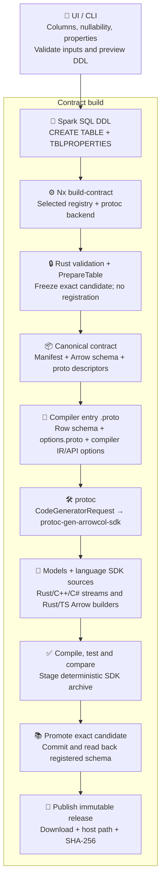
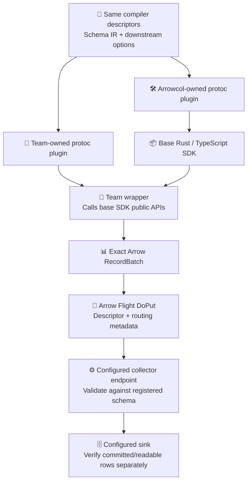

# Catalog-driven SDK generation

[Architecture index](README.md)

Spark SQL `.sql` DDL defines the table; the catalog owns immutable schema
versions and stable field identities. Generated SDKs use **Arrow Flight for
transport**. Protobuf is a schema contract, not an ingestion wire format.

| Catalog artifact | Contract |
| --- | --- |
| `manifest.json` | Canonical schema, identities, version, Arrow logical details and fingerprint |
| `schema.arrow` | Exact Arrow IPC schema; no row data |
| `descriptor.pb` | Proto2 `FileDescriptorSet` |
| `schema.proto` | Real source reconstructed deterministically from the persisted descriptor |
| `options.proto` and `google/protobuf/descriptor.proto` | Imported custom option vocabulary and complete dependency sources |

All scalar protobuf fields are optional, including SQL `NOT NULL` columns.
SQL/Arrow nullability remains authoritative for ingestion. Timestamp contract
values are `int64` UTC microseconds; decimals are base-10 strings. Collections
use repeated/message fields. Field numbers survive version changes and catalog
restart, are never reused, and skip the protobuf-reserved range 19000-19999.

| Generated surface | Responsibility |
| --- | --- |
| `models/{rust,cpp,csharp}` | Ordinary protobuf types plus the exact embedded contract; no Arrowcol SDK dependency |
| `runtime/` language SDK projects | Schema-independent `ArrowcolStream<Event>` binds a loaded contract and validates/converts messages at runtime |
| Rust `src/proto.rs` | Prost-generated contract types, alongside Arrow row builders |
| Rust and TypeScript row/builders | Construct the exact registered Arrow layout |
| Flight descriptor, fingerprint and routing helpers | Configure transport and send through Dataflow |
| `sdk-manifest.json` | Hashes of artifacts and generated files; package/version identity |

For the flat-scalar stream API, applications reference a language SDK and a
separate language models package. The neutral contract is independently available
to non-Arrowcol consumers. C++/C# share one native library across schemas. See the
[developer guide](sdk-developer-guide.md) for exact project references and limits.

The complete developer bundle also contains table-specific helpers such as
`ArrowcolEventsContract` and `ArrowcolEventsStream` in its `rust/`, `cpp/`,
`csharp/` and `native/` trees. `sdk-manifest.json` identifies the package roots
and capabilities.

Generation cross-checks source, descriptor, Arrow schema and normalized manifest.
Unsupported/lossy types, identifier collisions, stale output, symlinks and unsafe
paths fail explicitly. `check` is read-only and requires byte-exact output.
Generated roots must remain under gitignored `.temp` or `target`; archive
historical clients before cleanup.

## Commands

Run inside the repository devcontainer.

```bash
cargo run --locked -p arrowcol-sdk-gen -- generate \
  --catalog-endpoint http://127.0.0.1:8817 \
  --ddl schemas/events.sql --table telemetry.prod.events \
  --out .temp/sdk/events --export-artifacts .temp/catalog/events
```

`--ddl` is repeatable and ordered; each regular `.sql` file is one Spark DDL
statement. The command connects to the running catalog, executes Flight SQL,
then validates the catalog's committed history and artifacts. `--version 1`
selects a historical contract without changing it to the current head.
Use `--artifacts` for offline generation from validated exports.

| Command | Expected result |
| --- | --- |
| `npx --no-install nx run arrowcol-sdk-gen:generate` | Separate v1/v2 artifacts and Rust/TS SDKs |
| `npx --no-install nx run arrowcol-sdk-gen:check` | Deterministic generated output matches |
| `npx --no-install nx run arrowcol-sdk-gen:compatibility` | Catalog nullable-tail checks and real Buf `WIRE_JSON` both pass |
| `npx --no-install nx run arrowcol-sdk-gen:generated-test` | Generated Rust/Prost and TypeScript packages compile and execute |
| `npx --no-install nx run arrowcol-sdk-gen:package-artifact` | Deterministic SDK archive |

Offline fixtures materialize CREATE followed by ALTER into distinct immutable versions;
v1 output is not regenerated as v2. CI compares their separate `descriptor.pb`
descriptor sets (including imported options) using the pinned npm Buf CLI and root `buf.yaml`. Rust compatibility checks
remain stricter than protobuf: existing Arrow fields and partition roles cannot
change, and additions must be nullable trailing columns.

## Evolution and limits

A historical SDK continues to send its exact registered old Arrow layout.
The collector reuses existing arrays and null-fills only new trailing fields.
Protobuf optionality does not weaken that validation.

See the [generator CLI guide](../../../crates/arrowcol-sdk-gen/README.md) for
artifact-based export, packaging and safety details.

## Registration-last contract workflow

`arrowcol-sdk-gen:catalog-ui` is a local developer tool.
Its `/`, `/fabric` and `/lakehouse` frontends share the workflow API, persistent
authorities, runs and immutable releases. `/` defaults to direct generation;
`/fabric` and `/lakehouse` default to the protoc builder and allow a compiler
entry filename.
The primary form accepts catalogue/schema/table names, ordered columns, supported
types, nullability and table properties, then displays the generated DDL.
It serializes input only; the Rust parser and central property registry validate it.

| Phase | Durable result / invariant |
| --- | --- |
| Validate | Exactly one managed CREATE; reject ALTER, LOCATION, IF NOT EXISTS and invalid typed properties |
| Prepare | Read-only `PrepareTable` freezes table/field IDs, v1, complete schema, exact properties, comment, partitions and the selected authority's managed location |
| Export / validate protobuf (protoc only) | Export the compiler entry and options, then run descriptor-only `protoc` to resolve imports and validate protobuf; the plugin separately validates semantic IR/API binding |
| Generate | Direct backend and `protoc-gen-arrowcol-sdk` use the same Rust renderer |
| Verify | Canonical byte-exact check, Rust models compilation/tests and Rust/TypeScript Arrow builder checks; C++/C# and ingestion qualification happen separately |
| Stage | Neutral contract, independent language models/SDK source archives and complete developer bundle; individual digests in `packages.json`; not exposed before registration |
| Promote | `PromoteTable` validates the entire candidate under the catalogue DDL lock and commits through Delta optimistic transactions and reconciliation |
| Publish | Read-back equality of the complete committed v1 contract; create-only content-addressed archives, independent downloads and host paths |

Preparation is not a reservation and publishes no table/event. Conflicting
concurrent creation fails promotion; schema fingerprint equality alone is never
enough. The full candidate includes IDs and backend properties even though the
Arrow schema fingerprint deliberately does not hash mutable policy or DDL text.
Exact-candidate promotion is idempotent, including after a lost response/restart.
The catalogue assigns deterministic identities during preparation.
Preparation refuses a managed location with pre-existing Delta history.

Rebuilding uses an explicit committed table/version and never submits CREATE,
prepares a new candidate or promotes one. It generates and verifies against the
exported historical contract rather than a mutable head. Identical source,
authority and pinned artifacts yield identical archive bytes. A new generator or
changed policy version yields a distinct release digest; a different existing
file is never overwritten.

### Registry configuration and storage

First startup creates `.temp/contract-builder/config.json`.

| Field / path | Meaning |
| --- | --- |
| `registries[].id`, `label` | CLI selector and UI label; defaults `local`, `hosted` |
| `registries[].authority` | Persisted authority identity; distinct for each service, not a restart epoch |
| `registries[].endpoint` | Real Flight SQL/SchemaCatalog endpoint; defaults `http://127.0.0.1:18817` and `http://127.0.0.1:18818` |
| `registries[].mode` | `owned` starts an independent local service; `external` connects only, never provisions/stops it |
| `hostWorkspace` | Actual host checkout root for copyable paths; initialized from `CONTRACT_HOST_WORKSPACE` or the execution cwd |
| `registries/<authority-hash>/` | Independent persistent state, warehouse and service log |
| `registries/<authority-hash>/identity.key` | Local generated signing secret, retained across restarts; never served to the browser or packaged |
| `runs/<UUID>/` | Request, state, Nx/build logs, candidate, staged archive and payload |
| `releases/<authority-hash>/<table-UUID>/vN/<SHA-256>/contract-sdk.tar.gz` | Immutable completed SDK + schema contract |
| Same release directory: `contract.tar.gz`, `models-*.tar.gz`, `sdk-*.tar.gz` | Independently consumable neutral bundle, language models and reusable SDK sources; each has its own digest |

Stop the UI before editing configuration. An external endpoint must implement
the candidate RPCs for new tables; no fallback to registration-first is allowed.
Configure its actual stable authority identity, not an arbitrary new identity on
every restart. Endpoint configuration is not cloud deployment. An external Arrowcol service can
use a mounted `ARROWCOL_CATALOG_DDL_IDENTITY_SECRET_FILE`. Configure credentials
on the execution host; the UI does not forward credentials or provision services.
The workflow refuses a registry change between queueing and execution/promotion.

The UI binds to `127.0.0.1:4173` by default. `CONTRACT_UI_PORT` changes the port;
`CONTRACT_UI_BIND=0.0.0.0` is for an isolated devcontainer with a private forwarded
port only, never a public deployment. The backend checks local Host/Origin,
requires a session token and JSON for mutations, and exposes only structured
workflow requests, not shell commands. It refuses to adopt a process already
listening on an owned registry port. Shutdown drains admitted builds before
terminating only the registry children it started.
Owned loopback demo registries use the upstream signed-identity mode, with an
independently generated key for each authority. The backend, Nx bridge and local
collector use that authority's key file; the SDK and browser do not receive it.
Snapshot property maps have deterministic protobuf ordering so a signed
promotion remains valid after decode/re-encode, while modified values fail
authentication. Read-only rebuilds call `GetTable` directly, never the DDL
hydration path.

### Fabric-style frontends

`/fabric` provides a catalogue grid and table detail drawer. `/lakehouse` provides
a nested catalogue/schema/table tree with an inline table pane. Both display
local metadata; they are independent of Microsoft Fabric services.

| Surface | Local behavior |
| --- | --- |
| Workspaces / database filter | Views over logical catalogue/schema namespaces, not actual Fabric workspaces |
| Catalogue connection | Independent source of truth used by Nx; not an SDK or compiler variant |
| Inspect connections | Read-only Rust and native Unity/Hive metadata inspection, including foreign native tables without importing them |
| Table overview | Columns, properties, identity, version/fingerprint and committed-version rebuild |
| New table | Ordered schema editor, compiled property defaults, DDL preview and configured protoc entry |
| Workflow runs | Clickable live top-down pipeline, step attempts/timings and DDL/proto/log inspection, immutable download and actual host path |
| Favorites | Browser-local, scoped by catalogue connection |
| Govern, Secure, Copilot | Explicitly disabled; no implied connection or enforcement |

Schema, Properties and SDK contract tabs display committed local metadata.
New table, Build packages and Workflow runs share the backend and compiler
workflow. Catalogue selection includes Unity/Hive build authorities after
[`enable-build`](catalog.md#optional-local-unity-catalog-and-hive-services);
unconfigured native entries remain inspection-only. Native builds support new
flat, unpartitioned immutable v1 contracts and exact rebuilds; the separate native
registration receipt never changes the already verified SDK archive.
The surrounding Learn, Real-Time, Apps and other rail controls
are visual-only; OneLake catalog links to the working `/fabric` surface.
The table overview links back into Explorer using explicit registry/table query
parameters, which preserve the selected table on reload.

`arrowcol-sdk-gen:catalog-ui-e2e:lakehouse` covers metadata tabs,
tree search/collapse, non-interactive surrounding navigation, responsive layout
and the real protoc build/rebuild/download journey.

`arrowcol-sdk-gen:catalog-ui-e2e:fabric` exercises actual form submission,
protoc execution, registry isolation, reload/favorites, rebuild identity,
download bytes and descriptor properties.
`arrowcol-sdk-gen:catalog-ui-e2e` exercises the direct-default journey.

### Failure and recovery

Runs persist queued/running/succeeded/failed state, phase, registration outcome,
timestamps, logs and release references across page reloads and server restarts.
Click a run title/card in any frontend to open its top-down live pipeline.
Run traces record per-step start/end timestamps and failed/resumed attempts.
The panel follows the active step, or lets you select a stage and inspect the
submitted DDL, row/options/compiler proto, manifests, provenance or live log tail.
The selected run survives reload through `#run=RUN_UUID`. Direct builds explicitly
skip protoc-only stages; rebuilds skip registration. Missing trace data is
displayed as **not recorded**.
Document inspection is read-only and allowlisted, rejects symlinks, and returns
at most 128 KiB per document; it cannot read arbitrary workspace files or keys.
Pre-promotion validation/generation/test failures leave the authoritative
catalogue unchanged. A promotion transport error is recorded as **unknown**, not
incorrectly declared unregistered. Publication failure after acknowledgement is
**registered but not published**; verified staged bytes remain available.

Inspect the run and catalogue, then explicitly retry only finalization:

```bash
npx --no-install nx run arrowcol-sdk-gen:build-contract --resume-run=RUN_UUID
```

This checks retained archive/candidate digests and promotes the exact candidate,
not replayed DDL, before create-only publication. Interrupted processes are never
automatically replayed. A damaged/active claim or server lock requires operator
inspection, not blind deletion. Existing failed pre-promotion runs can be replaced
with a corrected new request because they have not registered the table.

The release records authority, endpoint, table ID, schema version/fingerprint,
backend policy metadata and generator/workflow/dependency-lock digests.
`backendPolicy` records descriptive metadata. Runtime policy enforcement is the
responsibility of the consuming service.

### Portable options and native defaults

The versioned [proto2 options definition](../../../crates/arrowcol-catalog/proto/options.proto)
is the authoritative extensible-property vocabulary. Rust compiles it and reads
the descriptor's optional labels, enum values and native declared defaults.
Neither the browser nor CLI maintains a second list of values/defaults.

| Surface | Convention |
| --- | --- |
| DDL key | `protobuf.` followed by the fully qualified custom option extension name |
| Demonstration | `protobuf.arrowcol.metadata.v1.ingest_tier` |
| Default | The declaration's native `[default = ...]`; materialized before candidate freezing |
| Unknown `protobuf.*` key or invalid enum | Reject; do not silently preserve it as an operational flag |
| Existing `arrowcol.*` / Delta keys | Continue using the central typed property registry |
| Other vendor metadata | Preserve verbatim in portable table metadata; inert unless a consumer understands it |
| Definition identity | SHA-256 of the complete compiled definitions descriptor set, including dependencies |

The optional-property dropdown comes from those descriptors, shows the declared
default and provides enum choices. The preview includes effective defaults;
explicit selections override them. The ingest-tier example is **metadata only**:
it does not implement routing tiers, retention, gRPC parameters or policy enforcement.

Preparation materializes defaults into canonical DDL and exact table metadata.
The form submits its definitions digest; a changed vocabulary is rejected before
preparation. Candidate descriptors, run state and release provenance freeze the
definitions. Finalization refuses different definitions rather than silently
reinterpreting a candidate. Restart the owned services after editing the options
definition; mixed server/generator versions fail artifact equality checks.

Generated `schema.proto` imports `options.proto` and carries selected values as
custom options. All dependency sources and the complete compiled `descriptor.pb`
are shipped in the contract and SDK descriptors. This is portable metadata, not
a JSON-only manifest feature. Inspect it without the JSON manifest:

```bash
cargo run --locked --quiet -p arrowcol-sdk-gen -- catalog metadata \
  --descriptor .temp/exported-contract/descriptor.pb
```

`catalog properties` (or the `contract-properties` Nx target) lists the compiled
vocabulary/defaults. Buf compatibility consumes `descriptor.pb#format=binpb`,
not an isolated source file lacking imports. Tests compile exported sources with
protoc/Buf and compare descriptor bytes, including native defaults and overrides.

## Optional protoc backend

The `/` frontend and `arrowcol-sdk-gen:build-contract` default to direct generation.
`arrowcol-protoc:build-contract` explicitly selects `codegen=protoc`; it builds
the exporter, plugin and normal catalogue bridge without restarting services.
Both backends share validation, SDK tests, staging, promotion and publication.
Use `--schema-version` for historical builds through Nx, whose own `--version`
flag is not forwarded.

| Compiler input | Contract |
| --- | --- |
| `--proto-entry=telemetry.proto` | Configurable basename, default `schema.proto`; traversal and reserved import names are rejected |
| `payload/compiler/` | Separate import root, bundled with the release; canonical `payload/contract/` is unchanged |
| `options.proto` | Native defaults, selected values and portable table properties |
| `arrowcol_codegen.proto` | Versioned compiler envelope and typed Arrowcol API binding |
| `compiler.catalog_manifest_json` | Canonical `artifact_manifest_version=1` catalogue IR, embedded as bytes in a protobuf option |
| `compiler.api` | Arrow Flight DoPut operation/path, descriptor path and resolved routing metadata |

The compiler descriptor embeds the versioned JSON catalogue IR.
It preserves nullability, IDs, physical types, decimals, timezones and collection
details that cannot be recovered from protobuf row primitives alone. A consumer
only needs the exported compiler sources/imports and compatible plugin binaries.

The plugin reconstructs the validated `ArtifactBundle` and compares its canonical
row, property and dependency descriptors with the request, ignoring only source
locations and the extra compiler envelope. Changes to rows, option defaults, IR
or unsupported API mappings fail closed. Unknown plugin parameters, duplicate
files and multiple selected table files are rejected.
Descriptor decoding preserves custom-option bytes. Both backends use the same
SDK renderer.

`CodeGeneratorResponse` returns UTF-8 sources. Nx copies the original binary
`schema.arrow` and `descriptor.pb` into the SDK, then checks the entire SDK against
direct generation byte-for-byte. The release includes the compiler sources and
exporter/plugin/driver hashes plus the protoc version. Toolchain changes during
generation fail before promotion. Compiler inputs and provenance are part of
the release digest.

### Supported APIs and extension ownership

| API | Surface |
| --- | --- |
| Construct Arrow batches | Rust `record_batch`; TypeScript `recordBatch` |
| Build routing metadata | Rust `routing_metadata`; TypeScript `routingMetadata` |
| Identify table/version | Rust `flight_descriptor`; TypeScript `createDoPutPlan().descriptorPath` |
| Write telemetry | Rust `do_put`, plus streaming encoder/decorator helpers; TypeScript `createDoPutPlan` supplies a plan to a transport adapter |
| Catalogue control plane | `GetTable`, `GetSnapshot`, events/Watch, `PrepareTable` and `PromoteTable`; not data-plane write methods |

The supported write binding is `/arrow.flight.protocol.FlightService/DoPut`.
Its metadata keys are `x-arrowcol-protocol-version`,
`x-arrowcol-implementation-pool`, `x-arrowcol-catalog`, `x-arrowcol-schema`,
`x-arrowcol-table`, and `x-arrowcol-schema-fingerprint`. The implementation pool
supports `dataflow`. The plugin rejects unsupported bindings.
Portable ingest-tier metadata is not forwarded as a transport header.

Run a second trusted plugin against the same descriptors to generate wrappers
around the SDK. It does not need to implement Arrowcol request construction.
For example, after exporting a compiler contract and creating an output directory:

```bash
protoc -I .temp/compiler telemetry.proto \
  --plugin=protoc-gen-arrowcol-sdk=target/debug/protoc-gen-arrowcol-sdk \
  --plugin=protoc-gen-team=target/debug/protoc-gen-arrowcol-example \
  --arrowcol-sdk_out=.temp/extended-sdk \
  --team_out=.temp/extended-sdk
```

Both plugins receive the input schema independently; one plugin's output is not
automatically the next plugin's input. The example creates
`typescript/team.ts`, calling `recordBatch` and `createDoPutPlan`.
It composes with the generated SDK without insertion points. This standalone
command emits text, not a fully packaged canonical SDK: binary-copy and manifest
assembly remain Nx responsibilities. Extra team-generated files also require
their own validation/package step rather than bypassing the core SDK's exact
file-set check. The live `arrowcol-protoc:e2e` target typechecks and executes this
wrapper separately from the immutable base release.

Plugin binaries are executable build tools, not untrusted UI parameters.
Nx uses fixed repository-owned plugin paths and compiled, digest-pinned option
definitions. It does not accept arbitrary plugin executables or option files.

## Design: schema authoring to a protoc-built SDK

The workflow separates authoring, build-time contract validation, registration
and runtime ingestion. UI frontends submit structured requests; the catalogue
and compiler own schema validation.

### End-to-end compilation



The UI persists authored DDL as `runs/<run-id>/definition.sql` in the local build
store. CLI callers supply a `.sql` file. Version-control those definitions through
your repository workflow; contract builds do not commit source files.

| Step | Input and implementation | Output and invariant |
| --- | --- | --- |
| Author | UI form or CLI definition; compiled property vocabulary supplies native defaults | Escaped DDL preview; ordered columns remain ordered; client validation is not authoritative |
| Admit build | Local backend enqueues a structured request; `contract.ts` executes the Nx workflow | Durable run ID, selected authority and explicit backend; no arbitrary-shell endpoint |
| Validate | `arrowcol-sdk-gen catalog validate` invokes Rust parsing/property validation | Exactly one supported managed CREATE; invalid or stale definitions fail before preparation |
| Freeze | Catalogue `PrepareTable` returns a candidate; no table, event or Delta log is created | Table UUID, v1, stable field/protobuf IDs, Arrow types/nullability, location and complete properties |
| Export canonical artifacts | Catalogue artifact code derives manifest, Arrow IPC schema, row proto and descriptors | Lossless canonical model and complete imports; schema fingerprint excludes mutable policy and DDL spelling |
| Export compiler input | `arrowcol-protoc --artifacts … --out … --entry telemetry.proto` | Separate compiler sources containing native property options plus the versioned compiler envelope |
| Invoke compiler | `protoc --arrowcol-sdk_out=…` resolves the explicitly pinned `protoc-gen-arrowcol-sdk` executable | Standard protobuf compiler request on stdin and response on stdout; no catalogue/network lookup inside the plugin |
| Interpret contract | Plugin reads extension-preserving descriptors, restores `ArtifactBundle` and compares row/options/dependencies/API binding | Changed or unsupported inputs fail; no silent inference of Arrow semantics from protobuf primitives |
| Render SDK | Plugin calls shared `render_sdk_files` | Models and SDK sources identical to the direct renderer; binary Arrow/descriptor files are copied separately by Nx |
| Verify and stage | Canonical checker, TypeScript checks/tests, Rust models/builder tests and deterministic packager | Independent package digests and pinned toolchain provenance; SDK failure leaves the registry unchanged |
| Register and publish | `PromoteTable` checks the exact candidate, commits and verifies read-back; Nx publishes create-only | Immutable release tied to authority, table ID, schema version/fingerprint and release SHA-256 |

### What the compiler options actually mean

`options.proto` defines **contracts with downstream components**: portable table
properties, native defaults and selected values. The plugin-specific
`arrowcol_codegen.proto` adds an explicit API binding, not executable code.
Its `CompilerContract` contains:

| Field | Role |
| --- | --- |
| `format_version` | Version of the compiler-envelope protocol |
| `catalog_manifest_json` | Canonical, lossless versioned IR embedded inside the protobuf descriptor |
| `option_definitions_sha256` | Pins the complete compiled property vocabulary |
| `api.operation` / `api.grpc_path` | Supported operation and `/arrow.flight.protocol.FlightService/DoPut` |
| `api.descriptor_path` | Catalog, schema, table and `v<version>` |
| `api.metadata` | Resolved protocol, implementation-pool, namespace and fingerprint headers |

The embedded IR preserves details that row `.proto` primitives cannot encode:
Arrow nullability, decimal representation, timezones and stable identity.
The plugin checks the binding against the supported SDK implementation rather
than treating arbitrary strings as instructions to call arbitrary services.
Properties such as ingest tier are metadata unless a runtime
binding consumes them; gateway-policy/tier enforcement is not implied.

### Extension and runtime boundaries



Both plugins read the same input descriptors independently. Importing a proto
does not run a plugin. A plugin that emits another `.proto` for compilation needs
a second protoc invocation; the tested wrapper example needs only one invocation
and no insertion points. Extension files are validated separately from the
canonical base SDK's exact file-set check.

Rust exposes an actual `do_put` client path plus batch/stream/request helpers.
TypeScript's `createDoPutPlan` supplies a batch, descriptor and headers to a
transport adapter; it is not itself a network sender. Collector validation and
downstream visibility require their own end-to-end proof. A successful build,
registered table or admitted Flight stream alone does not demonstrate that rows
have reached a durable sink.

### Registry adapter boundary

The selected catalogue is the **source of truth used by the Nx workflow**, not
a compiler backend, SDK variant or runtime SDK dependency. Rust Catalogue,
Unity Catalog and Hive are independent authorities, not replicas that must all
register a table. Nx adapters obtain or validate the canonical schema contract
against the selected authority; the compiler consumes the frozen neutral contract.
The application selects an on-node or endpoint Arrowcol destination independently.
The generated SDK does not query any registry.
Arrowcol itself uses its deployment-configured catalogue for schema lookup and
admission. Callers do not pass a catalogue service/connection as an SDK argument
or per-ingestion request setting. The logical catalogue name in the table identity
and routing metadata is a namespace, not a registry URL or connection configuration.

Local and hosted simulation are two independent Rust catalogues. Native Unity
Catalog and Hive use workflow adapters for REST and Thrift, respectively, and
a CES bridge for Arrowcol schema lookup. For new tables the authored schema is a proposal until
registration; adapters must preserve read-only preparation, retained canonical
contract history and exact-candidate registration checks. External native identity
belongs in a post-registration receipt, not a rewrite of the verified SDK. See the
[native services and registry adapter design](catalog.md#optional-local-unity-catalog-and-hive-services)
for persistence, registration recovery and capability limitations.

#### Catalogue metadata versus SDK versioning

Native catalogue schemas should not require Arrowcol-specific `version`,
`field_number` or `contract_uri` properties. Table/column properties can carry
optional namespaced documentation and downstream options, just as DDL
`TBLPROPERTIES` does today. Namespacing optional extension keys does not make
them prerequisites for representing an ordinary table.

Protobuf field numbers are stable message-field identifiers, not column-order
instructions. Under the strict nullable-tail-append policy, the compiler
can derive them deterministically from the original sibling ordinal, skipping
protobuf's reserved range. Once published, the previous descriptor is the
compatibility baseline: numbers cannot be reused or reassigned. Native reorder,
drop, rename or type changes must fail compatibility checks, rather than silently
generating a different mapping.

SDK package versions are declared in their language project manifests.
Models packages use `<schema-version>.0.0`; their contract records the schema
fingerprint. DDL spelling is not identity. Immutable schema/descriptor snapshots
and native registration receipts are stored with release artifacts.

The current collector also uses internal schema versions in Flight descriptor
paths (`vN`). An adapter must resolve those published contracts or change runtime
lookup explicitly; SDK SemVer alone cannot replace that lookup. Existing fields
remain unchanged and new fields must be nullable tail additions. In particular,
making a newly nullable field required would reject older producers that omit it.
This keeps schema identity, SDK release version and optional runtime policy
metadata distinct without requiring reserved catalogue properties.

### Source map and acceptance

| Responsibility | Source |
| --- | --- |
| Form and DDL preview | `tools/libs/arrowcol-sdk-gen/ui/app.ts` |
| HTTP API and Nx dispatch | `tools/libs/arrowcol-sdk-gen/src/catalog-server.ts` |
| Build state machine | `tools/libs/arrowcol-sdk-gen/src/contract.ts` |
| Protoc orchestration | `tools/libs/arrowcol-sdk-gen/src/protoc.ts` |
| Compiler contract and plugin | `crates/arrowcol-protoc/proto/arrowcol_codegen.proto`, `crates/arrowcol-protoc/src/lib.rs` |
| Shared SDK renderer | `crates/arrowcol-sdk-gen/src/generate.rs`, `src/render/` |
| Real plugin-composition proof | `crates/arrowcol-protoc/tests/plugin.rs`, `tools/libs/arrowcol-sdk-gen/test/protoc-backend.e2e.ts` |
| Separate Fabric-style layout | `tools/libs/arrowcol-sdk-gen/fabric-ui/` |
| Generated SDK to committed Delta proof | `tools/libs/arrowcol-sdk-gen/test/collector-contract.e2e.ts` |

Acceptance requires actual UI submission, protoc execution, generated SDK checks,
registration-last failure cases, correct downloadable archive/hash and persistent
history after restart. A runtime extension of that demonstration additionally
requires sending known rows through the selected collector topology and reading
them from the configured sink, with admission distinguished from durable delivery.

### Collector integration

The collector supports a remote
catalogue/cache, standalone or SQL routing, Arrow Flight admission, Delta export
and optional Quiver durable admission. Production ingestion-layout metadata
remains separate from the SDK's logical schema.

The local runtime proof consumes a successful fresh protoc UI run, starts one
loopback endpoint Arrowcol with that run's catalogue configured on the collector,
calls the generated Rust `do_put` with three strongly typed rows, and reads only
Parquet files referenced by committed Delta Add actions. It compares all row
values, timestamp units and nulls; Flight completion alone is not success.
The SDK sender receives only the Arrowcol endpoint, not a catalogue argument.
The proof keeps its rows/evidence and refuses a nonempty or external table.
It shuts down only its own collector and does not replay CREATE.

The three-row test covers **SDK -> regional Arrowcol -> Delta**.
The [localhost demo](localhost-demo.md) uses `registration: shared_catalog` for
optional node-to-regional forwarding and queries committed Delta data through
a Kusto external table. Its end-to-end test checks Rust/C++/C# applications on
both direct and node paths. The exporter does not send DDL in shared-authority mode.

Unity/Hive builds and runtime lookups use the enabled native CES bridge, which
validates native identity and metadata. Their REST/Thrift endpoints still cannot
be substituted directly for an Arrowcol `SchemaCatalog` RPC endpoint.
The [developer guide](sdk-developer-guide.md) covers protobuf models, language
SDK dependencies and the stream API.
