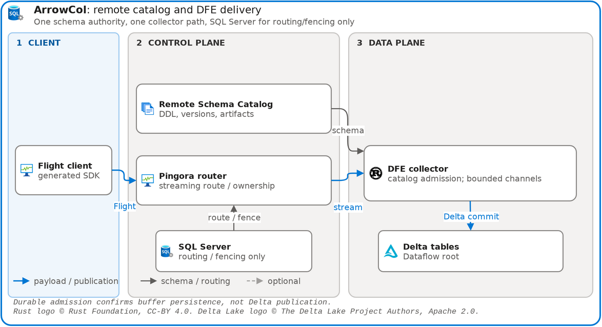

# ArrowCol lakehouse loadtest

[](../arrowcol-platform/diagrams/platform.drawio)

The [platform diagram](../arrowcol-platform/diagrams/platform.drawio) shows the current DFE-only collection path. This guide covers the complete workload, including catalog registration, independent validation, maintenance, and downstream query semantics. Draw.io sources and rendered PNGs are kept together; the [snapshot registry](../snapshots.json) records their renderer and SHA-256 digests.

## Generated workload and publication

The generator registers 13 table schemas through Flight SQL, exports immutable
catalog artifacts, generates Rust and TypeScript SDKs, and constructs every
`RecordBatch` from the generated schema. Every schema includes explicit
`customer_id`; deterministic interleaved customers exercise tenant predicates
and sorted Parquet row groups.

The workload sends generated Arrow batches through the Pingora router to the
DFE-only Dataflow pool. SQL Server retains only routing registrations, pressure,
and fenced leases; catalog registration uses the standalone CatalogService.

| Boundary | Meaning |
| --- | --- |
| Default Flight completion | Best-effort admission; not buffer durability or Delta publication |
| Native Quiver durable admission | Buffer persistence with WAL fsync before acknowledgement in the loadtest's zero-flush-interval configuration |
| Delta publication | Independently observed committed snapshot and validated rows |
| Client delivery receipts | No durable delivery receipt IDs, polling, or client receipt/purge API |
| Operational custody receipts | Reset, stop, provider custody, publisher-release, and validation evidence remain distinct |

DFE durable admission proves buffer persistence, not Delta publication. Replay
does not deduplicate independent client submissions. See
[Quiver durability and recovery](../../quiver/README.md) for the retained
WAL/subscriber boundaries and loss conditions.

Delta Kernel publication writes data before atomically publishing the log.
Stable publication transaction identity protects the retry of that publication,
not two separate requests with identical content. Ingestion-time UTC partition
stamps survive retry and Quiver replay; loadtests use minute partitions.

## Modes and downstream semantics

`--mode local|azure` selects the storage and Kusto pair together; the default
comes from `ARROWCOL_MODE`, falling back to `local`.

| Surface | Local mode | Azure mode |
| --- | --- | --- |
| Source Delta | Local disk, DFE Delta root | ADLS Gen2, DFE Delta root |
| Kusto | Pinned emulator: native external Delta with Query Acceleration Policy | External Delta tables with native Query Acceleration Policy |
| Storage identity | Scoped local mounts | Existing Azure CLI writer identity; dedicated Kusto storage-read UAMI |
| Evidence | Functional integration, active-file visibility, recovery | Real QAP state, capacity, lag, correctness, and reacceleration |

The emulator is a functional integration surface, not an Azure performance
benchmark. Native external Delta/QAP is the default. The local policy uses
`MaxAge=1min`, with a bounded five-minute convergence gate after append, OPTIMIZE, delete, partition PURGE,
and VACUUM. Longer `MaxAge` can retain stale cached rows.
The local emulator's acceleration worker pool is pinned to 16, independent of
host cores, so cache convergence after final compaction does not depend on
the runner size.

Cache statistics alone do not establish freshness: a reported 100% acceleration,
zero pending files, and recent update time can coexist with stale query results.
Require current `TableVersion`, healthy `IsHealthy`, and expected
`AcceleratedRowCount` from `QueryAccelerationState`, plus actual cached
row-multiset equality with both the
independent oracle and MaxAge-overridden query. Record observed convergence separately
from the bounded deadline; focused native-probe acceptance does not prove the
integrated 13-schema workload or Explorer/stress acceptance.

The exact corpus is packed into disjoint whole-partition chunks: at most 256
distinct complete rows per chunk and 65,536 per captured table. A single
oversized partition, an unsupported partition shape, or a changing capture
fails explicitly; the oracle never samples or truncates rows to pass. Exact
partition and total counts include duplicate multiplicities and reject
unexpected rows. The cached phase has one global five-minute deadline across
all tables and chunks; fallback validation is a separate phase. The focused
all-13 native type harness uses sequential per-table waits, so its completion
time is not proof of that production global budget.

Native Kusto follows the current active snapshot after asynchronous refresh,
including OPTIMIZE replacements and partition removals. A tenant fork has
intentionally different semantics: capture a snapshot, tail logical appends,
ignore OPTIMIZE, and retain already-copied rows after source purge.

Standalone maintenance plans and revalidates work before applying it. OPTIMIZE
rewrites real files with `dataChange=false`; PURGE removes existing expired
partitions; VACUUM LITE uses retained tombstones and keeps the ordinary seven-day
safety floor. Physical retention bounds recovery: missing required source history
or files must fail visibly rather than advancing a consumer checkpoint.
Kernel checkpoints preserve active state and publication/query transaction IDs.
Optional log pruning additionally requires a proven checkpoint, durable vacuum
progress, eligible retained history and a durable floor; it does not make
expired source history available to a lagging consumer. No whole-storage byte
plateau follows merely from configuring checkpoint cadence.

Azure mutators capture `ARROWCOL_RESET_GENERATION` before leased publisher
admission and owned data, log or checkpoint I/O. Original WAL generations remain bound across restart;
the tenant sink and checkpoint share one process session. Explicit close follows
drain, and uncertain physical outcomes retain their blocking registration.
Bootstrap has its separate `ARROWCOL_EXPECTED_RESET_GENERATION` precondition.

## Operations and qualification

Use the [loadtest CLI guide](../../../projects/loadtest/README.md) as the
canonical source for current commands, flags, prerequisites, lifecycle,
diagnostics, and evidence locations. Keeping operational examples there avoids
the obsolete duplicated CLI that previously lived in this architecture guide.

Run the repository checks inside the Linux devcontainer:

```bash
npx nx run rust:verify
npx nx run loadtest:verify
npx nx run-many -t verify --all --parallel=1
npx nx run hello-world:image-smoke
```

Qualification checks the DFE pool across all schemas with an independent Delta
reader, committed snapshot-selected files, manifest hashes, row multisets,
partition metadata, routing ownership, and recovery evidence. The delta-rs
reader is a validation oracle, not the production transaction writer.

Metrics, logs, and traces feed LGTM/Grafana. Maintenance, stream/checkpoint, native QAP,
and publication signals must be observed live, not inferred from dashboard JSON.
Keep the optional OTEL baseline separate from Arrow Flight panels.
The lifecycle drains publications while admin endpoints are alive, captures
actual panel query ranges, returned frames and screenshots, then cleanly stops
the source, tenant and maintenance mutators before immutable Delta/native
validation. Kusto, LGTM and Explorer remain available. Run- and
generation-bound receipts are evidence, not proof that an unknown operation
has completed. The source-SDK baseline scope is distinct from full-service
qualification of maintenance, tenant effects and native QAP.

Azure configuration remains in a gitignored private `.env`; do not commit
subscription/resource values or credentials into diagrams, screenshots, logs,
or public evidence. Cloud checks are explicit and credential-gated: a skipped
check is not a pass. Bind measurements to the integrated source SHA and record
limitations. Stop the Azure cluster after live tests. Reset is preview-first;
public execution remains unconditionally disabled until distributed publisher
admission, uncertain-operation retention, fencing, and definitive drain are
enforced across every mutator. The intended explicit-execution path removes only
verified owned data and preserves the account, containers, cluster, and managed
identity. Preview or offline control-plane tests do not establish live reset safety.

See [storage contracts](../arrowcol-platform/storage.md),
[delivery guarantees](../arrowcol-platform/delivery-guarantees.md), and
[observability](../arrowcol-platform/observability.md) for the corresponding
platform boundaries.
