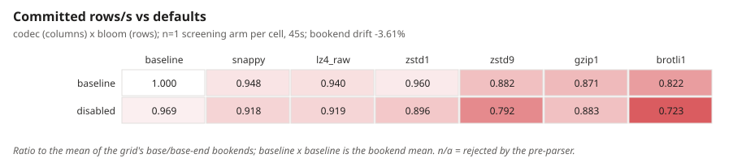
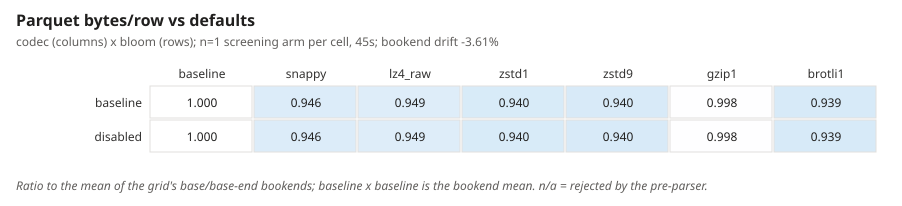
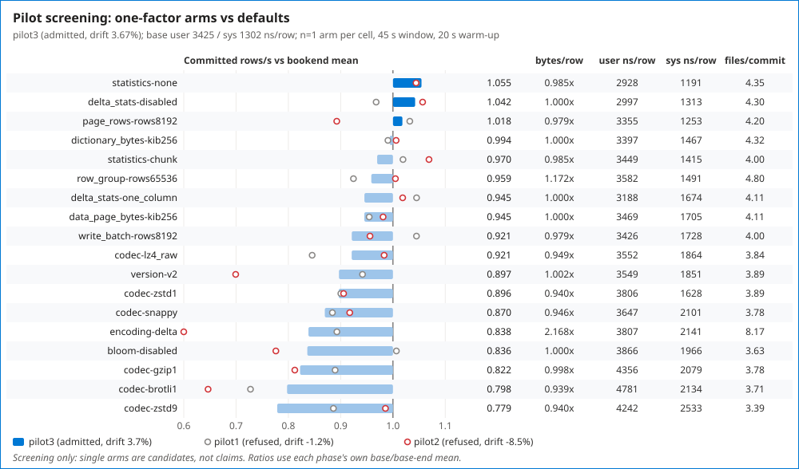
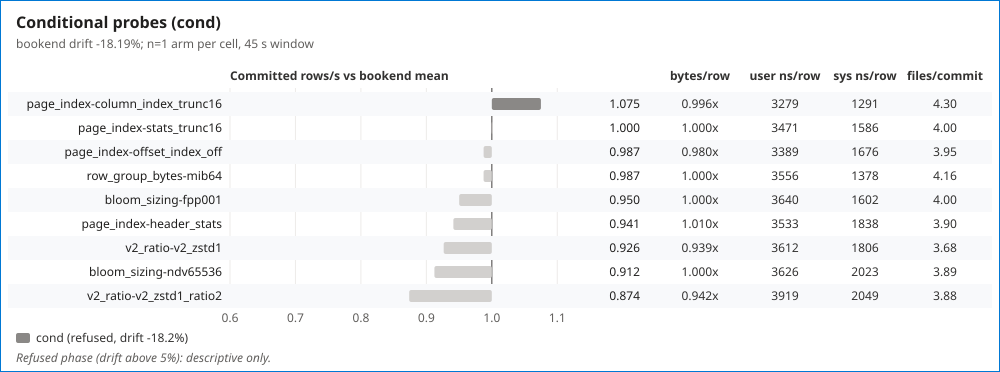
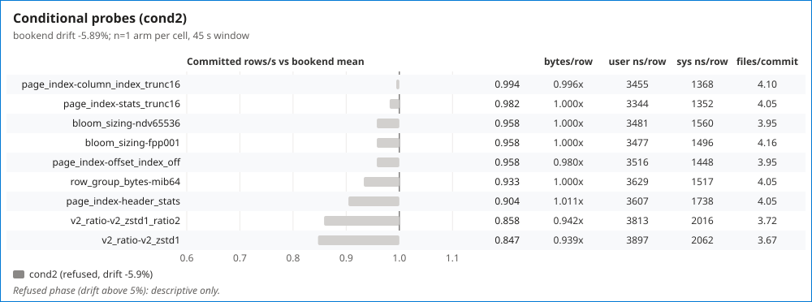

# Lane P: Parquet encoding and compression sweep

**Verdict: INCONCLUSIVE.** The pre-registered A/B/A was never run. Screening stopped under rule 3 because the conditional phase was refused on bookend drift in both of its allowed attempts (−18.19%, then −5.89%; the limit is 5%). Nothing on this page is a claim. Every ranking is screening evidence (n=1 per arm). Lane P changed no defaults and added no knobs.

Scope: one local ArrowCollector writing one Delta table on the local filesystem, measured on `dev/raki-windows-17`. Source `3259d8cd`, mimalloc, 45 s window after a 20 s warm-up. The collector was pinned to CPUs 0-11 (6 whole cores), the clients and catalog to 12-15 (2 cores). Kustainer was not started (`kustainer_rows: null`, collector-only experiment). In every arm, including the defaults, all 9 of 9 pressure samples reported `delta_state: degraded`, so the collector was saturated throughout.

## Heatmaps: codec × bloom filter (grid, admitted, drift −3.61%)

The kit chose this two-knob grid from the pilot. Values are ratios to the phase's bookend mean (base and base-end).

- No codec beat UNCOMPRESSED on rows/s. The cheapest was zstd level 1 (0.960×), then snappy (0.948×) and lz4_raw (0.940×). zstd 9, gzip 1 and brotli 1 cost 12–18%.
- Compression saves only about 5–6% (0.939–0.949× bytes/row). gzip 1 saves almost nothing (0.998×). The synthetic loadgen payload hardly compresses, so these bytes findings depend on the fixture.
- Disabling bloom filters does not change size (1.000×). Its rows/s effect is not reproducible: 1.007, 0.776 and 0.836 in the three pilots; 0.969 in the grid.

## One-factor screening (pilot3, admitted, drift +3.67%)

Circles mark the same arms in the two refused pilot attempts.

## Conditional probes (both attempts refused, descriptive only)

In cond2, no conditional arm beat the bookend mean. The best was column-index truncation at 16 bytes, at 0.994×. Its 1.075× in cond (1) was therefore likely a drift artefact.

## Gates

| Phase | Cells | Bookend drift | Admission |
| --- | --- | --- | --- |
| pilot (1) | 21 | −1.22% | Refused: the `encoding-no_dictionary` window overran (48.854 s against 45 s). This led to amendment A1. |
| pilot2 | 20 | −8.47% | Refused: drift. |
| pilot3 | 20 | +3.67% | **Admitted** as the screening pilot. |
| grid | 15 | −3.61% | **Admitted.** |
| cond (1) | 11 | −18.19% | Refused: drift. |
| cond2 | 11 | −5.89% | Refused: drift. This was the final attempt, so screening **stopped**. |
| room-default (1) | 3 | n/a | Superseded: it ran before cond2. Descriptive only. |
| selection, headroom, room-fast, registration | — | — | Not run (rule 3). |
| n=5 A/B/A | — | — | **Not run.** Its gates stay pre-registered and unchanged: geomean ≥1.05×, paired-log t ≥2.776 (df=4), bytes/row ≤1.10×, every A/A drift ≤5%. |

## Descriptive candidates (not claims)

| Goal | Arm | rows/s vs bookend mean | bytes/row | CPU ns/row (user / sys) | Evidence |
| --- | --- | --- | --- | --- | --- |
| Throughput | `statistics: none` | 1.045, 1.044, **1.055** | 0.985× (34.25 B) | 2,928 / 1,191 vs 3,425 / 1,303 | Consistent across all three pilots, but right at the 1.05 gate. It removes Parquet min/max statistics and page indexes for readers; Delta file statistics remain. |
| Throughput | `delta_stats: disabled` | 0.968, 1.057, 1.042 | 1.000× | 2,997 / 1,313 | Inconsistent. It also removes Delta data skipping. |
| Throughput | `data_page_row_count_limit: 8192` | 1.032, 0.893, 1.018 | 0.979× | 3,355 / 1,253 | Inconsistent. |
| Bytes | `compression: zstd(1)` | 0.900, 0.906, 0.896; grid 0.960 | **0.940×** (32.68 B) | 3,806 / 1,628 | Saves about 6% for a 4–10% throughput cost. |
| Bytes | `compression: brotli(1)` | 0.728, 0.647, 0.798; grid 0.822 | **0.939×** (32.63 B) | 4,781 / 2,134 | The smallest output, but it costs 18–35% throughput. |
| Avoid | `encoding: delta` fallback | 0.893, 0.568, 0.838 | 2.168× | 3,807 / 2,141 | Larger and slower. |

Pilot values are listed as pilot1, pilot2, pilot3; only pilot3 was admitted. No gain was multiplied with another.

## Tunables

[tunables.md](tunables.md) lists all 33 writer and Delta-statistics surfaces with their strict parse rules. Lane P added no knob. The coordinator's rule allows a new knob only for a measured gap, and screening stopped before any gap could be measured.

| Exposure at `3259d8cd` | Count | Surfaces |
| --- | --- | --- |
| existing | 18 | `compression`, `compression_level`, `encoding` (fallback), `dictionary_enabled`, `dictionary_page_size_limit`, `data_page_size_limit`, `data_page_row_count_limit`, `statistics`, `write_page_header_statistics`, `bloom_filter_enabled`/`_fpp`/`_ndv`, `data_page_v2_compression_ratio_threshold`, `writer_version`, `write_batch_size`, `offset_index_enabled`, `sorting_columns`, `delta_stats_columns` |
| existing with a limit | 4 | `max_row_group_rows` and `max_row_group_bytes`, `column_index_truncate_length`, `statistics_truncate_length`: none can explicitly request upstream `None` (unlimited) |
| partial | 1 | `delta.dataSkippingNumIndexedCols`: zero is expressible (`[]`), but a positive N or all columns (−1) is not |
| missing | 4 | `bloom_filter_position`, `coerce_types`, `content_defined_chunking`, `skip_arrow_metadata`; each needs round-trip or compatibility gating before it can be credited |
| metadata, unsupported or reader-side | 6 | `schema_root`, `with_parquet_schema`, `created_by`/key-value metadata, encryption, reader properties, and `RLE_DICTIONARY` as a fallback (not legal) |

| Screening status | Count |
| --- | --- |
| screened | 10 |
| screened_partial | 4 |
| conditional_probe | 8 |
| not_expressible | 4 |
| non_performance_or_unsupported | 7 |

## Why drift, and the recommended follow-up

- The harness keeps each arm's table, about 3 GB, on disk until the phase ends, as evidence. Within a phase the page cache grew. The `compact_stall` delta per cell rose about 3× (cond2: 7,292 to 20,283), and collector system CPU per row climbed to about 2,000 ns. This hypothesis is plausible but unproven.
- Recommendation (a coordinator decision; it changes the harness, which rule 5 forbids mid-screen):
  1. Amend the harness to delete each cell's Parquet after the footer audit.
  2. Rerun the conditional phase.
  3. Register an n=5 A/B/A of `ARROWCOL_PARQUET_CONFIG={"defaults":{"statistics":"none"}}` against defaults.

## Identity and provenance

| Item | Value |
| --- | --- |
| Source | `3259d8cd0fff5eeac77d77308898721cf696f7bd`, clean; otel-arrow submodule `19df11fa` |
| Build | mimalloc, LTO off, 16 codegen units, opt 3, `target_cpu=generic`; rustc 1.96.1; profile hash `af99694e1cc4827bef84056656c8ff5ace0dbd77186f086b57c252be6ae70124` |
| arrowcol-dataflow-rust | `fa48b5eccc520f9db307821507ce5646512461a0baacdaf29ee60aad3faf82a6` |
| arrowcol-dmv | `fd7b84cfa8fe0b39cb4320688daaf66c1d62208f54f88c21b3c5079f2954759f` |
| arrowcol-catalog-rust | `ca5a3f4d901f906415fef3f008f9a054982558e7869226210688775089157612` |
| delta-maintenance | `f145f4de703e9ebb96eb606c7f87d5315e9f14892071bf298cff43cf1b90359f` |
| arrowcol-loadgen (table initializer) | `4e8c22ff8d753629093d9062c599902d95bb036946e0635920a34501f6ece158` |
| Footer tool (parquet 58.4.0) | `6eda49432ec4f08a16ba1ca003883986e4d5d1e17fcafeb3a579f169c52e1be3` |
| Harness `score.ts` | `c8b69416e8f724791c46f7a8ea4385d681593c10ff7bef9a2a9f447bf094df15` |
| Fixture `base.yaml` (config) | `3beace90a22e64ba09b22b5cee4895cb8f9758c5433addace097a479e45316a6` |
| Host | AMD EPYC 7763, 16 logical CPUs (8 cores × 2 SMT, siblings 0-1 … 14-15), 61.8 GiB RAM, one NUMA node, no cgroup limits; Node v24.22.3 |

Each row also records footer-vs-Delta-Add reconciliation (`physical`), the effective startup config, and the binary hashes. Committed evidence:

- [screening-summary.csv](screening-summary.csv): one row per screening cell (101 rows), with ratios against the phase's bookend mean, user and system CPU ns/row, bytes/row, files per commit, commit count, pressure and degraded sample counts, the cell's `compact_stall` delta, and `kustainer_rows`.
- [heat.csv](heat.csv): the grid behind the heatmaps.
- [phase-log.md](phase-log.md): the pre-registered rerun rules and every attempt.
- [plans/](plans/): the executed grid and conditional plans, and `readiness.json` (Rust parser acceptance and effective-config readback for all 29 probe arms). The executed pilot, probe and headroom plans are `kit/screen-*.json`.
- [kit/](kit/): the executed kit, documented in [kit/KIT.md](kit/KIT.md). It includes amendment A1, the 33-row inventory and coverage map, and the offline tests. `lane-state.md` and `SHA256SUMS` stayed in the lane session, so they are not committed.
- [MANIFEST.sha256](MANIFEST.sha256): hashes of every committed file (`sha256sum -c MANIFEST.sha256`). The kit ran with CRLF line endings; the committed copies are LF-normalized, and committed Markdown table delimiter rows are reformatted to the repository's markdownlint style.
- [session-artifacts.sha256](session-artifacts.sha256): hashes of the exact as-run lane-session bytes. These are the CRLF kit files, the raw `results.jsonl` files and the job logs, about 9 MB in total, which are not committed.
