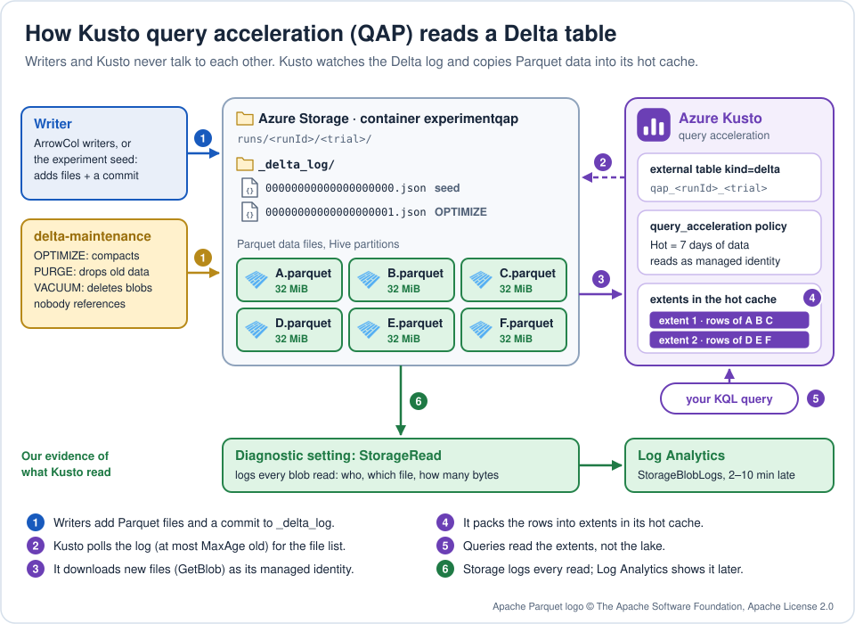
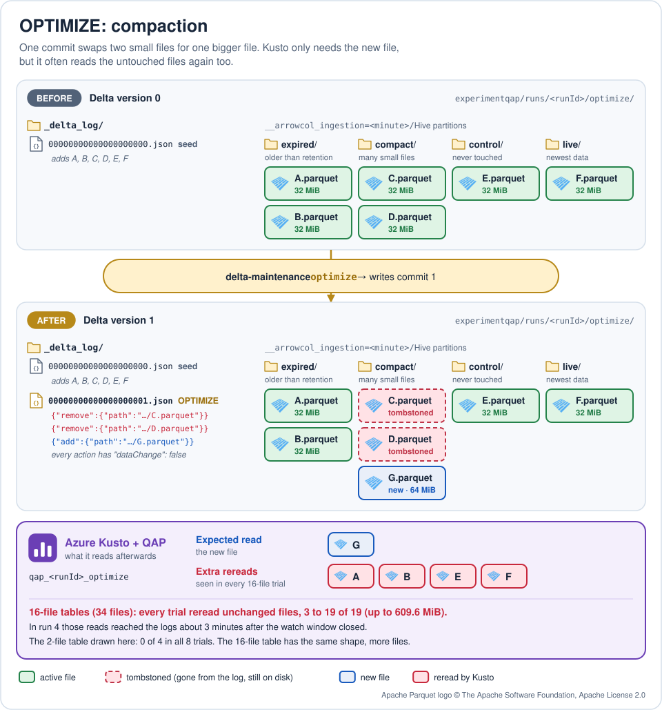
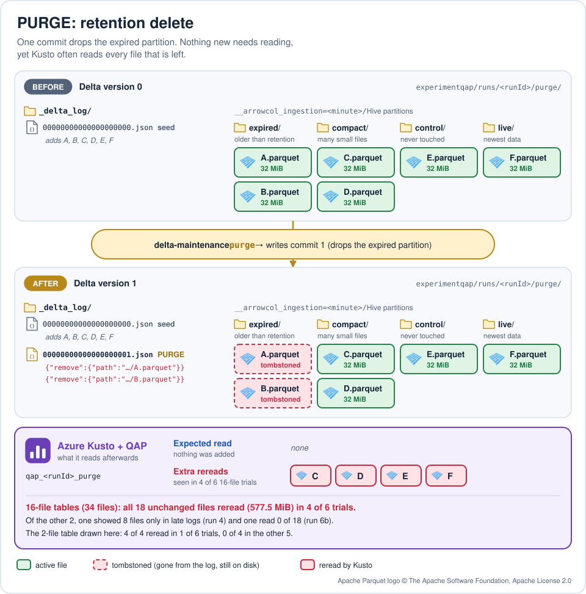
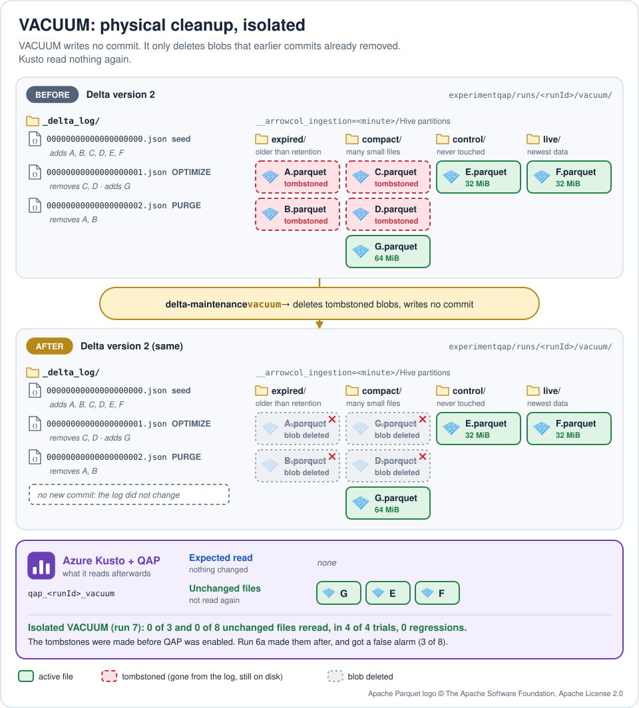
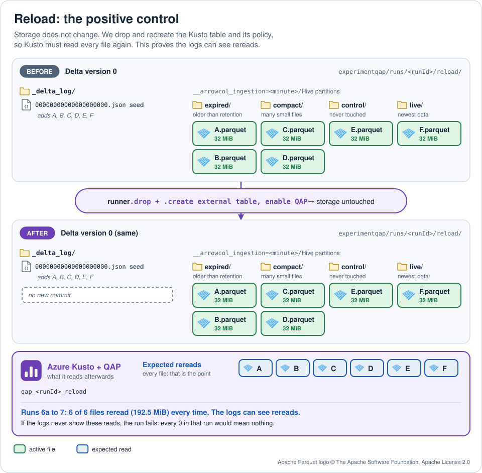
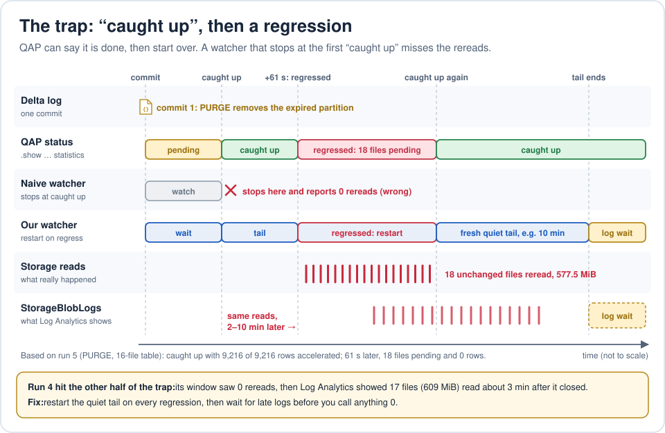
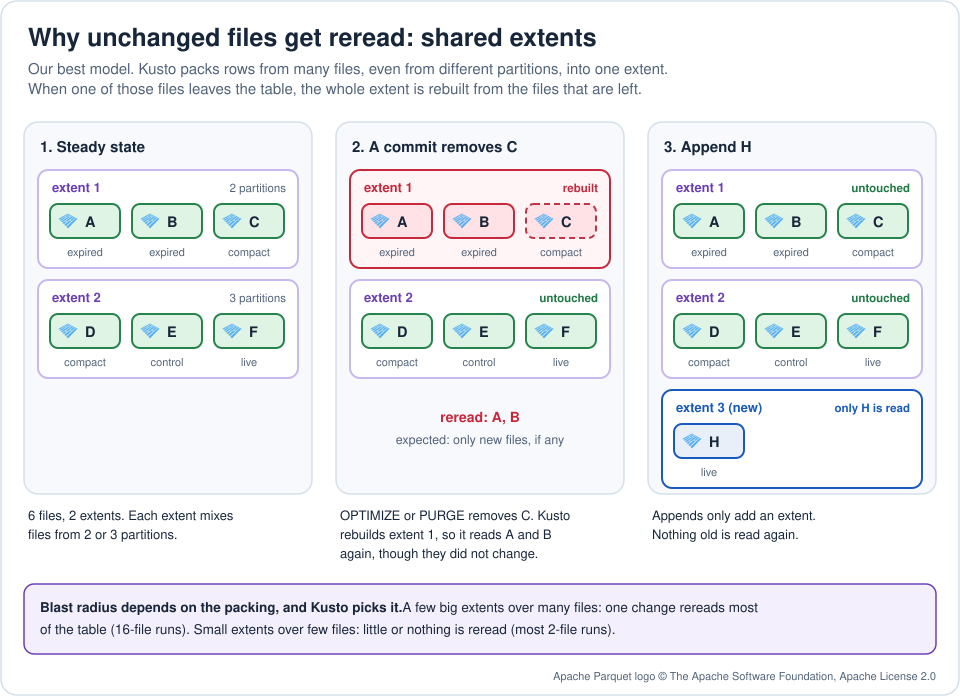
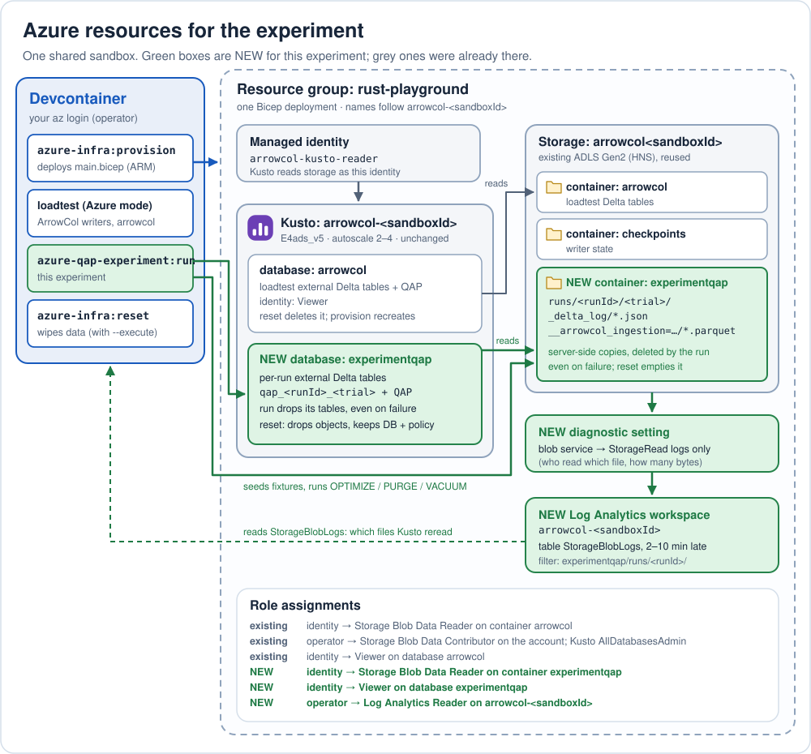
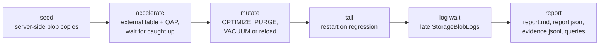

# Azure Kusto query acceleration over Delta: lessons learned

We pointed Azure Kusto's query acceleration policy (QAP) at external Delta
tables, ran Delta maintenance on them, and counted which Parquet files Kusto
downloaded again. This page shows what we learned, mostly as pictures.

An interactive version with tabs and a filterable results table is in
[index.html](index.html). GitHub shows HTML as source, so open it from a local
checkout in a browser.

## TL;DR

| Operation | Rereads files that did not change? | What we saw |
| --- | --- | --- |
| OPTIMIZE (compaction) | **Yes, often** | All 7 trials on 16-file tables reread unchanged files: 3 to 19 of 19 in the window, or (run 4) only in late logs. 2-file tables: never, in 8 trials. |
| PURGE (retention delete) | **Yes, often** | 16-file tables reread all 18 unchanged files in 4 of 6 trials. 2-file tables: once in 6. |
| VACUUM (isolated) | Not observed | 0 rereads in 4 of 4 isolated scale trials. It writes no commit, so the Delta snapshot does not change. |
| Reload (positive control) | Yes, on purpose | The scale-run controls reread 6 of 6 files. Proves the logs can see rereads. |
| Append | No excess pending files observed | A small append showed 1 pending file for 1 new file; aggregate pending counts alone do not prove zero unchanged-file reads. |

These are bounded observations, not guarantees for every table or watch window.

> **Rule of thumb:** any Delta commit that _removes_ files can make Kusto
> rebuild extents that also hold untouched files. Budget each remove commit as
> a possible full reingest of the accelerated table.

## How QAP reads an external Delta table



Writers and Kusto never talk to each other. Kusto polls the Delta log, downloads
new Parquet files as its managed identity and packs the rows into extents in its
hot cache. Queries then read the extents instead of the lake. The storage
account logs every blob read, which is how we see what Kusto downloaded.

## The test table

The historical scale trials used four Hive partitions
(`__arrowcol_ingestion=<minute>`) and 32 MiB Parquet files. The current quick
demo uses 1 MiB files by default.

| Partition | What it plays | 2-file table | 16-file table |
| --- | --- | --- | --- |
| `expired` | Old data that PURGE drops | 2 files (A, B) | 16 files |
| `compact` | Small files that OPTIMIZE merges | 2 files (C, D) | 16 files |
| `control` | Never touched | 1 file (E) | 1 file |
| `live` | Newest data | 1 file (F) | 1 file |
| **Total** | | **6 files, 192.1 MiB** | **34 files, 1088.7 MiB** |

The diagrams draw the 2-file table. The 16-file table has the same shape with
more files. Fixtures are server-side blob copies, so no data passes through the
devcontainer.

## What each operation did

Green files are active, dashed red files are tombstoned (removed from the log
but still on disk) and red chips are files Kusto read again although they did
not change.

### OPTIMIZE



- The commit removes the small files and adds one bigger file. Every action has
  `dataChange: false`, and there is no schema or protocol change.
- Kusto only needs the new file, yet every 16-file trial reread some or all of
  the 19 unchanged files (up to 609.6 MiB).

### PURGE



- The commit only removes files. Nothing new needs reading.
- In 4 of 6 trials on 16-file tables, Kusto reread **every** remaining file
  (18 files, 577.5 MiB), including partitions the commit never touched.

### VACUUM



- VACUUM only deletes blobs that earlier commits already removed. It writes no
  commit, so the Delta snapshot Kusto follows does not change.
- Isolated properly (run 7), it caused 0 rereads in all 4 trials.

### Reload control



The reload control drops and recreates the external table and its policy over
unchanged storage, so Kusto must read every file again. It read 6 of 6 files in
every run that included it (6a, 6b, 6c and 7). **If the logs never show this
control's reads, the run fails: every 0 in that run would mean nothing.**

## The trap: caught up, then regressed



- **Caught up is not final.** In run 5 (PURGE, 16-file table), QAP reported the
  new version with 9,216 of 9,216 rows accelerated. 61 s later, with no new
  commit, it reported 18 pending files and 0 accelerated rows, then reread all
  18. Run 6 saw the same regression in 2 OPTIMIZE and 1 PURGE trials.
- **The rebuild can start after you stop looking.** Run 4 stopped at caught up
  and recorded 0 rereads. Storage logs later showed 17 unchanged OPTIMIZE files
  (609 MiB) read about 3 minutes after the window, and 8 unchanged PURGE files
  (about 269 MB) about 4 minutes after it.
- **Fix:** hold a quiet tail after caught up, restart it on every regression,
  then wait for late logs before calling anything 0.

## Why unchanged files get reread



This is our best model, not a documented contract:

- Kusto stores accelerated rows in extents and merges them in the background,
  **across files and Hive partitions**. Before one mutation we saw a single
  8,192-row extent spanning two partitions.
- When a commit removes a file, every extent holding rows from that file is
  dropped. Rows of _unchanged_ files in those extents become unaccelerated
  (`extent_id()` returns the empty GUID), so Kusto downloads those files again.
- How much is reread depends on how far the merge has gone. A few big extents
  lose almost everything (16-file tables). Small per-file extents lose little or
  nothing (most 2-file trials). That is why the results look random at small
  sizes.
- Microsoft's [known issues](https://learn.microsoft.com/en-us/kusto/management/query-acceleration-policy?view=microsoft-fabric#known-issues)
  say OPTIMIZE'd data and frequently updated files need reacceleration. We saw
  this reach files the commit did not touch.

## VACUUM isolation and the run 6a confound

VACUUM needs tombstones to delete, so its table first gets OPTIMIZE and PURGE
commits. **When** those commits happen matters:

| Run | Tombstone commits made | VACUUM result (16-file) | Verdict |
| --- | --- | --- | --- |
| 6a | After QAP was enabled | 3 of 8 reread, both trials | Confounded: the reads were the OPTIMIZE/PURGE rebuild, not VACUUM |
| 6b | Same setup as 6a | 0 of 8, both trials | Not trusted alone; same flaw |
| 7 | Before QAP was enabled | 0 of 8 and 0 of 3, all 4 trials, 0 regressions | **Clean: VACUUM causes no rereads** |

Run 7 also re-ran the reload control (6 of 6) so its zeros mean something. It
took 1 h 51 min.

## Telemetry: late and partial

- **Logs arrive late.** `StorageBlobLogs` rows reached Log Analytics 2 to 10
  minutes after the read. Use `ingestion_time()` to see the lag, and keep
  waiting after the watch window.
- **Bytes read are not bytes ingested.** Storage logs show what Kusto
  downloaded, not how much CPU or extent work it did. Kusto does not expose
  per-file ingestion history or background ingestion CPU.
- **Prove the logs can see a reread.** Without the reload control, a 0 could
  just mean missing logs.
- **Keep your own queries out of the window.** A query over unaccelerated data
  reads Parquet as the same identity, so it looks like a reread. The runner only
  runs status commands during the window.
- **Attribute per file.** Classify each read as new, removed or unchanged by
  path. That is what lets parallel trials share one account safely.

## Results, runs 4 to 7

Each `reread/unchanged` value is one trial. Runs 4 to 7 ran on 2026-10-31 UTC
on a shared cluster. Every run kept exact row parity, every reload control read
6 of 6 files, and an idle table watched during every window read 0 bytes.

| Run | Operation | Table | Unchanged files reread | MiB reread | Notes |
| --- | --- | --- | --- | --- | --- |
| 4 | OPTIMIZE | 2-file | 0/4, 0/4 | 0 | |
| 4 | OPTIMIZE | 16-file | 0/19, 0/19 in the window | 0 in the window | **Late: 17 files, 609 MiB about 3 min after the window** |
| 4 | PURGE | 16-file | 0/18 in the window | 0 in the window | **Late: 8 files, about 269 MB about 4 min after the window** |
| 5 | PURGE | 2-file | 0/4, 0/4 | 0 | |
| 5 | PURGE | 16-file | **18/18** | 577.5 | Caught up, then regressed 61 s later |
| 6a | Reload | 2-file | 6/6 | 192.5 | Positive control |
| 6a | OPTIMIZE | 2-file | 0/4, 0/4 | 0 | |
| 6a | OPTIMIZE | 16-file | **6/19, 4/19** | 192.5, 128.3 | |
| 6a | PURGE | 2-file | 0/4, 0/4 | 0 | |
| 6a | PURGE | 16-file | **18/18, 18/18** | 577.5 each | |
| 6a | VACUUM | 2-file | 0/3, 0/3 | 0 | |
| 6a | VACUUM | 16-file | 3/8, 3/8 | 96.3 each | Confounded: tombstones made after QAP was enabled |
| 6b | Reload | 2-file | 6/6 | 192.5 | Positive control |
| 6b | OPTIMIZE | 2-file | 0/4, 0/4 | 0 | |
| 6b | OPTIMIZE | 16-file | **19/19, 19/19** | 609.6 each | 1 regression in each trial |
| 6b | PURGE | 2-file | 0/4, **4/4** | 0, 128.3 | 1 regression in the 4/4 trial |
| 6b | PURGE | 16-file | 0/18, **18/18** | 0, 577.5 | |
| 6b | VACUUM | 2-file | 0/3, 0/3 | 0 | Same setup as 6a |
| 6b | VACUUM | 16-file | 0/8, 0/8 | 0 | Same setup as 6a |
| 6c | Reload | 2-file | 6/6 | 192.5 | Positive control |
| 6c | OPTIMIZE | 2-file | 0/4, 0/4 | 0 | |
| 6c | OPTIMIZE | 16-file | **3/19** | 96.3 | The next trial failed on a transient blob PUT; the run stopped |
| 7 | Reload | 2-file | 6/6 | 192.5 | Positive control |
| 7 | VACUUM | 2-file | 0/3, 0/3 | 0 | Isolated: tombstones made before QAP was enabled |
| 7 | VACUUM | 16-file | 0/8, 0/8 | 0 | Isolated; 0 regressions |

New files are expected reads and are not counted: OPTIMIZE added 64.1 MiB
(2-file) or 480.4 MiB (16-file). Runs 6a to 6c ran in parallel on separate
tables. These runs used a throwaway storage account and Log Analytics workspace
per run; the current runner reuses the sandbox instead (see
[the Azure setup](#azure-setup)).

### Earlier small matrix (2026-10-30)

Before the scale runs, a functional matrix used tiny files (256 rows each) and
only Kusto's aggregate QAP statistics, so it could not tell which files were
read. It already hinted at the same effect:

| Window | First matrix pending peak | Repeat pending peak | New files |
| --- | --- | --- | --- |
| Partial OPTIMIZE | **7** | 1 | 1 |
| DELETE/PURGE | 0 | **7** | 0 |

Other findings from that matrix still hold:

- A small blind append showed 1 pending file for 1 new file, and a caught-up
  VACUUM LITE showed 0.
- Every case, including concurrent appends with maintenance and immediate
  VACUUM after OPTIMIZE/PURGE, ended with exact row parity.
- Reapplying the same QAP policy did not reset acceleration.
- Kusto refuses to change an external table's connection string while QAP is
  enabled ("Cannot alter the connection string ... as it has
  query_acceleration policy enabled"). Repointing a table is an explicit
  reset: remove the policy, change the source, enable QAP again.

## What to do about it

- **Batch removes.** Every PURGE or OPTIMIZE commit can rebuild up to the whole
  accelerated table. Run them rarely, in one commit, not per partition or hour.
- **Do not OPTIMIZE what QAP already accelerated.** Compaction only helps
  queries that read Parquet remotely. Restrict it to partitions outside the hot
  window, or skip it.
- **Size the hot window to the retention you purge.** Removes outside the hot
  window should not touch accelerated extents (not measured here).
- **Budget for it.** Treat each remove commit as a possible full reingest when
  sizing cluster capacity.
- **VACUUM is fine.** It does not touch the snapshot Kusto follows. Keep the
  seven-day retention default so lagging readers can still find old files; see
  [Delta maintenance](../../operations/DELTA_MAINTENANCE.md).

## Azure setup



The experiment lives inside the normal
[Azure sandbox](../../operations/AZURE_SANDBOX.md). `azure-infra:provision`
deploys everything in one Bicep deployment; names follow the private sandbox ID.

| Resource | Name | Status | Purpose |
| --- | --- | --- | --- |
| Storage account (ADLS Gen2) | `arrowcol<sandboxId>` | Reused | Holds the loadtest data and the experiment fixtures |
| Blob container | `experimentqap` | **New** | Fixtures under `runs/<runId>/<trial>/` |
| Kusto cluster | `arrowcol-<sandboxId>` | Reused, unchanged | E4ads_v5, autoscale 2 to 4 |
| Kusto database | `experimentqap` | **New** | One external table per trial, `qap_<runId>_<trial>` |
| Managed identity | `arrowcol-kusto-reader` | Reused | Kusto reads storage as this identity |
| Diagnostic setting | On the account's blob service | **New** | Sends `StorageRead` logs only |
| Log Analytics workspace | `arrowcol-<sandboxId>` | **New** | Stores `StorageBlobLogs` |

New role assignments:

- Identity: Storage Blob Data Reader on container `experimentqap`.
- Identity: Viewer on database `experimentqap`.
- Operator (your `az login`): Log Analytics Reader on the workspace.

## Run it

Start in the devcontainer with the private `.env` and an Azure sign-in. This is
a scenario runner, not a loadtest.

The defaults below were exercised against Azure on 2026-10-31. Use
`npx nx run azure-qap-experiment:run -- --help` and the
[experiment README](../../../experiments/azure-qap/README.md) for the current
CLI contract.

### Quick demo

About 5 minutes plus a bounded log wait. The defaults run each operation once,
on the small 6-file table with 1 MiB files, four trials at a time:

```bash
npx nx run azure-infra:provision
npx nx run azure-qap-experiment:run
```

Run `provision` once; it creates or updates the sandbox, including the
experiment's container, database and Log Analytics workspace.

**Measured runtime on 2026-10-31:** the default run reached the end of its
observation windows in about **5m13s**, then waited about **4m42s** for logs.
Including cleanup, it finished in **9m58s**. Provisioning and first-time builds
are separate. These timings depend on Azure warm-up and log ingestion latency.

| Quick-run check | Result |
| --- | --- |
| OPTIMIZE / PURGE / isolated VACUUM | Each observed 0/4 unchanged files reread in the short window |
| Reload control | Detected 6/6 unchanged files reread |
| VACUUM isolation | Deleted 2 tombstoned files; Delta version stayed at 3 |
| Report and cleanup | All four telemetry statuses complete, exit 0, cleanup done |
| Larger check: 16 files per mutable partition, still 1 MiB | 10m35s; reload detected 34/34, OPTIMIZE and PURGE observed 0/18; no VACUUM trial |

The larger check correctly retained `late-logs-pending` for reload at the
log-wait cap, even though every control file had already been observed. A
detected control does not make the remaining byte counts final. Tiny files and
a short tail demonstrate the tools, not a guaranteed maintenance reread.

### Long version

Use the historical 32 MiB fixture size and a longer watch window to investigate
the 16-file behavior above; a particular reread outcome is not guaranteed:

```bash
npx nx run azure-qap-experiment:run -- --files 16 --file-mib 32 --repetitions 2 --tail 10m --budget 1h
```

Raise `--budget` whenever you lengthen `--tail`: the runner refuses a budget
smaller than the tails alone, which is the number of rounds (trials divided by
`--parallel`, rounded up) times `--tail`. Four operations times two repetitions
is eight trials; at four in parallel that is two rounds of 10-minute tails, or
20 minutes, which does not fit the default 15-minute budget. Every regression
also restarts a tail. The quick command needs no override.

### Flags

| Flag | Default | What it does |
| --- | --- | --- |
| `--operations <list>` | `optimize,purge,vacuum,reload` | Which trials to run |
| `--files <n>` | `2` (2 to 128) | Files in each of the `expired` and `compact` partitions; 2 gives 6 files, 16 gives 34 |
| `--file-mib <n>` | `1` (1 to 32) | Size of each Parquet file; the long proof used 32 |
| `--repetitions <n>` | `1` (1 to 10) | Trials per operation; use 2 or more before you conclude anything, small tables are random |
| `--parallel <n>` | `4` (1 to 8) | Trials that run at the same time |
| `--tail <dur>` | `2m` | Quiet time after QAP is caught up; restarts on every regression |
| `--log-wait <dur>` | `5m` | Longest wait for late `StorageBlobLogs` rows; `0` skips it, and is refused when `reload` is included |
| `--budget <dur>` | `15m` | Hard cap for all trials, log wait included; cleanup gets up to 5 more minutes |
| `--env <file>` | `.env` | Env file with the sandbox settings |
| `--out <dir>` | `.temp/experiments/azure-qap/<runId>` | Where the report and saved queries go |
| `-h`, `--help` | | Print the flags and exit |

Bad flags exit with code 2 before anything is created.

### Phases



Each trial has a name: the operation, plus `_2`, `_3` and so on for later
repetitions (`purge`, `purge_2`). Run IDs look like `20250102t030405_ab12`.

1. **Seed** copies fixtures to `experimentqap/runs/<runId>/<trial>/`.
2. **Accelerate** creates `qap_<runId>_<trial>` in database
   `experimentqap`, enables QAP and waits until it is caught up.
3. **Mutate** runs `delta-maintenance` OPTIMIZE, PURGE or VACUUM LITE, or the
   reload control.
4. **Tail** watches QAP status only, and restarts on every regression, within
   the budget.
5. **Log wait** reads `StorageBlobLogs` for the run path and the Kusto
   identity.
6. **Report** writes `report.md`, `report.json`, `evidence.jsonl` and one
   saved Log Analytics query per trial in `queries/` to `--out`.

Cleanup always runs, even when a phase fails or you press Ctrl+C. It drops every
`qap_<runId>_<trial>` table and deletes `experimentqap/runs/<runId>/`, with up
to 5 minutes beyond the budget. It prints manual cleanup commands only if it
fails. Nothing is left to explore in Kusto or storage afterwards; the storage
logs are kept separately (see [Debug it](#debug-it)).

Each trial ends with one status:

- `complete`: the log wait saw the trial's rows settle.
- `late-logs-pending`: the log wait ended while rows could still arrive. A 0
  here is not yet a 0; rerun the saved query later.
- `budget-exceeded`: the budget cut the trial short. Its result is unknown,
  not 0.
- `failed`: the trial hit an error; `report.md` says which.

The exit code sums up the run:

| Code | Meaning |
| --- | --- |
| 0 | Report written without failures. Late logs may remain pending, but every included reload control must already be detected |
| 1 | An error, a failed trial, failed cleanup, or an included reload control not seen rereading every unchanged file, for any reason, pending logs and budget included |
| 2 | Bad flags or a bad `scenario.json` |
| 130 | Interrupted; cleanup still ran |

The reload control is why a missing reread is a failure, not a pass: if the
logs never show the reload's rereads, they could not have shown any other
reread either, so the run's zeros prove nothing. Missing telemetry never means
"no rereads".

## Debug it

The Kusto commands need the run's tables, so use them while the run is going.
The run prints each table name as it creates it, and drops the tables at the
end. Run them in the Azure Data Explorer web UI against database
`experimentqap`. Replace `qap_<runId>_purge` with your table.

Policy, as JSON:

```kusto
.show external table qap_<runId>_purge policy query_acceleration
| project Policy = todynamic(Policy)
```

Progress (pending files and percent complete):

```kusto
.show external table qap_<runId>_purge operations query_acceleration statistics
| project ExternalTableName, IsEnabled, AccelerationPendingDataFilesCount,
          AccelerationPendingDataFilesSize, AccelerationCompletePercentage,
          LastUpdatedDateTime, NotHealthyReason
```

Health:

```kusto
.show external table qap_<runId>_purge details
| extend State = todynamic(QueryAccelerationState)
| project State.IsHealthy, State.NotHealthyReason, State.CompletionPercentage,
          State.PendingDataFilesCount, State.LastUpdatedDateTime
```

Extents. External tables have no `.show extents`; group rows by `extent_id()`
instead. Unaccelerated rows get the empty GUID.

```kusto
external_table("qap_<runId>_purge")
| summarize Rows = count() by Partition = __arrowcol_ingestion, Extent = tostring(extent_id())
| order by Partition asc, Extent asc
```

Cluster capacity for acceleration, and what recent queries read remotely:

```kusto
.show capacity
| where Resource == "QueryAcceleration"
```

```kusto
.show queries
| where StartedOn > ago(1h)
| extend External = OverallQueryStats.input_dataset_statistics.external_data
| project StartedOn, Text, External
```

Which files Kusto read: run this in the Log Analytics workspace's **Logs**
blade. The run saves this query for each trial, already filled in, as
`queries/<trial>.kql` in its `--out` folder (see
[Rerun the log queries after cleanup](#rerun-the-log-queries-after-cleanup)).
To write it by hand, first get the identity's object ID:

```bash
az identity show -g rust-playground -n arrowcol-kusto-reader --query principalId -o tsv
```

```kusto
StorageBlobLogs
| where TimeGenerated > ago(3h)
| where AccountName == "arrowcol<sandboxId>"
| where Category == "StorageRead"
| where Uri contains "/experimentqap/runs/<runId>/"
| where RequesterObjectId =~ "<kusto-identity-object-id>"
| where OperationName in ("GetBlob", "ReadFile")
| where toint(StatusCode) between (200 .. 299)
| extend File = tostring(parse_url(Uri).Path)
| summarize Reads = count(), MiB = round(sum(ResponseBodySize) / 1048576.0, 1),
            FirstRead = min(TimeGenerated), LastArrived = max(ingestion_time()) by File
| order by FirstRead asc
```

How late the logs are:

```kusto
StorageBlobLogs
| where TimeGenerated > ago(3h)
| where Uri contains "/experimentqap/runs/<runId>/"
| extend LagMinutes = (ingestion_time() - TimeGenerated) / 1m
| summarize p50 = percentile(LagMinutes, 50), p95 = percentile(LagMinutes, 95), Max = max(LagMinutes)
```

Compare the file list with the Delta log of each version: a file that is in both
the old and new snapshot but appears here after the mutation is a reread.

### Rerun the log queries after cleanup

The Log Analytics queries keep working after the run has cleaned up, and after
`azure-infra:reset`. The rows live in the workspace, not in the tables or
blobs, and stay until the workspace's retention expires.

The run saves two queries per trial in its `--out` folder, by default
`.temp/experiments/azure-qap/<runId>/queries/`:

- `<trial>.kql` groups reads by file and `Phase`. Rows with `Phase` set to
  `after-mutation` and a `GetBlob` or `ReadFile` on a file the mutation did not
  touch are rereads. `late` rows arrived after the watch window ended.
- `<trial>.raw.kql` lists the individual requests.

Both start from a fixed `datetime()`, so they need no editing. When logs are
still pending, the run prints the exact command; it looks like this, with the
workspace's customer ID filled in:

```bash
az monitor log-analytics query -w <workspace-customer-id> \
  --analytics-query @.temp/experiments/azure-qap/<runId>/queries/<trial>.kql -o table
```

To look up the customer ID yourself:

```bash
az monitor log-analytics workspace show -g rust-playground \
  -n "arrowcol-<sandboxId>" --query customerId -o tsv
```

You can also paste a query file into the workspace's **Logs** blade. For the
handwritten queries above, widen `TimeGenerated > ago(3h)` so it still covers
the run. Compare the paths with the run's `report.md` and `evidence.jsonl`;
after cleanup the fixture blobs, Delta logs included, are gone.

## Cost and cleanup

- **The cluster is shared.** The experiment adds no compute. Rereads use the
  same cluster as the loadtest, so do not stop or reprovision it during a run.
- **Rereads cost ingestion work.** A 16-file PURGE rereads about 0.6 GiB; scale
  that to your real tables before running maintenance on them.
- **Log Analytics bills per GB ingested.** Only `StorageRead` is sent, but every
  blob read in the account is logged, including the loadtest's.
- **Each run deletes its own tables and fixture prefix**, always, even when it
  fails. Its storage logs stay in Log Analytics.
- **Reset the data plane** when you are done:

```bash
npx nx run azure-infra:reset
```

`reset` on its own only previews. With `--execute` (see the
[sandbox guide](../../operations/AZURE_SANDBOX.md#cloud-occupancy-and-reset)) it:

- deletes the main `arrowcol` Kusto database; `provision` recreates it;
- empties the `experimentqap` database, dropping every table, external table,
  function and materialized view, but keeps the database and its managed
  identity policy;
- deletes every blob in the `arrowcol`, `checkpoints` and `experimentqap`
  containers, but keeps the containers.

It keeps the account, cluster, managed identity and Log Analytics workspace, and
the logs already in the workspace. Run `npx nx run azure-infra:provision` after
a reset before the next experiment or loadtest.

## Limits

- Results come from one shared cluster on one day. Kusto may change how it
  merges extents.
- The extents model above explains every result we saw, but Kusto does not
  document it.
- Storage logs measure downloads, not ingestion CPU.
- The 2-file results are random. Repeat trials before trusting a 0.

## References

- [Query acceleration policy](https://learn.microsoft.com/en-us/kusto/management/query-acceleration-policy?view=microsoft-fabric)
- [Show query acceleration statistics](https://learn.microsoft.com/en-us/kusto/management/show-external-table-operations-query-acceleration-statistics?view=microsoft-fabric)
- [External Delta tables](https://learn.microsoft.com/en-us/kusto/management/external-tables-delta-lake?view=microsoft-fabric)
- [Azure Storage blob logs reference](https://learn.microsoft.com/en-us/azure/azure-monitor/reference/tables/storagebloblogs)
- [Experiment code](../../../experiments/azure-qap/README.md)
- [Azure sandbox](../../operations/AZURE_SANDBOX.md)
- [Delta maintenance](../../operations/DELTA_MAINTENANCE.md)

Apache Parquet logo © The Apache Software Foundation, Apache License 2.0. The
diagrams use it to mark Parquet files.
