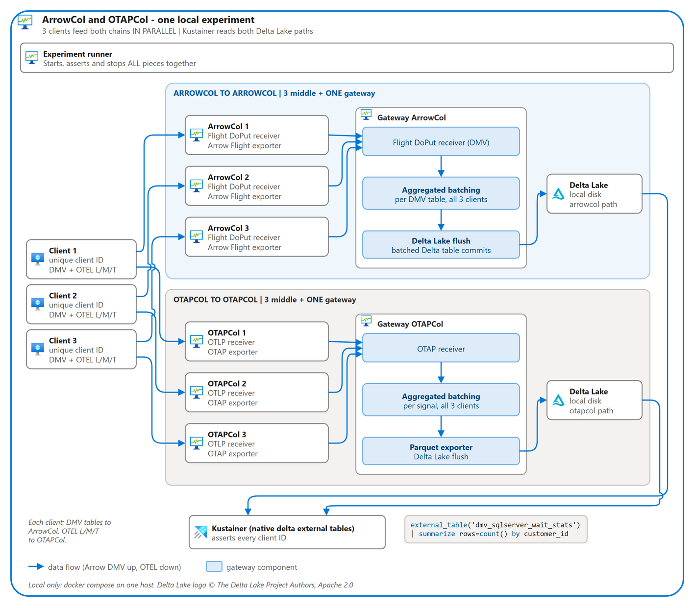

# Collector chaining: middles into one batching gateway

Clients feed middle collectors, and the middles feed one gateway per chain.
Both chains run side by side: ArrowCol carries DMV Arrow, and OTAPCol carries
OTEL logs, metrics and traces. Each gateway batches every client's data
before it writes Delta Lake to local disk. Kustainer reads both Delta paths
and checks that every client ID arrived. Everything runs locally under docker
compose.

| Claim | Evidence from a passing run |
| --- | --- |
| ArrowCol chains into ArrowCol | 13 DMV tables reach the gateway through `exporter:arrow_flight`. |
| OTAPCol chains into OTAPCol | Logs, spans and metrics reach the gateway through `exporter:otap`. |
| Every client lands in Kusto | Each of the 3 client IDs has 100 rows per DMV table, 10 logs, 10 spans and 2 metric rows. |
| The gateways batch across clients | Each of the 17 checked gateway tables holds all 3 clients in 1 Delta commit. |



Run it with `npx nx run collector-chain-experiment:run`. Flags, stages and
exit codes are in the
[experiment README](../../../experiments/collector-chain/README.md).

## Nodes

| Chain | Role | Receiver | Processor | Exporter |
| --- | --- | --- | --- | --- |
| ArrowCol | Middle (×3) | `receiver:arrow_flight` | | `exporter:arrow_flight` |
| ArrowCol | Gateway | `receiver:arrow_flight` | | `exporter:arrow_deltalake` |
| OTAPCol | Middle (×3) | `receiver:otlp` | | `exporter:otap` |
| OTAPCol | Gateway | `receiver:otap` | `processor:batch` | `exporter:deltalake` |

`exporter:deltalake` is the OTAP Parquet exporter with a Delta Lake commit
backend. The collector configs are in
[`experiments/collector-chain/config`](../../../experiments/collector-chain/config).
The client is [`bin/collector-chain`](../../../bin/collector-chain/README.md).
It writes its client ID into the DMV `customer_id` column and into the OTEL
`client.id` resource attribute.

## Kusto checks

Each gateway table becomes a native delta external table:

```kusto
.create-or-alter external table ['dmv_sqlserver_wait_stats']
kind=delta (h@'/delta/arrowcol/telemetry/sqlserver/sqlserver_wait_stats')
```

DMV rows carry the client ID directly:

```kusto
external_table('dmv_sqlserver_wait_stats')
| summarize rows=count() by client=customer_id
```

OTAP rows join the client ID from `resource_attrs`:

```kusto
let clients = external_table('otap_resource_attrs')
| where key == 'client.id' | project rid=parent_id, ns=_otel_join_namespace, client=str;
union
  (external_table('otap_logs') | project signal='logs', rid=tolong(resource.id), ns=_otel_join_namespace),
  (external_table('otap_spans') | project signal='spans', rid=tolong(resource.id), ns=_otel_join_namespace),
  (external_table('otap_univariate_metrics') | project signal='metrics', rid=tolong(resource.id), ns=_otel_join_namespace)
| join kind=inner clients on rid, ns
| summarize rows=count() by signal, client
```

`external_table()` takes only a string literal; `external_table(['x'])` fails
with `SEM0451`.

## Batching at the gateway

| Gateway table | Rows | Files | Commits |
| --- | --- | --- | --- |
| ArrowCol DMV tables (13) | 300 each | 3 or 6 | 1 |
| OTAP `logs` | 30 | 1 | 1 |
| OTAP `spans` | 30 | 1 | 1 |
| OTAP `resource_attrs` | 60 | 1 | 1 |
| OTAP `univariate_metrics` | 6 | 1 | 1 |

ArrowCol batches at the commit. Each forwarded batch becomes one Parquet
file, and the commit worker folds the files that arrive within its
`batch_window` (1s) into one Delta commit. OTAPCol batches before the write:
`processor:batch` merges the middles' streams, and the Parquet exporter
buffers rows until `flush_when_older_than` (5s) before one Delta commit.

## Design notes

- **ArrowCol forwarding.** `exporter:arrow_flight` replays catalog DDL before
  a table's first batch and ACKs only after the gateway admits the batch. See
  [Collector chaining](../../../crates/arrowcol-dataflow-components/README.md#collector-chaining).
  All three middles replay the same DDL to one gateway; the replay is
  idempotent.
- **Standalone routing.** Every ArrowCol claims its own table leases with
  `routing: { type: standalone }`, so the experiment needs no router.
- **Routing pressure.** A lease renewal with an empty pressure document used
  to erase the pressure the receiver had reported. The memory routing store
  now keeps it.
- **OTAP compression.** The gateway's `receiver:otap` sets
  `compression_method: zstd` to match what `exporter:otap` sends.
