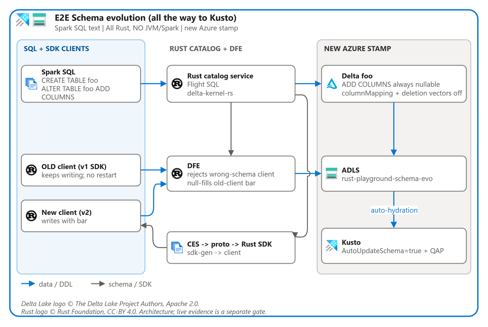

# Schema evolution to Kusto

| Claim | Evidence |
| --- | --- |
| A separate disposable stamp does not alias the shared sandbox | Azure configuration tests verify distinct RG-derived account, cluster, ownership and deployment names. |
| Hydration requires old-client writes both before and after ALTER, plus filled new-client rows | `schema-evolution-experiment:verify` checks exact per-client/per-phase counts and bounded observations. |
| Genuine historical and evolved SDK clients compile independently | `schema-evolution-experiment:build-fixtures` compiles v1 without `bar` or a v2 dependency and v2 with nullable `bar`; remote catalog artifacts remain a live gate. |
| Pinned Kustainer accepts native-refresh prerequisites | `schema-evolution-experiment:probe-kustainer` accepts create, QAP, then AutoUpdateSchema. Empty fixture means actual refresh remains inconclusive. |
| Live catalog, SDK, Delta and Kusto evolution | Not yet qualified; component checks are not an end-to-end pass. |
| Native Azure schema refresh | Must be observed without a post-ALTER manual external-table update. |
| New stamp reaches supported write readiness | Full bootstrap at `937a465` completed initialization under custody, reconciled 26 Delta external tables/QAP, and exported ready-v1 in 138.4 seconds. This is not the final DFE-only topology rehearsal. |

| Command | Expected result |
| --- | --- |
| `npx nx run schema-evolution-experiment:verify` | Strict TypeScript checks and deterministic hydration-verifier tests. No Azure deployment. |
| `npx nx run schema-evolution-experiment:build-fixtures` | Separately built old/new Rust clients from real generated immutable SDKs. No network writes. |
| `npx nx run schema-evolution-experiment:probe-kustainer` | Records Kustainer command capability and string null semantics; does not claim E2E delivery. |
| `npx nx run schema-evolution-experiment:run -- --target local` | Actual Rust catalog/DFE, real generated historical SDKs, physical Delta null inspection, pinned Kustainer native refresh. |
| `npx nx run schema-evolution-experiment:run -- --target azure --env-file .env.schema-evo.private --ready-env .env.azure.schema-evo` | Same real flow against the isolated stamp; requires a genuine exported ready generation and records bounded native refresh. |
| `AZURE_RESOURCE_GROUP=rust-playground-schema-evo npx --no-install tsx infra/azure/bootstrap.ts provision --infra-only --output .env.azure.schema-evo` | Creates only the selected stamp; private generated configuration preserves its RG. Real Azure charges apply. |
| `AZURE_RESOURCE_GROUP=rust-playground-schema-evo npx nx run azure-infra:provision -- --env-file .env.schema-evo.private --tables .env.azure.schema-evo.tables.json --output .env.azure.schema-evo` | Supported full initialization, KQL reconciliation and bootstrap completion. No generation or fencing bypass. Real Azure charges apply. |

Keep resource-name overrides blank when creating the separate stamp. Never
reuse the shared sandbox's table/checkpoint roots. **Stop/reset operate on the
selected resource group; inspect that selection before execution.**
See [Azure sandbox safety](../../operations/AZURE_SANDBOX.md).

The runner records source SHA, runbook hash, immutable v1 SDK/binary custody,
CES and exact cohort evidence under `.temp/experiments/schema-evolution`.
Azure inputs are explicit: the ready env is overlaid on a fresh private input
for the separate stamp, never inferred from shared `.env.azure`. The runner
uses standalone process-shared routing and a real remote catalog, not empty
memory catalogs or SQL/Hive fallbacks. Cleanup stops only owned processes and
drops only the run's external table and storage prefix. An unclean publisher
shutdown retains cloud data and occupancy for supported recovery.

## Qualification gates

Native-refresh setup is ordered: create an inferred external table, enable
QAP, then enable `AutoUpdateSchema=true` before Delta ALTER. Pinned Kustainer
rejects the flag when QAP is not yet enabled. No external-table ALTER is
allowed during the subsequent native-hydration observation.

| Step | Required evidence |
| --- | --- |
| CREATE v1 | Spark SQL text, catalog version, Delta schema and immutable generated v1 SDK hash. |
| Old client before ALTER | Accepted writes and persistent process identity. |
| ADD COLUMNS | `ALTER TABLE foo ADD COLUMNS (bar STRING)`, nullable Delta field, CES event and generated v2 SDK hash. Column mapping and deletion vectors remain off. |
| Old/new clients after ALTER | Same v1 process continues; genuine v2 SDK writes nonempty `bar`; wrong-schema client is rejected by DFE. |
| Azure Kusto | `AutoUpdateSchema=true` and QAP, elapsed bounded-poll observations and exact old/new data counts; no manual reconciliation after ALTER. |
| Kustainer | Record whether native refresh works. Production CES-triggered reconciliation, if required, is distinct from native refresh. |
| Bug bash | Two fresh Full bootstraps at the same final SHA and runbook hash, each including Azure, with stamp identity and reproducible commands. |

Kusto `string` values do not have null semantics like nullable Arrow/Delta
strings. Record the requested `isnull(bar)` query unchanged, but verify
old-client string representation using `isempty(bar)` and independently verify
physical Delta nulls. New-client fixture values must be nonempty, making empty
old values distinguishable without calling Kusto empty strings SQL NULL.

| Verification KQL | Purpose |
| --- | --- |
| `external_table('foo') \| summarize total=count(), nulls=countif(isnull(bar)), filled=countif(isnotnull(bar)) by client` | Original requested observation; do not reinterpret Kusto string null semantics. |
| `external_table('foo') \| summarize total=count(), empty=countif(isempty(bar)), filled=countif(isnotempty(bar)) by client, phase` | Exact data proof for old-before, old-after and new-after cohorts. |
