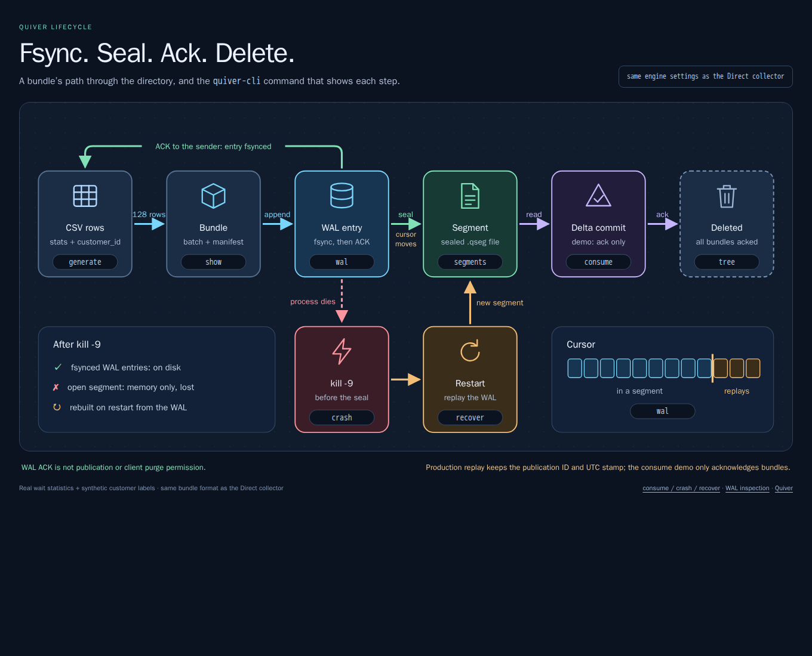
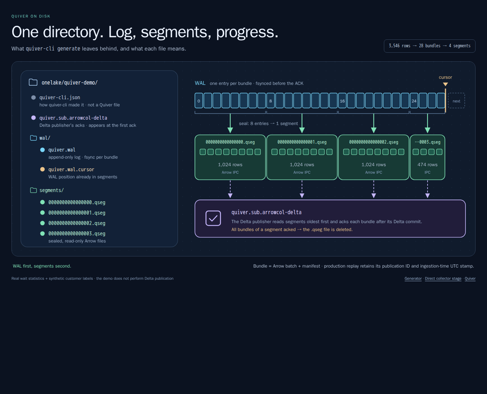

# Quiver on disk

`quiver-cli` writes captured SQL Server telemetry with synthetic customer labels
using the Direct collector's
[Quiver](../../submodules/otel-arrow/rust/otap-dataflow/crates/quiver/README.md)
bundle and WAL format, then shows what each file holds. Its `consume` command
demonstrates subscriber acknowledgements; it does not publish to Delta.
Production clients may purge only after a `published` receipt explicitly grants
`purge_allowed`, not after the earlier durable-admission acknowledgement.



- **Needs:** the dev container. Steps 1-7 need no Docker or SQL Server.
- **Runs as:** `npx nx run quiver-cli:run -- <command> [dir]` from the repository root.
- **Writes to:** `onelake/quiver-demo/` (gitignored).
- **Data:** 3,546 real `sys.dm_os_wait_stats` rows, [committed](#the-data).

## 1. Generate

```bash
npx nx run quiver-cli:run -- generate
```

```text
generated onelake/quiver-demo from bin/quiver-cli/data/sqlserver_wait_stats.csv

  table   telemetry.sqlserver.sqlserver_wait_stats  (schema v1, sha256:fcf62ed7, as registered by the benchmark)
  format  arrowcol.direct@1 bundles; WAL fsync before each bundle is acknowledged

   rows  bundles  WAL fsyncs  segments    on disk
  3,546       28          28         4  974.5 KiB

next: quiver-cli tree onelake/quiver-demo
```

| You see | It means |
| --- | --- |
| `28 bundles`, `28 WAL fsyncs` | One fsync per bundle, before its acknowledgement |
| `sha256:fcf62ed7` | The schema the benchmark registers for this table |
| `4 segments` | Bundles sealed 8 at a time into read-only files |

## 2. Look at the directory

```bash
npx nx run quiver-cli:run -- tree
```

```text
onelake/quiver-demo  (974.5 KiB in Quiver files)
├── quiver-cli.json                598 B  how quiver-cli generated this directory
├── wal/
│   ├── quiver.wal             483.9 KiB  write-ahead log: 28 entries, each fsynced before its bundle was acknowledged
│   └── quiver.wal.cursor           24 B  cursor at 495,451: every entry is in a segment, nothing to replay
└── segments/
    ├── 0000000000000000.qseg  140.4 KiB  8 bundles, 1,024 rows, 0/8 acknowledged
    ├── 0000000000000001.qseg  139.9 KiB  8 bundles, 1,024 rows, 0/8 acknowledged
    ├── 0000000000000002.qseg  140.3 KiB  8 bundles, 1,024 rows, 0/8 acknowledged
    └── 0000000000000003.qseg   69.5 KiB  4 bundles, 474 rows, 0/4 acknowledged
```



| You see | It means |
| --- | --- |
| `quiver.wal`, 28 entries | Every bundle, in arrival order |
| `cursor at 495,451` | WAL byte position up to which entries are in segments |
| `*.qseg` | Sealed Arrow files: what the Delta publisher reads |
| No `quiver.sub.*` file | Nothing acknowledged yet |

## 3. Read the WAL

```bash
npx nx run quiver-cli:run -- wal
```

```text
write-ahead log of onelake/quiver-demo: 1 file(s), 28 entries

  file             size  WAL positions
  quiver.wal  483.9 KiB  0 .. 495,451

  cursor at 495,451: entries before it are in segments; entries after it replay on next open
  28 in segments, 0 WAL only

  newest 12 of 28 entries
  seq  position   bytes  rows  table                 state
   16   285,392  17,969   128  sqlserver_wait_stats  in a segment
   17   303,361  17,969   128  sqlserver_wait_stats  in a segment
   18   321,330  17,841   128  sqlserver_wait_stats  in a segment
   19   339,171  17,777   128  sqlserver_wait_stats  in a segment
   20   356,948  17,841   128  sqlserver_wait_stats  in a segment
   21   374,789  17,777   128  sqlserver_wait_stats  in a segment
   22   392,566  17,841   128  sqlserver_wait_stats  in a segment
   23   410,407  17,777   128  sqlserver_wait_stats  in a segment
   24   428,184  17,713   128  sqlserver_wait_stats  in a segment
   25   445,897  17,841   128  sqlserver_wait_stats  in a segment
   26   463,738  17,841   128  sqlserver_wait_stats  in a segment
   27   481,579  13,872    90  sqlserver_wait_stats  in a segment
```

| You see | It means |
| --- | --- |
| `position` | Byte offset of the entry in the WAL |
| `90` rows in entry 27 | The CSV remainder: 3,546 = 27 &times; 128 + 90 |
| `in a segment` | Before the cursor: a restart skips it |

## 4. Open a segment

```bash
npx nx run quiver-cli:run -- segments
npx nx run quiver-cli:run -- show --columns customer_id,wait_type,wait_category,wait_time_ms,waiting_tasks_count
```

```text
4 finalized segments in onelake/quiver-demo  (28 bundles, 3,546 rows)

  segment                     size  bundles   rows  acknowledged  contents
  0000000000000000.qseg  140.4 KiB        8  1,024           0/8  sqlserver_wait_stats
  0000000000000001.qseg  139.9 KiB        8  1,024           0/8  sqlserver_wait_stats
  0000000000000002.qseg  140.3 KiB        8  1,024           0/8  sqlserver_wait_stats
  0000000000000003.qseg   69.5 KiB        4    474           0/4  sqlserver_wait_stats

  stream: slot 0, schema sha256:fcf62ed7; one Arrow IPC stream per segment holds this slot's rows
```

```text
segment 0000000000000000.qseg, bundle 0: 128 rows

manifest (arrowcol.direct@1, the bundle metadata a restarted collector publishes from)
  table     telemetry.sqlserver.sqlserver_wait_stats  (table id 30bbde33-b0e2-5244-9260-b9a10c36c872)
  schema    v1, sha256:fcf62ed7
  receipt   15e3d29d-c1a4-4f13-acd9-4186bd4e0ec6  (revision 0)
  lease     134b046a-f462-4404-8825-144944dee07d  (owner 16fb4e3a-6573-46a5-9250-aa2b5f0601ee, fencing epoch 1)
  size      128 rows, 19.0 KiB of Arrow memory

first 5 of 128 rows (slot 0, decoded from Arrow IPC)
+---------------------+----------------+--------------+---------------------+
| wait_type           | wait_category  | wait_time_ms | waiting_tasks_count |
+---------------------+----------------+--------------+---------------------+
| ASYNC_IO_COMPLETION | Other Disk IO  | 510          | 12                  |
| ASYNC_NETWORK_IO    | Network IO     | 0            | 1                   |
| AZURE_IMDS_VERSIONS | Unknown        | 145          | 1                   |
| BROKER_EVENTHANDLER | Service Broker | 2673         | 14                  |
| BROKER_MASTERSTART  | Service Broker | 0            | 1                   |
+---------------------+----------------+--------------+---------------------+
```

| You see | It means |
| --- | --- |
| `slot 0, schema sha256:fcf62ed7` | One Arrow IPC stream per segment |
| `manifest` | What a restarted collector publishes from, without SQL |
| The rows | The CSV rows, decoded back from Arrow IPC |

Receipt, lease, and owner IDs are synthetic and change on every run. Production
replay retains the original publication identity and ingestion-time UTC stamp;
this is not deduplication of independent client requests.

## 5. Consume

```bash
npx nx run quiver-cli:run -- consume --ack 12
npx nx run quiver-cli:run -- tree
```

```text
arrowcol-delta acknowledged 12 bundles, oldest first, as the collector does after each Delta commit

  segment                acknowledged  result
  0000000000000000.qseg           8/8  every bundle acknowledged: segment deleted
  0000000000000001.qseg           4/8  kept: other bundles are still unacknowledged

  segments on disk: 4 -> 3
```

```text
onelake/quiver-demo  (834.3 KiB in Quiver files)
├── quiver-cli.json                598 B  how quiver-cli generated this directory
├── quiver.sub.arrowcol-delta      124 B  progress of subscriber arrowcol-delta: 4 of 20 bundles in segments acknowledged
├── wal/
│   ├── quiver.wal             483.9 KiB  write-ahead log: 28 entries, each fsynced before its bundle was acknowledged
│   └── quiver.wal.cursor           24 B  cursor at 495,451: every entry is in a segment, nothing to replay
└── segments/
    ├── 0000000000000001.qseg  139.9 KiB  8 bundles, 1,024 rows, 4/8 acknowledged
    ├── 0000000000000002.qseg  140.3 KiB  8 bundles, 1,024 rows, 0/8 acknowledged
    └── 0000000000000003.qseg   69.5 KiB  4 bundles, 474 rows, 0/4 acknowledged
```

| You see | It means |
| --- | --- |
| `segments on disk: 4 -> 3` | A segment is deleted once all its bundles are acknowledged |
| `4/8 acknowledged` | A partly consumed segment stays |
| `quiver.sub.arrowcol-delta` | Subscriber progress, written at the first acknowledgement |
| `quiver.wal` still 483.9 KiB | WAL space is freed a whole rotated file at a time |

## 6. Crash

```bash
npx nx run quiver-cli:run -- crash --bundles 5
npx nx run quiver-cli:run -- wal --last 7
npx nx run quiver-cli:run -- show --wal 32 --rows 3 --columns customer_id,wait_type,wait_time_ms,waiting_tasks_count
```

```text
child process 866798 writes bundles like the collector (WAL fsync before each acknowledgement) and never finalizes a segment
  bundle 1 fsynced to the WAL and acknowledged
  bundle 2 fsynced to the WAL and acknowledged
  bundle 3 fsynced to the WAL and acknowledged
  bundle 4 fsynced to the WAL and acknowledged
  bundle 5 fsynced to the WAL and acknowledged
kill -9: child ended by signal 9 with its open segment never finalized

next: quiver-cli wal onelake/quiver-demo
```

```text
write-ahead log of onelake/quiver-demo: 1 file(s), 33 entries

  file             size  WAL positions
  quiver.wal  570.9 KiB  0 .. 584,528

  cursor at 495,451: entries before it are in segments; entries after it replay on next open
  28 in segments, 5 WAL only

  newest 7 of 33 entries
  seq  position   bytes  rows  table                 state
   26   463,738  17,841   128  sqlserver_wait_stats  in a segment
   27   481,579  13,872    90  sqlserver_wait_stats  in a segment
   28   495,451  17,841   128  sqlserver_wait_stats  WAL only: replays on next open
   29   513,292  17,777   128  sqlserver_wait_stats  WAL only: replays on next open
   30   531,069  17,713   128  sqlserver_wait_stats  WAL only: replays on next open
   31   548,782  17,841   128  sqlserver_wait_stats  WAL only: replays on next open
   32   566,623  17,905   128  sqlserver_wait_stats  WAL only: replays on next open
```

```text
WAL entry 32 (WAL only: replays on next open): 128 rows

manifest (arrowcol.direct@1, the bundle metadata a restarted collector publishes from)
  table     telemetry.sqlserver.sqlserver_wait_stats  (table id 30bbde33-b0e2-5244-9260-b9a10c36c872)
  schema    v1, sha256:fcf62ed7
  receipt   6e774ae6-115f-4440-95a8-f115d5f46ab2  (revision 0)
  lease     dcdba182-058e-4672-a846-4a8b5ca95a11  (owner cd0b816b-8196-432c-a966-188f8fcedd24, fencing epoch 1)
  size      128 rows, 19.0 KiB of Arrow memory

first 3 of 128 rows (slot 0, decoded from Arrow IPC)
+------------------------+--------------+---------------------+
| wait_type              | wait_time_ms | waiting_tasks_count |
+------------------------+--------------+---------------------+
| POPULATE_LOCK_ORDINALS | 0            | 1                   |
| PREEMPTIVE_FILESIZEGET | 8            | 57                  |
| PREEMPTIVE_LOCKMONITOR | 0            | 1                   |
+------------------------+--------------+---------------------+
```

| You see | It means |
| --- | --- |
| `signal 9` | Killed before sealing a segment, like a crash |
| `5 WAL only` | Acknowledged bundles that exist only in the WAL |
| `WAL entry 32` rows | The bytes are on disk before any segment holds them |

## 7. Recover

```bash
npx nx run quiver-cli:run -- recover
npx nx run quiver-cli:run -- segments
```

```text
opened onelake/quiver-demo like a restarted collector

  before   3 segments, 5 WAL-only entries
  replay   WAL entries -> new segment 0000000000000004.qseg (5 bundles, 640 rows)
  after    4 segments, 0 WAL-only entries
```

```text
4 finalized segments in onelake/quiver-demo  (25 bundles, 3,162 rows)

  segment                     size  bundles   rows  acknowledged  contents
  0000000000000001.qseg  139.9 KiB        8  1,024           4/8  sqlserver_wait_stats
  0000000000000002.qseg  140.3 KiB        8  1,024           0/8  sqlserver_wait_stats
  0000000000000003.qseg   69.5 KiB        4    474           0/4  sqlserver_wait_stats
  0000000000000004.qseg   90.1 KiB        5    640           0/5  sqlserver_wait_stats

  stream: slot 0, schema sha256:fcf62ed7; one Arrow IPC stream per segment holds this slot's rows
  arrowcol-delta: subscriber whose acknowledgements free a segment for deletion
```

| You see | It means |
| --- | --- |
| `replay` | Opening the directory replays entries after the cursor |
| `0000000000000004.qseg`, 640 rows | 5 &times; 128 rows: nothing acknowledged was lost |
| `4/8` on segment 1 | Acknowledgements survive the restart too |

## 8. The benchmark's directories

Run the load test with Quiver, then point the read-only commands at its
directories. The live directory transcripts in this section are historical
examples, not qualification of the current source images. Byte positions, file
sizes, and outstanding bundles depend on the run.

```bash
npx nx run loadtest:run -- --quiver --measure 2m
npx nx run quiver-cli:run -- tree onelake/benchmark/latest/direct-state-1/quiver
npx nx run quiver-cli:run -- wal onelake/benchmark/latest/direct-state-1/quiver --last 4
npx nx run quiver-cli:run -- tree onelake/benchmark/latest/dataflow-state-1/quiver
npx nx run quiver-cli:run -- tree onelake/benchmark/latest/dataflow-state-1/quiver/core_1
```

```text
onelake/benchmark/latest/direct-state-1/quiver  (47.2 MiB in Quiver files)
├── quiver.sub.arrowcol-delta      80 B  progress of subscriber arrowcol-delta: nothing pending, acknowledged segments are deleted
├── wal/
│   ├── quiver.wal             47.2 MiB  write-ahead log: 85 entries, each fsynced before its bundle was acknowledged
│   └── quiver.wal.cursor          24 B  cursor at 6,058,131,362: every entry is in a segment, nothing to replay
└── segments/
```

```text
write-ahead log of onelake/benchmark/latest/direct-state-1/quiver: 1 file(s), 85 entries

  file            size  WAL positions
  quiver.wal  47.2 MiB  6,008,633,482 .. 6,058,131,362

  cursor at 6,058,131,362: entries before it are in segments; entries after it replay on next open
  85 in segments, 0 WAL only

  newest 4 of 85 entries
    seq       position      bytes   rows  table                                  state
  10303  6,055,437,672    170,680  1,024  sqlserver_cpu_utilization              in a segment
  10304  6,055,608,352    728,578  1,024  sqlserver_availability_group_states    in a segment
  10305  6,056,336,930    460,091  1,024  sqlserver_client_connections           in a segment
  10306  6,056,797,021  1,334,341  1,024  sqlserver_availability_replica_states  in a segment
```

```text
onelake/benchmark/latest/dataflow-state-1/quiver holds one Quiver directory per Dataflow core:
  core_0/   quiver-cli tree onelake/benchmark/latest/dataflow-state-1/quiver/core_0
  core_1/   quiver-cli tree onelake/benchmark/latest/dataflow-state-1/quiver/core_1
```

```text
onelake/benchmark/latest/dataflow-state-1/quiver/core_1  (48.4 MiB in Quiver files)
├── quiver.sub.durable-buffer     564 B  progress of subscriber durable-buffer: nothing pending, acknowledged segments are deleted
├── wal/
│   ├── quiver.wal             48.4 MiB  write-ahead log: 88 entries, each fsynced before its bundle was acknowledged
│   └── quiver.wal.cursor          24 B  cursor at 6,057,742,869: every entry is in a segment, nothing to replay
└── segments/
```

| You see | It means |
| --- | --- |
| Empty `segments/` | Everything reached Delta; acknowledged segments were deleted |
| Positions from `6,008,633,482` | About 6 GB went through this WAL; older files were freed |
| Many tables in one WAL | One Quiver per collector, shared by every table |
| `core_N/`, `durable-buffer` | Dataflow keeps one Quiver per core, drained by its durable buffer |

`tree`, `segments`, `show`, and `wal` never change a directory. `consume`,
`crash`, and `recover` refuse directories without `quiver-cli.json`.

## Reference

| File | Written | Holds | Shown by |
| --- | --- | --- | --- |
| `wal/quiver.wal` | Every bundle, fsynced | Append-only log of bundles | `wal`, `show --wal` |
| `wal/quiver.wal.N` | On rotation | Older WAL, deleted once behind the cursor | `wal` |
| `wal/quiver.wal.cursor` | Each seal | WAL position already in segments | `wal`, `tree` |
| `segments/*.qseg` | Each seal | Arrow IPC streams and bundle manifests | `segments`, `show` |
| `quiver.sub.<subscriber>` | Acknowledgements | Acknowledged bundles per segment | `tree`, `segments` |
| `quiver-cli.json` | `generate` | How quiver-cli made the directory | `tree` |

## The data

[`sqlserver_wait_stats.csv`](../../bin/quiver-cli/data/sqlserver_wait_stats.csv)
holds 30 snapshots of `sys.dm_os_wait_stats`, 5 s apart, from the load test's
SQL Server 2022 during a `loadtest:run`. Columns follow
[`sqlserver.sql`](../../projects/loadtest/schemas/sqlserver.sql); wait types
map to Query Store wait categories. A leading `customer_id` cycles through 16
synthetic labels independently of the captured SQL statistics, matching the
loadtest's required customer column. The capture script supplies these labels
without changing the original telemetry values. Recapture during a load test:

```bash
bin/quiver-cli/data/capture-wait-stats.sh 30 5 > bin/quiver-cli/data/sqlserver_wait_stats.csv
```

Other load test tables work too: `generate --csv <file> --table <name>`.
