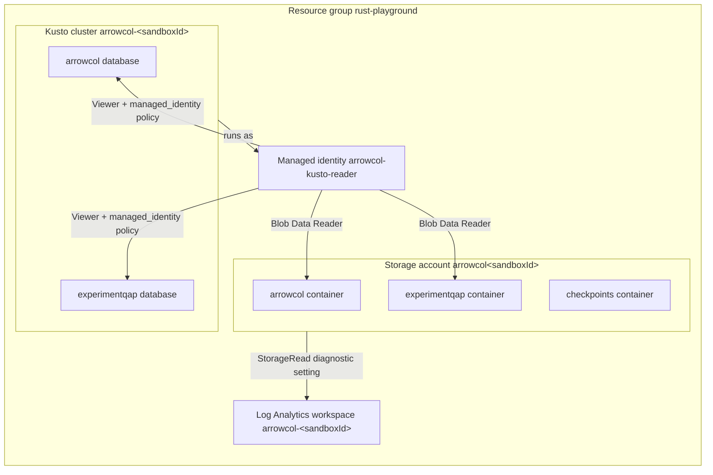

# Azure sandbox

Declarative Bicep infrastructure with TypeScript orchestration. Run from the repository root inside the Linux devcontainer.

| Setup | Value |
| --- | --- |
| Private configuration | Copy `.env.example` to repo-bootstrapper's `sync/rust-playground/.env`; fill in the authorized subscription and required tags. |
| Authentication | `az login --use-device-code`; the identity needs deployment and role-assignment permissions. |
| Runtime | Repository Node.js, `npm ci`, Azure CLI and Linux `flock`. |
| Infrastructure | Resource group, ADX cluster/database, ADLS Gen2 containers, managed identity, RBAC, 26 external Delta tables and QAP. |
| QAP experiment | `experimentqap` container and Kusto database, Log Analytics workspace `arrowcol-<sandboxId>` and a blob `StorageRead` diagnostic setting. |
| Loadtest default | Local disk and Kusto; Azure is opt-in. |

| QAP experiment resource | Name (env override) | Notes |
| --- | --- | --- |
| Blob container | `experimentqap` (`AZURE_STORAGE_EXPERIMENT_CONTAINER`) | In the existing storage account. Fixtures live under `runs/<runId>/<operation>/`. |
| Kusto database | `experimentqap` (`AZURE_KUSTO_EXPERIMENT_DATABASE`) | In the existing cluster, same 7-day retention and 1-day hot cache. The experiment creates `qap_<runId>_<operation>` external tables. |
| Log Analytics workspace | `arrowcol-<sandboxId>` (`AZURE_LOG_ANALYTICS_WORKSPACE`) | `PerGB2018`, 30-day retention. |
| Diagnostic setting | `arrowcol-storage-reads` | On `blobServices/default`: `StorageRead` only, into the resource-specific `StorageBlobLogs` table. |

| Access | Grant |
| --- | --- |
| Managed identity | Storage Blob Data Reader on the `arrowcol` and `experimentqap` containers; Viewer on both Kusto databases; `provision` applies the `ExternalTable` managed identity policy to both databases. |
| Operator | Storage Blob Data Contributor on the account, AllDatabasesAdmin on the cluster (covers both databases), Log Analytics Reader on the workspace. |

The storage account is shared with the loadtest, so `StorageBlobLogs` also holds loadtest reads. Filter by the `experimentqap/runs/<runId>/` path and the Kusto managed identity. Log ingestion is billed per GB and kept for 30 days. To pause it, run `az monitor diagnostic-settings delete --name arrowcol-storage-reads --resource <storage-account-id>/blobServices/default --subscription <subscription>`; the next `provision` recreates it.

Use `npx --no-install tsx infra/azure/bootstrap.ts <command>`:

| Command | Result |
| --- | --- |
| `config` | Generate private `.env.azure`; no Azure calls. |
| `preflight` | Check subscription and provisioning identity. |
| `provision --wait-seconds 600` | Create or reconcile infrastructure, Delta roots, external tables and QAP; rerunnable. |
| `provision --infra-only` | Create or reconcile Azure resources and both managed identity policies only. |
| `status` | Check deployed infrastructure, Kusto capacity, experiment container/database, workspace customer ID and the `StorageRead` diagnostic setting. |
| `reset` | Preview data-plane deletion; no mutation. |
| `reset --execute` | Delete the sandbox Kusto database and stored blobs, versions and snapshots in all three containers; drop every table, external table, function and materialized view in the experiment database. |
| `reset --resume` | Finish interrupted reset from its durable intent. |
| `recover` / `recover --execute` | Preview / recover abandoned publisher occupancy after stopping writers. |

| Task | Command |
| --- | --- |
| Azure benchmark | `npx nx run loadtest:run -- --mode azure --validate --measure 2m` |
| Archive an unsealed prior attempt | `npx --no-install tsx projects/loadtest/src/main.ts --discard-unsealed` |
| Recreate empty tables after reset | `npx --no-install tsx infra/azure/bootstrap.ts provision --wait-seconds 600` |
| Offline checks | `npx nx run azure-infra:verify` |

**Reset deletes data, not Azure resources, except the sandbox Kusto database that `provision` recreates.** It keeps the cluster, storage account, all three containers, the experiment database, the Log Analytics workspace and the managed identity. Stop writers first; keep `.env*` private.

| Details | Reference |
| --- | --- |
| Configuration, custody, recovery and failure contracts | [Azure sandbox details](../../docs/operations/AZURE_SANDBOX.md) |
