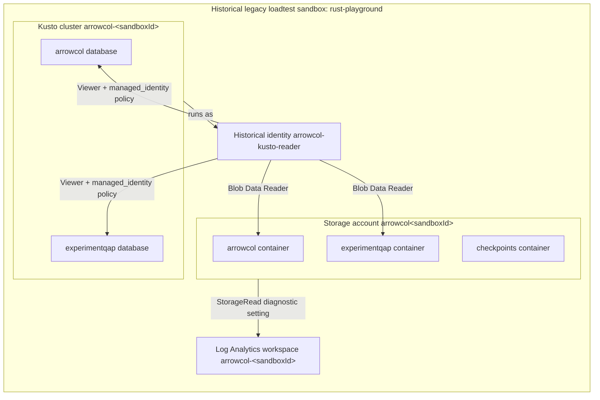

# Azure sandbox

> The legacy loadtest sandbox below remains separate from the AKS QAP stamp.
> Replacement AKS, ADX, storage, registry and logging resources are scoped to
> `arrow-collector-rg`; the separate `rust-playground` resource group is not
> a deployment or cleanup target. See [AKS QAP operations](../../docs/operations/AKS_QAP.md).

| Ownership mode | Selection | Safety |
| --- | --- | --- |
| Stamped (default) | `bootstrap.ts <command> --stamp-config <private YAML>` | Main's exact `arrow-collector-rg`, stamp, AKS/ACR/network and identity checks remain mandatory. |
| Schema evolution only | `bootstrap.ts <command> --mode schema-evolution --env-file .env.schema-evo.private` | Default group or dedicated `rust-playground-schema-evo-<suffix>` (lowercase alphanumeric/hyphen suffix); subscription:RG hash isolates resources. Rejects stamp/AKS/ACR input; does not deploy stamped resources or convert authority. |

The isolated flag applies to **every** command, including config, status,
reset, recovery, preflight and provision. Inspect the selected private input
before destructive execution. Environment variables never select this mode.
Use the [schema-evolution runbook](../../experiments/schema-evolution/README.md)
for projection and public Nx commands. Existing authority/generation fences
apply unchanged; no ownership adoption or migration is provided.

Declarative Bicep infrastructure with TypeScript orchestration. Run from the repository root inside the Linux devcontainer.

| Setup | Value |
| --- | --- |
| Private configuration | Copy `.env.example` to repo-bootstrapper's `sync/rust-playground/.env`; fill in the authorized subscription and required tags. |
| Authentication | `az login --use-device-code`; the identity needs deployment and role-assignment permissions. |
| Runtime | Repository Node.js, `npm ci`, Azure CLI and Linux `flock`. |
| Historical infrastructure | The legacy `rust-playground` sandbox: ADX, storage, its former `arrowcol-kusto-reader` identity/RBAC, 13 Dataflow external Delta tables and QAP. These names are not the current AKS stamp. |
| QAP experiment | `experimentqap` container and Kusto database, Log Analytics workspace `arrowcol-<sandboxId>` and a blob `StorageRead` diagnostic setting. |
| Loadtest default | DFE collector, remote Schema Catalog, local disk and Kusto; Azure is opt-in. |
| SQL Server | Router routing/fencing only; no SQL catalog or delivery-receipt store. |

| QAP experiment resource | Name (env override) | Notes |
| --- | --- | --- |
| Blob container | `experimentqap` (`AZURE_STORAGE_EXPERIMENT_CONTAINER`) | In the existing storage account. Fixtures live under `runs/<runId>/<operation>/`. |
| Kusto database | `experimentqap` (`AZURE_KUSTO_EXPERIMENT_DATABASE`) | In the existing cluster, same 7-day retention and 1-day hot cache. The experiment creates `qap_<runId>_<operation>` external tables. |
| Log Analytics workspace | `arrowcol-<sandboxId>` (`AZURE_LOG_ANALYTICS_WORKSPACE`) | `PerGB2018`, 30-day retention. |
| Diagnostic setting | `arrowcol-storage-reads` | On `blobServices/default`: `StorageRead` only, into the resource-specific `StorageBlobLogs` table. |
| Optional read-log storage | `arrowreadlogs<stamp>` | `storageReadLogDestination: storage` adds an independent Azure Monitor destination. Provision grants sink-scoped Blob Data Reader to the operator/UAMI and ARM Reader to the UAMI for readiness checks. Evidence survives fixture reset until RG deletion. |

| Access | Grant |
| --- | --- |
| Managed identity | Blob reader on `arrowcol`, contributor on `experimentqap` and the checkpoint control container; Viewer on the sandbox database, Admin on the experiment database; Reader on the Kusto cluster and Log Analytics Reader on the workspace. `provision` applies the `ExternalTable` managed identity policy to both databases. |
| Operator | Storage Blob Data Contributor on the account, AllDatabasesAdmin on the cluster (covers both databases), Log Analytics Reader on the workspace. |

The storage account is shared with the loadtest, so `StorageBlobLogs` also holds loadtest reads. Filter by the `experimentqap/runs/<runId>/` path and the Kusto managed identity. Log ingestion is billed per GB and kept for 30 days. To pause it, run `az monitor diagnostic-settings delete --name arrowcol-storage-reads --resource <storage-account-id>/blobServices/default --subscription <subscription>`; the next `provision` recreates it.

Set `STAMP_CONFIG` to the ignored private YAML for the intended stamp (for example, `STAMP_CONFIG=infra/azure/stamp.yaml`). Each command below explicitly selects it; the legacy diagram and identities above are historical only. Run `npx --no-install tsx infra/azure/bootstrap.ts <command> --stamp-config "$STAMP_CONFIG"`:

| Command | Result |
| --- | --- |
| `config --stamp-config "$STAMP_CONFIG"` | Generate private `.env.azure`; no Azure calls. |
| `preflight --stamp-config "$STAMP_CONFIG"` | Check subscription and provisioning identity. |
| `provision --stamp-config "$STAMP_CONFIG" --wait-seconds 600 --preview-before-create` | Create or reconcile infrastructure, Delta roots, external tables and QAP; rerunnable. |
| `provision --stamp-config "$STAMP_CONFIG" --infra-only --preview-before-create` | Create or reconcile Azure resources and both managed identity policies only. |
| `status --stamp-config "$STAMP_CONFIG"` | Check deployed infrastructure, Kusto capacity, experiment container/database, workspace customer ID and the `StorageRead` diagnostic setting. |
| `reset --stamp-config "$STAMP_CONFIG"` | Preview data-plane deletion; no mutation. |
| `reset --stamp-config "$STAMP_CONFIG" --execute` | Destructively delete the selected stamp's main Kusto database and blobs, versions and snapshots in its three containers; empty the experiment database. |
| `reset --stamp-config "$STAMP_CONFIG" --resume` | Finish interrupted reset from its durable intent. |
| `recover --stamp-config "$STAMP_CONFIG"` / `recover --stamp-config "$STAMP_CONFIG" --execute` | Preview / recover abandoned publisher occupancy after stopping writers. |
| `prepare-run-fic --stamp-config "$STAMP_CONFIG"` / `probe-run-fic --stamp-config "$STAMP_CONFIG"` / `cleanup-run-fic --stamp-config "$STAMP_CONFIG"` | Exact-run AKS trust lifecycle; [arguments and custody rules](../../docs/operations/OAT_RUN_AUTHORITY.md). **Cleanup removes only the recorded FIC after workload namespace removal; ambiguous receipts block automatic retry/recovery.** |
| `bind-oat-qap --stamp-config "$STAMP_CONFIG"` / `verify-oat-qap --stamp-config "$STAMP_CONFIG"` / `cleanup-oat-qap --stamp-config "$STAMP_CONFIG"` | Run-scoped bindings use the qualified Delta `Properties`, `ConnectionStrings`, mutation-receipt and cleanup-tombstone contracts. **Provider-contract qualification is not accelerated-read or benchmark readiness.** [Required workload/stop records and qualification boundary](../../docs/operations/OAT_RUN_AUTHORITY.md#run-scoped-qap-bindings). Cleanup's scope is only recorded external-table bindings, never data roots, databases or ownership tombstones. |

External publisher federation may be empty; the separate native
`azure-qap-${clusterName}` trust is still required and verified. OAT pin setup
uses the finite migrator-only Job and immutable V0011 authority, not app DML;
see [OAT run authority](../../docs/operations/OAT_RUN_AUTHORITY.md).

| Task | Command |
| --- | --- |
| Azure benchmark | `npx nx run loadtest:run -- --mode azure --validate --measure 2m` |
| Archive an unsealed prior attempt | `npx --no-install tsx projects/loadtest/src/main.ts --discard-unsealed` |
| Recreate empty tables after reset | `npx --no-install tsx infra/azure/bootstrap.ts provision --stamp-config "$STAMP_CONFIG" --wait-seconds 600 --preview-before-create` |
| Offline checks | `npx nx run azure-infra:verify` |

Full provision runs the fenced Rust initializer, then KQL reconciliation under
PublisherControl custody. `complete_bootstrap` publishes readiness only after
definitive completion; the parent exports the captured reset generation only
after verifying same-generation `ready-v1`. `--infra-only` is not full readiness.

DFE completion is best-effort admission unless `durable_buffer` is enabled,
which confirms buffer persistence only—not Delta publication. Clients have no
durable receipt IDs, receipt polling, or receipt purge APIs. Reset, stop, and
provider custody receipts remain required operational evidence; they are not
delivery receipts.

**Reset deletes data, not Azure resources, except the sandbox Kusto database that `provision` recreates.** It keeps the cluster, storage account, all three containers, the experiment database, the Log Analytics workspace and the managed identity. Stop writers first; keep `.env*` private.

| Details | Reference |
| --- | --- |
| Configuration, custody, recovery and failure contracts | [Azure sandbox details](../../docs/operations/AZURE_SANDBOX.md) |

## AKS QAP stamp

The AKS runtime runs the existing QAP driver and Rust binaries in a Kubernetes
Job; devcontainer mode remains the default. The template declares one
`arrow-collector` UAMI in the primary resource group, shared by ADX, AKS control
plane and kubelet, the federated pod, and ACR image publishing/pull. This is not
a count of AKS-managed resource-group identities; required platform extensions
may create separate identities there. See [identity qualification](../../docs/operations/AKS_QAP.md#tenant-enforced-identities). Preflight qualifies Azure support, quota and networking, and
blocks replacement while legacy Terraform state, Key Vault consumers, role
assignments, registry publishers or FIC subjects remain unaccounted for.
The operator principal must be authorized to create and delete federated
identity credentials on the UAMI. AKS setup checks those effective permissions
read-only through the current Azure CLI context at the selected UAMI's scope;
the workload UAMI itself does not receive the FIC Contributor role. Removing
the runtime grant from the template does not remove it from an existing
incremental-deployment stamp; only a clean redeploy under a new stamp number
proves the change live. This role change does not alter the Cilium networking
decision.

| Task | Entry point |
| --- | --- |
| Configure / qualify / provision | `infra/azure/stamp.example.yaml`; follow [AKS QAP operations](../../docs/operations/AKS_QAP.md) before provisioning. |
| Fresh resource group | No manual group creation: subscription Bicep creates an absent `arrow-collector-rg`. Preflight still rejects metadata access failures, legacy resources and extra declared identities. |
| Egress IP allocation policy | Set `aks.network.egressIpv4IpTags` and `egressIpv6IpTags` in private stamp YAML only to allocation tags authorized for the target subscription. Empty lists request untagged prefixes; Azure policy may reject them. Corporate-tenant policy can also require a Kusto classification tag (`AZURE_KUSTO_CLUSTER_TAGS` in `.env.example`) and first-party allocation ipTags for both egress prefixes. No policy exemption or skip tags are added. |
| Stamp and user-pool roles | `stamp` is `1`..`999999` or the quoted `'00000'`. Each user pool sets `role: arrowcol` or `role: client`, which applies label `arrow-collector/role=<role>` and taint `arrow-collector/role=<role>:NoSchedule`; workloads need the matching selector and toleration. Pool maxima plus 33% upgrade surge must fit the node subnet and the /16 overlay pod CIDR. |
| Kustomize Job config | Copy `infra/kubernetes/azure-qap.example.yaml` to ignored `azure-qap.yaml`; set a digest-pinned image and desired resources/node selector. |
| Run on AKS | `npx nx run azure-qap-experiment:run -- --kubernetes --kubernetes-config infra/kubernetes/azure-qap.yaml` |
| Preserve evidence | The runner collects raw read evidence, reports, queries and owned HTTP receipts before removing its unique Job. Trial path + shared principal + complete owned-read exclusions identify ADX traffic; no Kusto-specific UA assumption. AKS requires `reload`. |

Do not treat the legacy `reset` command as an AKS resource-group cleanup. No
resource-group deletion is part of bootstrap or reset.
