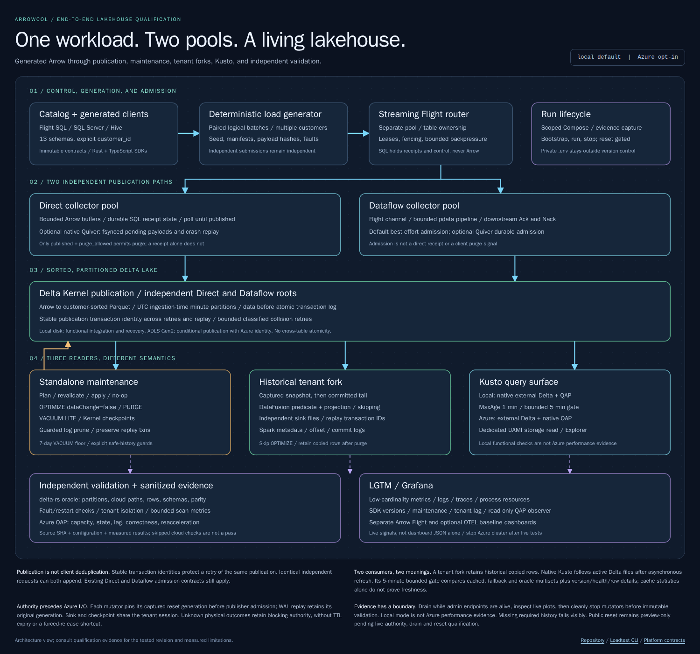

# loadtest

Every synthetic table has a required `customer_id VARCHAR` first column. The
deterministic input interleaves 16 customers (`customer-0000` through
`customer-0015`) rather than pre-sorting the input. Direct and Dataflow receive
the same immutable encoded batches, including retries. The independent reader
can return a bounded complete row multiset with multiplicities for Kusto
validation; it rejects a changed snapshot or more than 256 distinct rows rather
than silently sampling away differences.

[](../../loadtest-architecture.html)

The independent delta-rs oracle reconstructs partition columns from committed
`Add.partitionValues`, not directory names, and excludes uncommitted Parquet
files. `delta-inspect evidence <root> --table catalog.schema.table` returns a
captured snapshot plus its bounded row multiset. Local roots and explicit-table
`abfss://` roots are supported; cloud reads use the existing Azure CLI identity
and fail visibly without credentials. Deletion vectors are explicitly rejected.

```bash
npx nx run loadtest:run -- --warmup 2m --concurrency 8 --batch-rows 1024
```

This starts a fresh SQL Server, Hive, router, Direct collector, Dataflow
collector, Kusto emulator, [kusto-explorer](../kusto-explorer/README.md) query
UI, and monitoring stack, then sends the same Arrow batches to both collectors
across all 13 tables. Kusto mirrors the committed output into native tables for
live functional inspection.

**Each start replaces the previous loadtest. Its SQL, Hive, and Kusto volumes,
Delta tables, and results are deleted.** Other Docker projects and workspace
files are left alone. You do not need to choose a name or clean up an earlier
test yourself.

The test runs until **Ctrl+C**. Stopping the generator leaves the stack running
so you can inspect the charts and output; the next start resets it.

## Fenced Azure schema bootstrap

Infrastructure provisioning invokes:

```bash
cargo run --locked --quiet --package arrowcol-loadgen -- initialize-azure \
  --manifest "$ARROWCOL_AZURE_TABLE_MANIFEST"
```

Private environment inputs are `ARROWCOL_AZURE_TABLE_ROOT`,
`AZURE_STORAGE_ACCOUNT`, `AZURE_STORAGE_CONTAINER`, and
`AZURE_STORAGE_CHECKPOINT_CONTAINER`. The root must be a credential-free
`abfss://` URL inside that account/container. The storage authority must remain
owned and **fenced** during initialization; this command cannot acquire a data
writer or bypass the reset fence.

The canonical registry initializes both pools/all 13 schemas with required
`__arrowcol_ingestion STRING` partitions. Core normalization runs exactly once,
including timestamp companions. Existing compatible roots are preserved.
Only after all 26 roots succeed is the `{name, relative_path}` JSON manifest
written; paths such as `direct/telemetry/sqlserver/sqlserver_active_sessions`
are relative to `ARROWCOL_AZURE_TABLE_ROOT`, including any private isolated-run
prefix. Initialization does not insert data or prove Azure/QAP readiness.

## Options

| Option | Meaning | Default |
| --- | --- | --- |
| `--mode` | Select `local` disk/emulator or `azure` ADLS/Azure Kusto together | `ARROWCOL_MODE`, otherwise `local` |
| `--warmup` | Warmup before measurement | `30s` |
| `--concurrency` | Concurrent sending lanes | `4` |
| `--batch-rows` | Rows per Arrow batch | `8192` |
| `--measure` | Stop after a finite measurement, such as `5m` | Until Ctrl+C |
| `--validate` | Check Delta snapshots and native Kusto data after the generator finishes | Off |
| `--quiver` | Both collectors persist every batch to [Quiver](#disk-persistence-with-quiver) on local disk before acknowledging it, then publish to Delta from disk | Off |
| `--crash-after` | With `--quiver`, `kill -9` both collectors this long after they start persisting, restart them, and require replay from disk | Off |

Azure mode reads private `.env`, then `.env.azure`, with explicit inherited
environment taking precedence. It requires the configured owned ADLS root,
account, data/checkpoint containers, Kusto URI and database; it never falls back
to another subscription or to the emulator. Each run uses isolated roots below
the configured private prefix. The runner acquires occupancy before cloud work
and stops its owned writers before releasing it. Missing authorization is a
failure, not successful skipped qualification. Real Azure QAP qualification is
separate from local emulator functionality and remains unverified until a live
authorized run produces the required observations.

Azure collector images must include the shared pinned CLI installer from
`infra/docker/install-azure-cli.sh`. At runtime the runner makes a separate
writable Azure CLI config copy for each collector, below the ignored
`onelake/benchmark/latest/azure-cli/` directory. Directories are mode `0700`,
files `0600`; collectors use the invoking UID/GID. The host cache is never
mounted into a collector, and config/credentials never enter an image or its
build context. Copying config is not proof of valid cloud authorization:
token refresh and owned storage access must still succeed.

To stop only this workspace's loadtest without deleting its data:

```bash
npx --no-install tsx projects/loadtest/src/main.ts --stop
```

Successful stop emits one JSON receipt with `stopped:true`,
`scope:"workspace-owned-loadtest"` and `dataPreserved:true`. This local stop is
not a distributed fencing guarantee: Azure reset must also enforce the owned
checkpoint-container metadata fence and occupancy CAS.

Both collectors use two CPUs and matching buffer limits: 128 MiB overall,
32 MiB per table, and 32 MiB per flush. SQL Server defaults to a 16 GiB memory
budget. The Kusto container has a separate 4 GiB memory limit. Keep host memory
available for the other services.

To change the SQL budget (in MiB):

```bash
SQLSERVER_MEMORY_LIMIT_MB=8192 npx nx run loadtest:run -- --warmup 2m --concurrency 8 --batch-rows 1024
```

## Disk persistence with Quiver

```bash
npx nx run loadtest:run -- --quiver --measure 2m --crash-after 30s --validate
```

`--quiver` puts [Quiver](https://github.com/mdrakiburrahman/otel-arrow/tree/main/rust/otap-dataflow/crates/quiver),
the OpenTelemetry Arrow write-ahead log and segment store, in front of Delta in
both collectors. A batch is written and fsynced to disk **before** the client
gets its acknowledgement, and Delta publication reads it back from disk:

- **Direct** persists each batch with its receipt identity under
  `direct-state-1/quiver/`. Its receipt is still the delivery contract. The
  Quiver copy is released only after the receipt reaches `published`.
- **Dataflow** routes batches through the DFE `durable_buffer` processor under
  `dataflow-state-1/quiver/core_N/`. The Flight stream completes with
  `durable_admission`, replacing `best_effort`, only after every batch is on
  disk. Dataflow still has no SQL receipts.

To look inside these directories, see [Quiver on disk](../../docs/quiver/README.md#8-the-benchmarks-directories).

An fsync per acknowledgement costs throughput; that is the trade-off on show.
Watch the **Quiver** panels in Grafana for disk usage, backlog, and persist and
drain rates.

`--crash-after` sends `SIGKILL` to both collectors mid-load, so no drain or
flush runs. It then restarts them on the same disk.

- The restarted Direct process is a new generation. It adopts its predecessor's
  receipts and publishes the persisted batches under their original receipt IDs.
- Dataflow replays its write-ahead log and rebinds the replayed batches to its
  new table leases.

The load generator keeps retrying through the outage for up to five minutes.
`results/quiver-recovery.json` records the outage, the backlog on disk at the
moment of the kill, and the replay counts. The run fails unless both collectors
replay batches from disk.

With `--quiver`, `--validate` requires **every acknowledged row** in Delta for
both pools. Without it, Dataflow admission is best effort, so validation only
requires a published batch per Dataflow table. Independent source-client submissions may duplicate under the at-least-once
request contract. Replaying the **same publication identity** must instead be
idempotent. Exact snapshot row multisets and stable publication IDs, rather than
ACK counts alone, are the correctness evidence.

## Watch and inspect

- **Grafana:** <http://localhost:3000/d/arrowcol> (`admin` / `admin`).
- **SQL Server:** `localhost,14333`, username `sa`. The local password is printed
  at startup and stored in `projects/arrowcol-infra/secrets/sqlserver-sa-password.txt`.
- **Portainer:** <https://localhost:9444>, username `admin`, the SQL Server password.
  The local certificate is self-signed.
- **Kusto:** <http://localhost:8080>, database `loadtest`, no authentication.
  This is an HTTP query endpoint, not a browser UI.
- **kusto-explorer:** <http://localhost:8090>, a browser KQL workbench with the
  `loadtest` database preselected. Its server reaches Kusto at
  `http://kusto:8080` over the Compose network.
- **Logs:** `docker logs -f rust-playground-loadtest-latest-dataflow-1-1`
  (use `direct-1-1` for the Direct collector).

Use `SQLSERVER_PORT`, `GRAFANA_PORT`, `PORTAINER_PORT`, `KUSTO_PORT`, or
`KUSTO_EXPLORER_PORT` to override host ports. Published ports bind to host
loopback only. Inside the devcontainer,
the runner uses the emulator's allocated `10.89.x.50:8080` address instead of
`localhost`; the host connection remains `http://localhost:${KUSTO_PORT:-8080}`.
Do not share startup logs containing local-development passwords.

Output is always under `onelake/benchmark/latest/`:

```text
direct/                   Direct Delta tables
dataflow/                 Dataflow Delta tables
results/                  Metrics, manifests, diagnostics, and validation output
direct-state-1/quiver/    Direct Quiver WAL and segments (--quiver)
dataflow-state-1/quiver/  Dataflow Quiver WAL and segments (--quiver)
```

The runner prints the absolute Delta paths at startup. It samples memory,
threads, readiness, and row counters while the generator is running.

## Live Kusto inspection

The emulator requires Linux/amd64 Docker, a CPU supporting SSE4.2/AVX2, and
sufficient host memory. Its first image download is over 1 GB compressed. The
Compose service pins an immutable digest of Microsoft's documented
`mcr.microsoft.com/azuredataexplorer/kustainer-linux:latest` image and leaves its
startup command unchanged. It configures `ACCEPT_EULA=Y`; running this target
therefore accepts the [Microsoft emulator license terms][emulator-install].
The emulator supports HTTP only, without Microsoft Entra authentication.

The database is `loadtest`. Each of the 13 SQL table names appears in both pools:
`direct_<sqlserver_table>` and `dataflow_<sqlserver_table>`, for 26 native Kusto
tables. For example:

```kusto
direct_sqlserver_wait_stats
| take 5
```

Committed Parquet files become queryable incrementally while generation runs.
Tables may be pending until their first Delta commit; readiness of the cluster
does not establish completeness of the mirror. Only the current fixed-schema,
append-only workload is supported. Schema changes or removal of previously
ingested active files degrade synchronization rather than silently leaving
stale tables. Timestamp `__unix_nanos` companion columns retain the original
integer nanoseconds; Kusto `datetime` alone is not nanosecond-exact.

To inspect all native-table counts from the Docker host:

```bash
curl --fail-with-body --silent --show-error \
  "http://localhost:${KUSTO_PORT:-8080}/v2/rest/query" \
  -H 'Content-Type: application/json' \
  -d '{"db":"loadtest","csl":"union withsource=TableName direct_*, dataflow_* | summarize Rows=count() by TableName | order by TableName asc"}'
```

For an interactive view, open kusto-explorer at <http://localhost:8090>. It lists
every table in its connections tree; run the same query there with **F5** and
chart it with `| render columnchart`. The browser talks only to kusto-explorer,
whose server queries Kusto through the Compose service name. No Azure
subscription or cloud credentials are required.

### Failures, validation, and retained data

Kusto starts and is probed separately from the mandatory SQL/Hive/collector
startup. The readiness probe is `POST /v1/rest/mgmt` with
`{"csl":".show cluster"}`, without requiring the database to exist yet.
An image, startup, readiness, or synchronization failure does **not** stop
ordinary collector load generation. The runner prints an explicit
`Kusto DEGRADED` outcome rather than claiming the full integration succeeded;
an ordinary run may still exit successfully.

`--validate` and `loadtest:e2e` require real post-run KQL correctness assertions
for all 26 tables and an in-run live-query observation. They fail if Kusto is
unavailable, incomplete, inconsistent, or unverifiable. Counts are compared with
each pool's captured Delta snapshot, not with acknowledgements or an assumption
that the two pools have equal physical row multiplicities.

They also require the kusto-explorer UI gate. After the KQL assertions pass, the
runner starts a Playwright browser container (Compose profile `ui-gate`) on the
stack's network and drives `http://kusto-explorer:8080` like a user. The gate
checks the configured cluster is `http://kusto:8080`, the connections tree lists
all 26 tables, and the per-table row counts exported from the UI match
`kusto-validation.json`. It also runs a management command and a column chart,
and fails on any browser console error. In ordinary runs, a kusto-explorer
startup failure is only a warning.

Run the focused verification suite with:

```bash
npx nx run loadtest:verify
```

Its functional E2E uses 1,024-row batches while retaining all 13 schemas and all
26 native-table assertions. It runs twice in sequence: the baseline, then
`--quiver --crash-after 15s`. The second run resets the first, so the retained
results are from the Quiver crash run. Ordinary `loadtest:run` defaults are
unchanged.

Inspect these files under `onelake/benchmark/latest/results/`:

| Artifact | Meaning |
| --- | --- |
| `kusto-startup.json` | Independent, sanitized emulator start/probe outcome |
| `kusto-status.json` | Rust synchronization state, live visibility, file count, and any error |
| `kusto-ingestions.jsonl` | Committed-file ingestion and replay evidence |
| `kusto-queries.jsonl` | Executed KQL and query results, including live observations |
| `kusto-validation.json` | Final native-table correctness assertions |
| `kusto-explorer-validation.json` | UI gate checks, screenshots, and any browser console errors |
| `kusto-explorer-export.json` | Per-table row counts exported through the UI |
| `kusto-explorer-*.png` | UI screenshots in the dark and light themes, or `kusto-explorer-failure.png` |
| `provenance.json` | Image identities and sanitized effective resource configuration |
| `quiver-recovery.json` | `--crash-after` outage, on-disk backlog at the kill, and replay counts per collector |

Startup diagnostics remain separate if synchronization subsequently recovers.
Missing or malformed final synchronization status is degraded, never assumed
healthy. Save evidence outside `onelake/benchmark/` before another run resets it.

The running emulator and native data remain available after finite runs and
Ctrl+C. Its owned `kusto-data` volume is mounted at `/kustodata`; the persistent
database uses `/kustodata/dbs/loadtest/{md,data}`. Only the Direct and Dataflow
output roots are exposed at `/delta/direct` and `/delta/dataflow`, both read-only.
The next loadtest start removes the owned volume after checking its project,
name, and workspace identity; it does not clean up other Docker projects.

Override the emulator memory limit and published port when needed:

```bash
KUSTO_MEMORY_LIMIT=4g KUSTO_PORT=18080 npx nx run loadtest:run -- --measure 5m --validate
```

### Functional inspection only

[Microsoft's emulator license prohibits benchmark tests][emulator-overview].
Do not measure or publish Kusto emulator throughput or latency; it is not a
production Azure Data Explorer performance proxy. This integration exercises
native local-file ingestion and query correctness only, not managed/queued or
streaming ingestion. Live mirroring consumes shared host resources, so collector
measurements with this stack must not be described as unaffected by Kusto.
Its configured resource limits are retained in provenance.

[emulator-install]: https://learn.microsoft.com/en-us/azure/data-explorer/kusto-emulator-install
[emulator-overview]: https://learn.microsoft.com/en-us/azure/data-explorer/kusto-emulator-overview
